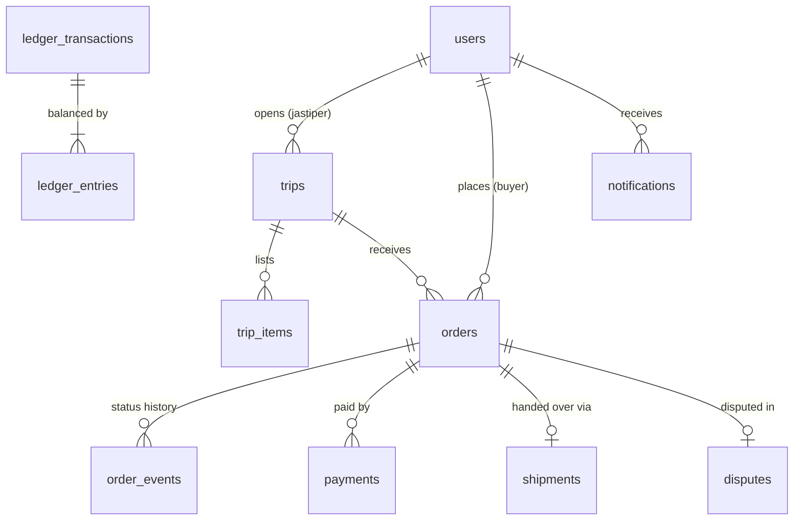

# titipdong-be

Backend for TITIP DONG, an escrow-backed jastip platform. A Go modular monolith: Fiber + Huma (OpenAPI 3.1),
PostgreSQL via pgx and sqlc, goose migrations. Deployed to a two-node AKS cluster.

- Product and architecture: `titipdong-docs/PLAN.md`
- Backend architecture, scope, and status: [`docs/PLAN.md`](docs/PLAN.md)
- Per-module documentation (rules, endpoints, flows): [`docs/features/`](docs/features/README.md)
- Database schema: [`docs/DATABASE.md`](docs/DATABASE.md)

## Features

| Module               | What it does                                                                                         |
| -------------------- | ---------------------------------------------------------------------------------------------------- |
| F01 Auth & User      | Buyer and jastiper accounts, JWT access tokens with rotating refresh cookies, profile, account suspension |
| F02 Trip & Catalog   | Jastipers open trips with a destination, dates, deadline, and item capacity, plus a catalog of popular items |
| F03 Order            | Buyers request items; jastipers approve with a price or reject; a state machine guards every step    |
| F04 Payment & Escrow | Payment into escrow (fake gateway), double-entry ledger, release with a 5% platform fee, refunds, payouts |
| F05 Shipment         | COD or courier handover with proof photo; buyer confirmation releases the funds                       |
| F06 Dispute          | Buyers dispute shipped orders with evidence and messages; admins decide refund or release            |
| F07 Notification     | In-app notifications for every step, polled by the frontend                                         |
| F08 Admin            | Dashboard stats, orders, ledger transactions, users, payouts, audit log                              |

Background jobs inside the API cancel unpaid orders after 24 hours, release funds 7 days after shipping, and close
expired trips. Each module's status is in [`docs/features/`](docs/features/README.md).

## Requirements

- Go 1.26
- Docker with Compose v2 (`docker compose`)
- GNU Make

Nothing else needs installing: `make` runs sqlc, goose, and golangci-lint at pinned versions through `go run`
(the first run of each tool compiles it, which takes about a minute).

## Run locally

1. Configure the environment. `.env` is git-ignored; Compose and the API both read it, and real environment
   variables take precedence.

   ```sh
   cp .env.example .env
   # set JWT_SECRET to the output of: openssl rand -base64 32
   # DATABASE_URL, POSTGRES_* and AZURE_STORAGE_CONNECTION_STRING already match compose.yaml
   ```

   PostgreSQL is published on port 5433 so it does not clash with a local PostgreSQL on 5432.

2. Start the complete local application defined in `compose.yaml`: PostgreSQL 16, Azurite (Blob Storage emulator
   on port 10000), and the API.

   ```sh
   make db-up      # rebuilds the API image and waits until everything is healthy
   make seed       # demo accounts, one Tokyo trip, and three catalog items
   ```

3. The API runs at `http://localhost:8080`; pending migrations are applied on startup. To follow its JSON logs:

   ```sh
   docker compose logs -f api
   ```

   `make run` remains available only when you deliberately want to run the API
   directly on the host.

| Variable       | Required | Description                                  |
| -------------- | -------- | -------------------------------------------- |
| `DATABASE_URL` | yes      | PostgreSQL connection string                 |
| `JWT_SECRET`   | yes      | HMAC key for access tokens, ≥ 32 characters  |
| `PORT`         | no       | Listen port, default `8080`                  |
| `CORS_ORIGINS` | no       | Comma-separated frontend origins, default `http://localhost:5173`; also applied to Blob Storage CORS |
| `COOKIE_SECURE`| no       | `false` for plain-HTTP local development; default `true` |
| `PAYMENT_GATEWAY` | no    | Only `fake` is supported                     |
| `AZURE_STORAGE_CONNECTION_STRING` | no | Blob Storage (or Azurite) with an account key; uploads are disabled when empty |
| `BLOB_CONTAINER` | no     | Private container for uploads, default `uploads` |
| `BLOB_PUBLIC_URL` | no    | Scheme and host browsers use for signed URLs, when it differs from the connection string (Azurite in Docker) |

## Commands

Run `make` to list every command. The common ones:

| Command                           | Description                                                  |
| --------------------------------- | ------------------------------------------------------------ |
| `make db-up` / `make db-down`     | Start / stop local PostgreSQL (data is kept)                 |
| `make db-reset`                   | Delete local PostgreSQL data and start fresh                 |
| `make db-shell`                   | Open psql in the local database                              |
| `make run`                        | Run the API                                                  |
| `make build` / `make clean`       | Build the binary into `bin/` / remove it                     |
| `make test`                       | Unit tests (no database needed)                              |
| `make check`                      | Everything CI checks: format, vet, lint, sqlc drift, tests   |
| `make migration name=create_trips`| Create the next numbered migration                           |
| `make sqlc`                       | Regenerate Go code from SQL                                  |
| `make fmt`                        | Format all Go code                                           |

## API

- `GET /openapi.json`: the OpenAPI 3.1 contract, generated from the Huma operations. The frontend generates its
  client from it (`pnpm api` in `titipdong-fe`).
  `make openapi` writes the same spec to `openapi.json` without a database or a running API.
- `GET /docs`: interactive API docs.
- `GET /health`: liveness probe.
- `GET /health/ready`: readiness probe; 503 while PostgreSQL is unreachable.
- Demo data: `make seed` creates `jastiper@titipdong.test`, `buyer@titipdong.test`, and
  `admin@titipdong.test` (password `demo12345`), plus a Tokyo trip with three catalog items. It is safe to run more
  than once; existing demo records are kept.
- Payments use a fake gateway: after `POST /orders/{id}/payments`, call `POST /payments/{id}/simulate` to pay.

Errors use RFC 9457 `application/problem+json`. Protected endpoints take `Authorization: Bearer <access token>`.

Quick check:

```sh
curl -X POST localhost:8080/auth/register -H 'Content-Type: application/json' \
  -d '{"name":"Carlo","email":"carlo@example.com","password":"rahasia123","role":"buyer"}'
```

## Test

```sh
make test                                        # all unit tests (no database needed)
go test ./internal/auth -run TestLogin -v        # a single test
make check                                       # run before opening a PR
```

## Local observability

`/metrics` exposes Prometheus-format API and Go runtime metrics. The local
Prometheus, Grafana, Loki, and Alloy configuration lives in `monitoring/`.

```sh
cd monitoring
docker compose --env-file ../.env up -d
```

Open Grafana at `http://localhost:3000`. Its credentials and the local
PostgreSQL Docker variables are documented in `.env.example`; keep real values
only in the ignored `.env` file. When the API runs in Docker, Alloy collects
its safe JSON logs directly from the container stdout. In Grafana, open the
**TITIP DONG Prototype API** dashboard and use the **API request logs** panel
(or Explore with Loki) to view them. `LOG_FILE=logs/api.jsonl` is only needed
when running the API directly on the host.

## Project layout

```
cmd/api/              API entrypoint: config, DB, migrations, module wiring
db/migrations/        goose SQL migrations (embedded into the binary)
db/queries/           all SQL queries for sqlc, one file per table or topic
internal/db/          generated by sqlc from db/queries (never edit)
internal/platform/    shared infrastructure: config, database, httpserver (Fiber + Huma)
internal/<module>/    one package per feature: auth, trip, order, payment, shipment, dispute, notification, admin
sqlc.yaml             sqlc configuration
deploy/k8s/           Kubernetes manifests
```

Each feature has `handler.go`, `service.go`, and `repository.go`; its repository calls the shared `internal/db`
queries. Queries may JOIN any table, and services may call each other. `internal/auth` is the reference;
the rules are in [`docs/PLAN.md`](docs/PLAN.md#2-architecture).

## Database design

The full schema for every module (tables, constraints, indexes, and the double-entry ledger) is in
[`docs/DATABASE.md`](docs/DATABASE.md), which marks the tables that do not have a migration yet.



| Module               | Tables                                                                                     |
| -------------------- | ------------------------------------------------------------------------------------------ |
| F01 Auth & User      | `users`, `refresh_tokens`                                                                  |
| F02 Trip & Catalog   | `trips`, `trip_items`                                                                      |
| F03 Order            | `orders`, `order_events`                                                                   |
| F04 Payment & Escrow | `payments`, `refunds`, `ledger_*`, `payout_accounts`, `payouts`                            |
| F05 Shipment         | `shipments`                                                                                |
| F06 Dispute          | `disputes`, `dispute_evidence`, `dispute_messages`                                         |
| F07 Notification     | `notifications`                                                                            |
| Platform             | `audit_logs`, `uploads`                                                                    |

Key rules: money is `BIGINT` rupiah, statuses are `TEXT` with `CHECK`, the ledger and audit log are append-only, and
order status and ledger rows are written only through the order and payment services.

## Database changes

1. `make migration name=create_trips` creates `db/migrations/0000N_create_trips.sql`. Fill in both the
   `-- +goose Up` and `-- +goose Down` sections. Keep the change compatible with the currently deployed code, because
   old and new pods run side by side during a rollout.
2. Add queries to `db/queries/<table>.sql` (for example `db/queries/trips.sql`). Check whether a query already exists
   first.
3. Run `make sqlc` and commit the generated files. `make check` fails if they are out of date.

The next `make run` applies the migration. Never edit files under `internal/db/`.

## Deployment

Pushing any branch other than `main` runs `.github/workflows/check.yml` (`make check` plus integration tests against
PostgreSQL and Azurite). Pushing to `main` runs `.github/workflows/deploy-aks.yml`: the same check, a `linux/amd64`
image pushed to Azure Container Registry tagged with the commit SHA, then a rolling update of the `titipdong-api`
Deployment. Manual steps, secrets, and configuration are in [`deploy/k8s/README.md`](deploy/k8s/README.md).
