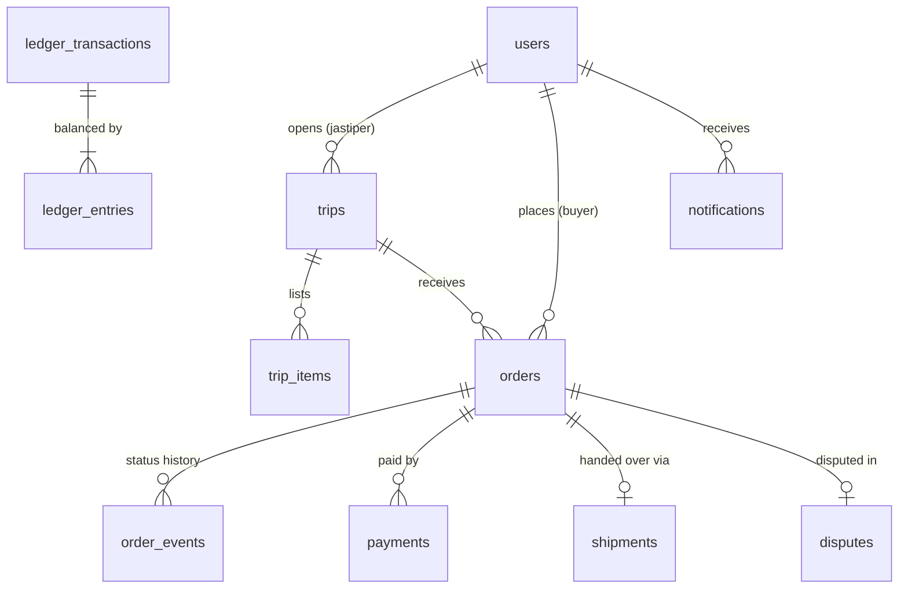

# titipdong-be

Backend for TITIP DONG, an escrow-backed jastip platform. A Go modular monolith: Fiber + Huma (OpenAPI 3.1),
PostgreSQL via pgx and sqlc, goose migrations. Deployed to a two-node AKS cluster.

- Product and architecture: `titipdong-docs/PLAN.md`
- Backend implementation plan, module status, and open decisions: [`docs/PLAN.md`](docs/PLAN.md)

## Requirements

- Go 1.26
- Docker with Compose v2 (`docker compose`)
- GNU Make

Nothing else needs installing: `make` runs sqlc, goose, and golangci-lint at pinned versions through `go run`
(the first run of each tool compiles it, which takes about a minute).

## Run locally

1. Start the local dependencies (PostgreSQL 16) defined in `compose.yaml`:

   ```sh
   make db-up      # waits until PostgreSQL is healthy
   ```

   If port 5432 is already taken (for example by a Homebrew PostgreSQL), run `POSTGRES_PORT=5433 make db-up` and use
   port 5433 in `DATABASE_URL`.

2. Configure the environment. `.env.local` is git-ignored and read on startup; real environment variables take
   precedence.

   ```sh
   cp .env.example .env.local
   # set JWT_SECRET to the output of: openssl rand -base64 32
   # DATABASE_URL already matches compose.yaml
   ```

3. Run the API. Pending migrations are applied on startup.

   ```sh
   make run        # http://localhost:8080
   ```

| Variable       | Required | Description                                  |
| -------------- | -------- | -------------------------------------------- |
| `DATABASE_URL` | yes      | PostgreSQL connection string                 |
| `JWT_SECRET`   | yes      | HMAC key for access tokens, ≥ 32 characters  |
| `PORT`         | no       | Listen port, default `8080`                  |

## Commands

Run `make` to list every command. The common ones:

| Command                           | Description                                                  |
| --------------------------------- | ------------------------------------------------------------ |
| `make db-up` / `make db-down`     | Start / stop local PostgreSQL (data is kept)                 |
| `make db-reset`                   | Delete local PostgreSQL data and start fresh                 |
| `make db-shell`                   | Open psql in the local database                              |
| `make run`                        | Run the API                                                  |
| `make build` / `make clean`       | Build the binary into `bin/` / remove it                     |
| `make test`                       | Unit tests (no database needed)                              |
| `make check`                      | Everything CI checks: format, vet, lint, sqlc drift, tests   |
| `make migration name=create_trips`| Create the next numbered migration                           |
| `make sqlc`                       | Regenerate Go code from SQL                                  |
| `make fmt`                        | Format all Go code                                           |

## API

- `GET /openapi.json`: the OpenAPI 3.1 contract, generated from the Huma operations. The frontend generates its
  client from it (`pnpm api` in `titipdong-fe`).
- `GET /docs`: interactive API docs.
- `GET /health`: liveness probe.

Errors use RFC 9457 `application/problem+json`. Protected endpoints take `Authorization: Bearer <access token>`.

Quick check:

```sh
curl -X POST localhost:8080/auth/register -H 'Content-Type: application/json' \
  -d '{"name":"Carlo","email":"carlo@example.com","password":"rahasia123","role":"buyer"}'
```

## Test

```sh
make test                                        # all unit tests (no database needed)
go test ./internal/auth -run TestLogin -v        # a single test
make check                                       # run before opening a PR
```

## Project layout

```
cmd/api/              API entrypoint: config, DB, migrations, module wiring
db/migrations/        goose SQL migrations (embedded into the binary)
db/queries/           all SQL queries for sqlc, one file per table or topic
internal/db/          generated by sqlc from db/queries (never edit)
internal/platform/    shared infrastructure: config, database, httpserver (Fiber + Huma)
internal/<module>/    one package per feature: auth, trip, order, payment, shipment, dispute, notification, admin
sqlc.yaml             sqlc configuration
deploy/k8s/           Kubernetes manifests
```

Each feature has `handler.go`, `service.go`, and `repository.go`; its repository calls the shared `internal/db`
queries. Queries may JOIN any table, and services may call each other. `internal/auth` is the reference;
the rules are in [`docs/PLAN.md`](docs/PLAN.md#2-architecture).

## Database design

The full schema for every module (tables, constraints, indexes, and the double-entry ledger) is in
[`docs/DATABASE.md`](docs/DATABASE.md). Only `users` exists so far; each module adds its tables through a migration
when it is implemented.



| Module               | Tables                                                                                     |
| -------------------- | ------------------------------------------------------------------------------------------ |
| F01 Auth & User      | `users`, `refresh_tokens`                                                                  |
| F02 Trip & Catalog   | `trips`, `trip_items`                                                                      |
| F03 Order            | `orders`, `order_events`                                                                   |
| F04 Payment & Escrow | `payments`, `payment_notifications`, `refunds`, `ledger_*`, `payouts`, `payout_accounts`   |
| F05 Shipment         | `shipments`                                                                                |
| F06 Dispute          | `disputes`, `dispute_evidence`, `dispute_messages`                                         |
| F07 Notification     | `notifications`, `outbound_emails`                                                         |
| Platform             | `audit_logs`, `uploads`                                                                    |

Key rules: money is `BIGINT` rupiah, statuses are `TEXT` with `CHECK`, the ledger and audit log are append-only, and
order status and ledger rows are written only through the order and payment services.

## Database changes

1. `make migration name=create_trips` creates `db/migrations/0000N_create_trips.sql`. Fill in both the
   `-- +goose Up` and `-- +goose Down` sections. Keep the change compatible with the currently deployed code, because
   old and new pods run side by side during a rollout.
2. Add queries to `db/queries/<table>.sql` (for example `db/queries/trips.sql`). Check whether a query already exists
   first.
3. Run `make sqlc` and commit the generated files. `make check` fails if they are out of date.

The next `make run` applies the migration. Never edit files under `internal/db/`.

## Deployment

Pushing to `main` runs `.github/workflows/deploy-aks.yml`: tests, a `linux/amd64` image pushed to Azure Container
Registry tagged with the commit SHA, then a rolling update of the `titipdong-api` Deployment. Manual steps are in
[`deploy/k8s/README.md`](deploy/k8s/README.md).

> The manifests do not yet provide `DATABASE_URL` and `JWT_SECRET`. Set up the secrets described in
> [`docs/PLAN.md` section 6](docs/PLAN.md#6-delivery-pipeline-and-infrastructure) before merging to `main`, otherwise the new
> pods fail on startup.
