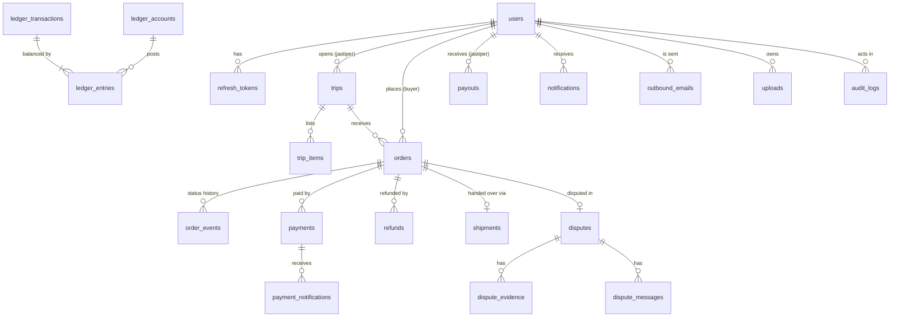

# TITIP DONG database design

The full PostgreSQL schema for the platform, grouped by the feature that mainly uses each table. Only `users` exists today;
every other table is a design that its module creates through a goose migration when the module is implemented. Once
a migration exists, **the migration is the source of truth** and this document is updated to match it.

Related: endpoints and flows per feature in [`PLAN.md`](PLAN.md) section 4, open decisions in [`PLAN.md`](PLAN.md) section 7.

## 1. Conventions

| Topic         | Rule                                                                                                                      |
| ------------- | ------------------------------------------------------------------------------------------------------------------------- |
| Primary keys  | `UUID`, generated by the application. New tables use UUIDv7 (`uuid.NewV7()`), which is time-ordered and indexes better     |
| Append-only   | Event and ledger tables use `BIGINT GENERATED ALWAYS AS IDENTITY` keys and are never updated or deleted                   |
| Timestamps    | `TIMESTAMPTZ`; mutable tables have `created_at` and `updated_at` (set by the application); calendar dates use `DATE`     |
| Money         | `BIGINT` whole rupiah, `CHECK (… >= 0)`. Never `NUMERIC` with decimals, never floating point                              |
| Statuses      | `TEXT` with a `CHECK (… IN (…))` list rather than PostgreSQL enums, so adding a value is a simple migration              |
| Text          | `TEXT` with `CHECK (char_length(…) <= n)` where the API has a limit                                                       |
| Emails        | Stored lowercased; uniqueness enforced on `LOWER(email)`                                                                  |
| Files         | Tables store Blob Storage object keys (`*_key`), never URLs or file contents                                              |
| Foreign keys  | Used wherever a column references another table, across features too                                                       |
| Deletes       | No soft-delete columns. Records that end use a status (`suspended`, `closed`, `cancelled`)                               |
| Queries       | All SQL lives in `db/queries/` (one file per table, e.g. `orders.sql`) and generates the shared `internal/db` package. Any query may read and JOIN any table |
| Writes        | `orders.status` and the ledger tables are written only through the order and payment services, so the state machine and double-entry rules live in one place |

## 2. Overview



| Module                | Tables                                                                                              |
| --------------------- | --------------------------------------------------------------------------------------------------- |
| F01 Auth & User       | `users`, `refresh_tokens`                                                                           |
| F02 Trip & Catalog    | `trips`, `trip_items`                                                                               |
| F03 Order             | `orders`, `order_events`                                                                            |
| F04 Payment & Escrow  | `payments`, `payment_notifications`, `refunds`, `ledger_accounts`, `ledger_transactions`, `ledger_entries`, `payouts`, `payout_accounts` |
| F05 Shipment          | `shipments`                                                                                         |
| F06 Dispute           | `disputes`, `dispute_evidence`, `dispute_messages`                                                  |
| F07 Notification      | `notifications`, `outbound_emails`                                                                  |
| F08 Admin             | none (reads the other tables through shared queries)                                                |
| Platform              | `audit_logs`, `uploads`                                                                             |
| Managed by tools      | `goose_db_version` (goose), `river_*` (River job queue)                                             |

## 3. F01 Auth & User

### `users` (exists; `status`, `phone`, and `updated_at` still to be added)

```sql
CREATE TABLE users (
    id            UUID PRIMARY KEY,
    name          VARCHAR(100) NOT NULL,
    email         TEXT NOT NULL,
    password_hash TEXT NOT NULL,                       -- Argon2id, PHC string format
    role          VARCHAR(16) NOT NULL CHECK (role IN ('buyer', 'jastiper', 'admin')),
    status        TEXT NOT NULL DEFAULT 'active' CHECK (status IN ('active', 'suspended')),
    phone         TEXT CHECK (char_length(phone) <= 20),
    created_at    TIMESTAMPTZ NOT NULL DEFAULT now(),
    updated_at    TIMESTAMPTZ NOT NULL DEFAULT now()
);
CREATE UNIQUE INDEX users_email_lower_key ON users (LOWER(email));
```

- `role` is one role per user. Whether a user can be both buyer and jastiper is open (PLAN section 7, decision 3); if yes,
  this becomes a `user_roles (user_id, role)` table.
- Suspended users cannot log in or refresh; their existing access token expires within 15 minutes.
- Identity verification (KYC) tables are not designed until that decision is made (PLAN section 7, decision 2).

### `refresh_tokens`

```sql
CREATE TABLE refresh_tokens (
    id          UUID PRIMARY KEY,
    user_id     UUID NOT NULL REFERENCES users (id),
    family_id   UUID NOT NULL,                         -- all rotations of one login share a family
    token_hash  BYTEA NOT NULL UNIQUE,                 -- SHA-256 of the cookie value; the raw token is never stored
    expires_at  TIMESTAMPTZ NOT NULL,
    revoked_at  TIMESTAMPTZ,
    replaced_by UUID REFERENCES refresh_tokens (id),
    user_agent  TEXT,
    created_at  TIMESTAMPTZ NOT NULL DEFAULT now()
);
CREATE INDEX refresh_tokens_user_idx ON refresh_tokens (user_id);
CREATE INDEX refresh_tokens_family_idx ON refresh_tokens (family_id);
```

Rotation: each refresh revokes the presented token, inserts a new one in the same family, and sets `replaced_by`.
Presenting a token that is already revoked means it was stolen or replayed, so the whole family is revoked. A
periodic job deletes rows past `expires_at`; this is the only table where old rows are deleted.

## 4. F02 Trip & Catalog

### `trips`

```sql
CREATE TABLE trips (
    id                  UUID PRIMARY KEY,
    jastiper_id         UUID NOT NULL REFERENCES users (id),
    slug                TEXT NOT NULL UNIQUE,          -- public URL: /trip/:slug
    title               TEXT NOT NULL CHECK (char_length(title) <= 120),
    description         TEXT CHECK (char_length(description) <= 2000),
    destination_city    TEXT NOT NULL,
    destination_country CHAR(2) NOT NULL,              -- ISO 3166-1 alpha-2
    departs_on          DATE NOT NULL,
    returns_on          DATE NOT NULL,
    request_deadline    TIMESTAMPTZ NOT NULL,          -- last moment buyers can request
    capacity            INTEGER NOT NULL CHECK (capacity > 0),
    reserved_capacity   INTEGER NOT NULL DEFAULT 0,
    status              TEXT NOT NULL DEFAULT 'open'
                        CHECK (status IN ('open', 'closed', 'completed', 'cancelled')),
    created_at          TIMESTAMPTZ NOT NULL DEFAULT now(),
    updated_at          TIMESTAMPTZ NOT NULL DEFAULT now(),
    CHECK (returns_on >= departs_on),
    CHECK (reserved_capacity BETWEEN 0 AND capacity)
);
CREATE INDEX trips_browse_idx ON trips (destination_city, departs_on) WHERE status = 'open';
CREATE INDEX trips_jastiper_idx ON trips (jastiper_id, created_at DESC);
```

- The capacity unit (kg, item count, or other) is open (PLAN section 7, decision 4). The columns are integers in that unit.
- `reserved_capacity` is changed only by `trip.Service.Reserve/Release`, called by Order under a row lock on the
  trip. The `CHECK` makes overbooking impossible even if application code is wrong.
- `open`: accepting requests. `closed`: past the deadline or closed by the jastiper. `completed`: trip finished.
  `cancelled`: trip will not happen (open orders must be rejected or refunded first).

### `trip_items`

Popular items the jastiper offers on a trip (the catalog shown on the trip page).

```sql
CREATE TABLE trip_items (
    id              UUID PRIMARY KEY,
    trip_id         UUID NOT NULL REFERENCES trips (id),
    name            TEXT NOT NULL CHECK (char_length(name) <= 120),
    description     TEXT CHECK (char_length(description) <= 1000),
    photo_key       TEXT,
    reference_price BIGINT CHECK (reference_price >= 0),  -- indicative only; the final price is set per order
    position        INTEGER NOT NULL DEFAULT 0,
    created_at      TIMESTAMPTZ NOT NULL DEFAULT now(),
    updated_at      TIMESTAMPTZ NOT NULL DEFAULT now()
);
CREATE INDEX trip_items_trip_idx ON trip_items (trip_id, position);
```

## 5. F03 Order

### `orders`

```sql
CREATE TABLE orders (
    id               UUID PRIMARY KEY,
    code             TEXT NOT NULL UNIQUE,             -- human-friendly reference, e.g. TD-7K3P9Q
    trip_id          UUID NOT NULL REFERENCES trips (id),
    buyer_id         UUID NOT NULL REFERENCES users (id),
    jastiper_id      UUID NOT NULL REFERENCES users (id),  -- copied from the trip for access checks
    product_name     TEXT NOT NULL CHECK (char_length(product_name) <= 200),
    product_url      TEXT CHECK (char_length(product_url) <= 2000),
    photo_key        TEXT,
    quantity         INTEGER NOT NULL CHECK (quantity > 0),
    capacity_units   INTEGER NOT NULL CHECK (capacity_units > 0),  -- trip capacity this order reserves
    notes            TEXT CHECK (char_length(notes) <= 1000),

    -- Set when the jastiper approves. The buyer pays `total`.
    item_price       BIGINT CHECK (item_price >= 0),   -- per unit
    jastip_fee       BIGINT CHECK (jastip_fee >= 0),   -- jastiper's fee for the whole order
    total            BIGINT CHECK (total > 0),

    status           TEXT NOT NULL DEFAULT 'requested' CHECK (status IN (
                         'requested', 'approved', 'rejected', 'cancelled', 'paid', 'shipped',
                         'delivered', 'disputed', 'released', 'refunded')),
    status_reason    TEXT,                             -- rejection or cancellation reason
    payment_deadline TIMESTAMPTZ,
    created_at       TIMESTAMPTZ NOT NULL DEFAULT now(),
    updated_at       TIMESTAMPTZ NOT NULL DEFAULT now(),

    CHECK (buyer_id <> jastiper_id),
    -- Price fields are set together, and every status after approval has them.
    CHECK ((item_price IS NULL) = (total IS NULL) AND (jastip_fee IS NULL) = (total IS NULL)),
    CHECK (status IN ('requested', 'rejected', 'cancelled') OR total IS NOT NULL),
    CHECK (total IS NULL OR total = item_price * quantity + jastip_fee)
);
CREATE INDEX orders_buyer_idx ON orders (buyer_id, created_at DESC);
CREATE INDEX orders_jastiper_idx ON orders (jastiper_id, status, created_at DESC);
CREATE INDEX orders_trip_idx ON orders (trip_id, status);
CREATE INDEX orders_payment_deadline_idx ON orders (payment_deadline) WHERE status = 'approved';
```

- Status values are lowercase in the database and API; the FE maps them to labels. Allowed transitions are the
  state diagram in `titipdong-docs/PLAN.md`, enforced by the Order service (not by a trigger).
- Every transition locks the row (`SELECT … FOR UPDATE`), updates `status`, and inserts an `order_events` row in the
  same transaction.
- Timestamps of each step (paid at, shipped at, …) are read from `order_events` instead of one column per status.
- A cancelled order may or may not have a price, depending on whether it was approved first.

### `order_events`

Append-only status history, used for the timeline in the UI and for audits.

```sql
CREATE TABLE order_events (
    id          BIGINT GENERATED ALWAYS AS IDENTITY PRIMARY KEY,
    order_id    UUID NOT NULL REFERENCES orders (id),
    from_status TEXT,                                  -- NULL for the creating event
    to_status   TEXT NOT NULL,
    actor_id    UUID REFERENCES users (id),            -- NULL when the system acted (job, gateway)
    actor_type  TEXT NOT NULL CHECK (actor_type IN ('buyer', 'jastiper', 'admin', 'system')),
    reason      TEXT,
    created_at  TIMESTAMPTZ NOT NULL DEFAULT now()
);
CREATE INDEX order_events_order_idx ON order_events (order_id, id);
```

## 6. F04 Payment & Escrow

### `payments`

One row per checkout attempt. The payment `id` is sent to Midtrans as its `order_id`, so every attempt is unique on
the gateway side.

```sql
CREATE TABLE payments (
    id                      UUID PRIMARY KEY,
    order_id                UUID NOT NULL REFERENCES orders (id),
    amount                  BIGINT NOT NULL CHECK (amount > 0),
    provider                TEXT NOT NULL DEFAULT 'midtrans',
    provider_transaction_id TEXT UNIQUE,               -- Midtrans transaction_id, known after the first notification
    payment_type            TEXT,                      -- e.g. bank_transfer, qris, gopay
    status                  TEXT NOT NULL DEFAULT 'pending'
                            CHECK (status IN ('pending', 'paid', 'failed', 'expired', 'cancelled')),
    checkout_token          TEXT,                      -- Snap token for the frontend
    expires_at              TIMESTAMPTZ NOT NULL,
    paid_at                 TIMESTAMPTZ,
    created_at              TIMESTAMPTZ NOT NULL DEFAULT now(),
    updated_at              TIMESTAMPTZ NOT NULL DEFAULT now()
);
-- At most one live attempt per order, and never two successful payments.
CREATE UNIQUE INDEX payments_one_active_per_order ON payments (order_id) WHERE status IN ('pending', 'paid');
```

### `payment_notifications`

Every notification the gateway sends, stored before processing. This is the idempotency record and the evidence
for reconciliation and disputes with the gateway.

```sql
CREATE TABLE payment_notifications (
    id                      BIGINT GENERATED ALWAYS AS IDENTITY PRIMARY KEY,
    provider                TEXT NOT NULL,
    provider_transaction_id TEXT NOT NULL,
    transaction_status      TEXT NOT NULL,             -- gateway status: settlement, pending, expire, …
    payment_id              UUID REFERENCES payments (id),
    signature_valid         BOOLEAN NOT NULL,
    payload                 JSONB NOT NULL,            -- raw body; contains no card data with Snap
    outcome                 TEXT CHECK (outcome IN ('applied', 'duplicate', 'ignored', 'rejected')),
    received_at             TIMESTAMPTZ NOT NULL DEFAULT now(),
    processed_at            TIMESTAMPTZ,
    UNIQUE (provider, provider_transaction_id, transaction_status)
);
```

The `UNIQUE` constraint is what makes a repeated notification a no-op: the insert conflicts, and the handler answers
200 without touching the ledger again.

### `refunds`

```sql
CREATE TABLE refunds (
    id                 UUID PRIMARY KEY,
    order_id           UUID NOT NULL REFERENCES orders (id),
    payment_id         UUID NOT NULL REFERENCES payments (id),
    amount             BIGINT NOT NULL CHECK (amount > 0),
    reason             TEXT NOT NULL CHECK (reason IN ('jastiper_cancelled', 'dispute_refund')),
    status             TEXT NOT NULL DEFAULT 'pending' CHECK (status IN ('pending', 'succeeded', 'failed')),
    provider_refund_id TEXT UNIQUE,
    failure_reason     TEXT,
    created_at         TIMESTAMPTZ NOT NULL DEFAULT now(),
    completed_at       TIMESTAMPTZ
);
CREATE UNIQUE INDEX refunds_one_per_order ON refunds (order_id) WHERE status <> 'failed';
```

### Ledger: `ledger_accounts`, `ledger_transactions`, `ledger_entries`

Double-entry bookkeeping as described in `titipdong-docs/PLAN.md`. Balances are never stored; they are sums of
entries.

```sql
CREATE TABLE ledger_accounts (
    id         UUID PRIMARY KEY,
    kind       TEXT NOT NULL CHECK (kind IN (
                   'gateway_clearing',   -- money held by the payment gateway on our behalf
                   'escrow',             -- buyer money held until release or refund
                   'jastiper_payable',   -- earned by a jastiper, not yet paid out (one per jastiper)
                   'platform_revenue',   -- the 5% platform fee
                   'buyer_refundable')), -- owed back to a buyer (one per buyer)
    user_id    UUID REFERENCES users (id),
    created_at TIMESTAMPTZ NOT NULL DEFAULT now(),
    CHECK ((kind IN ('jastiper_payable', 'buyer_refundable')) = (user_id IS NOT NULL))
);
CREATE UNIQUE INDEX ledger_accounts_kind_user_key ON ledger_accounts (kind, user_id) NULLS NOT DISTINCT;

CREATE TABLE ledger_transactions (
    id              UUID PRIMARY KEY,
    kind            TEXT NOT NULL CHECK (kind IN ('payment_received', 'release', 'refund', 'refund_paid', 'payout')),
    order_id        UUID REFERENCES orders (id),
    idempotency_key TEXT NOT NULL UNIQUE,             -- e.g. 'release:<order_id>'; a retry cannot post twice
    created_by      UUID REFERENCES users (id),       -- NULL for system and gateway actions
    created_at      TIMESTAMPTZ NOT NULL DEFAULT now()
);

CREATE TABLE ledger_entries (
    id             BIGINT GENERATED ALWAYS AS IDENTITY PRIMARY KEY,
    transaction_id UUID NOT NULL REFERENCES ledger_transactions (id),
    account_id     UUID NOT NULL REFERENCES ledger_accounts (id),
    order_id       UUID REFERENCES orders (id),       -- lets escrow be summed per order
    direction      TEXT NOT NULL CHECK (direction IN ('debit', 'credit')),
    amount         BIGINT NOT NULL CHECK (amount > 0),
    created_at     TIMESTAMPTZ NOT NULL DEFAULT now()
);
CREATE INDEX ledger_entries_account_idx ON ledger_entries (account_id, id);
CREATE INDEX ledger_entries_order_idx ON ledger_entries (order_id) WHERE order_id IS NOT NULL;
```

Integrity rules, enforced in the database so a bug cannot break them:

- **Balanced transactions.** A `DEFERRABLE INITIALLY DEFERRED` constraint trigger on `ledger_entries` checks at
  commit that each transaction's debits equal its credits and that it has at least two entries.
- **Append-only.** A trigger rejects `UPDATE` and `DELETE` on all three ledger tables, and the application role is
  granted only `SELECT, INSERT` on them. Mistakes are corrected with a new reversing transaction.

Postings (amounts for an order with `total` = Rp 1.000.000):

| Event                         | Debit                             | Credit                                                      |
| ----------------------------- | --------------------------------- | ----------------------------------------------------------- |
| Payment settled               | `gateway_clearing` 1.000.000      | `escrow` 1.000.000                                          |
| Release to jastiper           | `escrow` 1.000.000                | `jastiper_payable` 950.000, `platform_revenue` 50.000       |
| Refund decided                | `escrow` 1.000.000                | `buyer_refundable` 1.000.000                                |
| Refund completed at gateway   | `buyer_refundable` 1.000.000      | `gateway_clearing` 1.000.000                                |
| Payout to jastiper            | `jastiper_payable` 950.000        | `gateway_clearing` 950.000                                  |

The platform fee is `floor(total × 5 / 100)`; the remainder goes to the jastiper, so no rupiah is lost to rounding.

### `payouts` and `payout_accounts`

Depend on how funds are disbursed with the gateway (PLAN section 7, decision 1). Planned shape:

```sql
CREATE TABLE payout_accounts (
    id             UUID PRIMARY KEY,
    user_id        UUID NOT NULL UNIQUE REFERENCES users (id),
    bank_code      TEXT NOT NULL,
    account_number TEXT NOT NULL,                     -- encrypted at the application layer
    account_name   TEXT NOT NULL,
    verified_at    TIMESTAMPTZ,
    created_at     TIMESTAMPTZ NOT NULL DEFAULT now(),
    updated_at     TIMESTAMPTZ NOT NULL DEFAULT now()
);

CREATE TABLE payouts (
    id                 UUID PRIMARY KEY,
    jastiper_id        UUID NOT NULL REFERENCES users (id),
    payout_account_id  UUID NOT NULL REFERENCES payout_accounts (id),
    amount             BIGINT NOT NULL CHECK (amount > 0),
    status             TEXT NOT NULL DEFAULT 'requested'
                       CHECK (status IN ('requested', 'processing', 'paid', 'failed')),
    provider_ref       TEXT UNIQUE,
    failure_reason     TEXT,
    requested_at       TIMESTAMPTZ NOT NULL DEFAULT now(),
    completed_at       TIMESTAMPTZ
);
CREATE INDEX payouts_jastiper_idx ON payouts (jastiper_id, requested_at DESC);
```

## 7. F05 Shipment

### `shipments`

One row per order, created when the jastiper hands the item over.

```sql
CREATE TABLE shipments (
    order_id            UUID PRIMARY KEY REFERENCES orders (id),
    method              TEXT NOT NULL CHECK (method IN ('cod', 'courier')),
    courier_code        TEXT,                          -- e.g. jne, jnt, sicepat
    tracking_number     TEXT,
    handover_note       TEXT CHECK (char_length(handover_note) <= 1000),
    proof_key           TEXT,                          -- photo of the handover or receipt
    tracking_status     TEXT,                          -- last status from the tracking provider
    tracking_checked_at TIMESTAMPTZ,
    shipped_at          TIMESTAMPTZ NOT NULL,
    delivered_at        TIMESTAMPTZ,
    created_at          TIMESTAMPTZ NOT NULL DEFAULT now(),
    updated_at          TIMESTAMPTZ NOT NULL DEFAULT now(),
    CHECK (method = 'cod' OR (courier_code IS NOT NULL AND tracking_number IS NOT NULL))
);
CREATE INDEX shipments_tracking_poll_idx ON shipments (tracking_checked_at)
    WHERE method = 'courier' AND delivered_at IS NULL;
```

## 8. F06 Dispute

```sql
CREATE TABLE disputes (
    id            UUID PRIMARY KEY,
    order_id      UUID NOT NULL UNIQUE REFERENCES orders (id),  -- an order can be disputed once
    opened_by     UUID NOT NULL REFERENCES users (id),
    category      TEXT NOT NULL CHECK (category IN ('not_received', 'not_as_described', 'damaged', 'other')),
    description   TEXT NOT NULL CHECK (char_length(description) <= 2000),
    status        TEXT NOT NULL DEFAULT 'open' CHECK (status IN ('open', 'under_review', 'resolved')),
    decision      TEXT CHECK (decision IN ('refund', 'release')),
    decision_note TEXT,
    decided_by    UUID REFERENCES users (id),
    decided_at    TIMESTAMPTZ,
    created_at    TIMESTAMPTZ NOT NULL DEFAULT now(),
    updated_at    TIMESTAMPTZ NOT NULL DEFAULT now(),
    CHECK ((status = 'resolved') = (decision IS NOT NULL AND decided_by IS NOT NULL AND decided_at IS NOT NULL))
);
CREATE INDEX disputes_queue_idx ON disputes (status, created_at) WHERE status <> 'resolved';

CREATE TABLE dispute_evidence (
    id          UUID PRIMARY KEY,
    dispute_id  UUID NOT NULL REFERENCES disputes (id),
    uploaded_by UUID NOT NULL REFERENCES users (id),
    file_key    TEXT NOT NULL,
    note        TEXT CHECK (char_length(note) <= 500),
    created_at  TIMESTAMPTZ NOT NULL DEFAULT now()
);
CREATE INDEX dispute_evidence_dispute_idx ON dispute_evidence (dispute_id);

-- After the initial release: conversation between buyer, jastiper, and admin.
CREATE TABLE dispute_messages (
    id         BIGINT GENERATED ALWAYS AS IDENTITY PRIMARY KEY,
    dispute_id UUID NOT NULL REFERENCES disputes (id),
    author_id  UUID NOT NULL REFERENCES users (id),
    body       TEXT NOT NULL CHECK (char_length(body) <= 2000),
    created_at TIMESTAMPTZ NOT NULL DEFAULT now()
);
CREATE INDEX dispute_messages_dispute_idx ON dispute_messages (dispute_id, id);
```

A partial refund is not modelled: the decision is all-or-nothing, as in the business flow. `FINANCE.md` mentions
percentage refunds; supporting them needs an `amount` on the decision and a matching ledger posting.

## 9. F07 Notification

```sql
CREATE TABLE notifications (
    id         UUID PRIMARY KEY,
    user_id    UUID NOT NULL REFERENCES users (id),
    type       TEXT NOT NULL,                          -- e.g. order.approved, payment.received, dispute.resolved
    data       JSONB NOT NULL DEFAULT '{}',            -- IDs and values for the FE to render; no secrets
    read_at    TIMESTAMPTZ,
    created_at TIMESTAMPTZ NOT NULL DEFAULT now()
);
CREATE INDEX notifications_user_idx ON notifications (user_id, created_at DESC);
CREATE INDEX notifications_unread_idx ON notifications (user_id) WHERE read_at IS NULL;

CREATE TABLE outbound_emails (
    id                  UUID PRIMARY KEY,
    user_id             UUID REFERENCES users (id),
    to_address          TEXT NOT NULL,
    template            TEXT NOT NULL,
    data                JSONB NOT NULL DEFAULT '{}',
    status              TEXT NOT NULL DEFAULT 'queued' CHECK (status IN ('queued', 'sent', 'failed')),
    provider_message_id TEXT,
    last_error          TEXT,
    created_at          TIMESTAMPTZ NOT NULL DEFAULT now(),
    sent_at             TIMESTAMPTZ
);
CREATE INDEX outbound_emails_status_idx ON outbound_emails (status, created_at) WHERE status <> 'sent';
```

Notifications are created by River jobs, which are inserted in the same transaction as the change that caused them.
Retries and attempt counts live in River's own tables.

## 10. Platform

### `audit_logs`

Append-only record of sensitive actions: anything that moves money, dispute decisions, user suspension, and admin
actions. Written through `platform/audit` inside the same transaction as the action.

```sql
CREATE TABLE audit_logs (
    id          BIGINT GENERATED ALWAYS AS IDENTITY PRIMARY KEY,
    actor_id    UUID REFERENCES users (id),            -- NULL for system actions
    actor_type  TEXT NOT NULL CHECK (actor_type IN ('buyer', 'jastiper', 'admin', 'system')),
    action      TEXT NOT NULL,                          -- e.g. order.released, dispute.decided, user.suspended
    target_type TEXT NOT NULL,                          -- e.g. order, dispute, user
    target_id   TEXT NOT NULL,
    metadata    JSONB NOT NULL DEFAULT '{}',
    request_id  TEXT,
    created_at  TIMESTAMPTZ NOT NULL DEFAULT now()
);
CREATE INDEX audit_logs_target_idx ON audit_logs (target_type, target_id, id);
CREATE INDEX audit_logs_created_idx ON audit_logs (created_at DESC);
```

Protected like the ledger: no `UPDATE` or `DELETE` for the application role.

### `uploads`

Files go straight from the browser to Blob Storage with a short-lived SAS URL. This table records what the backend
issued, so a module only accepts keys the same user actually uploaded for that purpose.

```sql
CREATE TABLE uploads (
    id           UUID PRIMARY KEY,
    owner_id     UUID NOT NULL REFERENCES users (id),
    purpose      TEXT NOT NULL CHECK (purpose IN (
                     'order_photo', 'trip_item_photo', 'shipment_proof', 'dispute_evidence')),
    object_key   TEXT NOT NULL UNIQUE,
    content_type TEXT NOT NULL,
    size_bytes   BIGINT CHECK (size_bytes > 0),
    status       TEXT NOT NULL DEFAULT 'pending' CHECK (status IN ('pending', 'uploaded', 'attached')),
    created_at   TIMESTAMPTZ NOT NULL DEFAULT now(),
    attached_at  TIMESTAMPTZ
);
CREATE INDEX uploads_cleanup_idx ON uploads (created_at) WHERE status <> 'attached';
```

A cleanup job deletes blobs and rows that were never attached after 24 hours.

## 11. Decisions that change this schema

| PLAN section 7 decision               | Affected tables                                                           |
| ------------------------------ | ------------------------------------------------------------------------- |
| 1. Escrow arrangement          | `payouts`, `payout_accounts`, ledger account kinds and postings           |
| 2. KYC                         | new verification table(s) linked to `users`                               |
| 3. Roles                       | `users.role` → `user_roles`, `actor_type` values                          |
| 4. Capacity unit               | `trips.capacity`, `trips.reserved_capacity`, `orders.capacity_units`      |
| 5. Deadlines                   | `orders.payment_deadline` value, auto-release job timing (no column change) |
