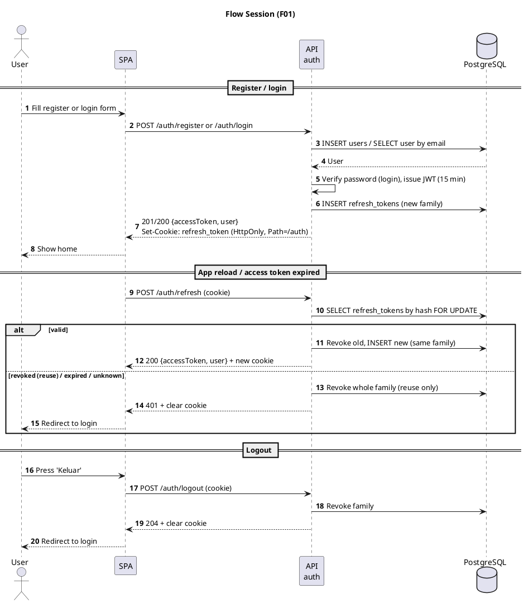
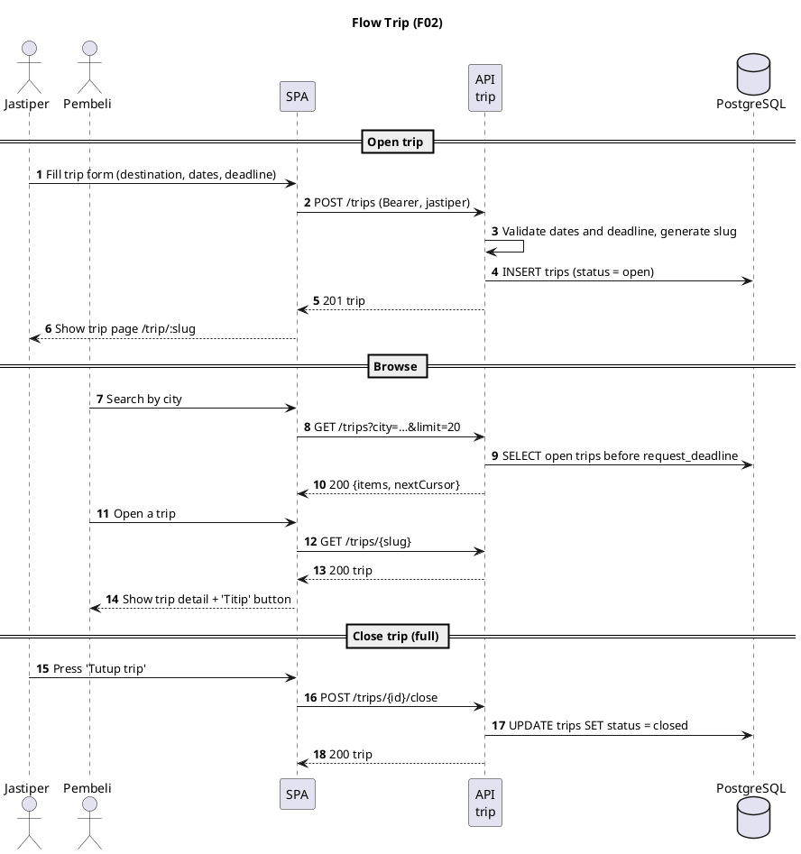
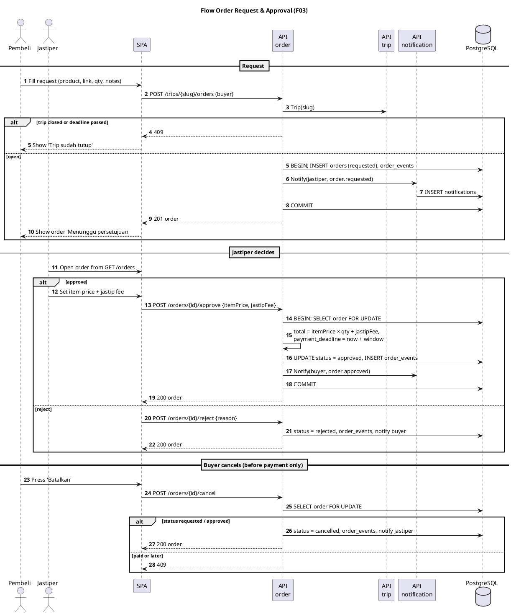
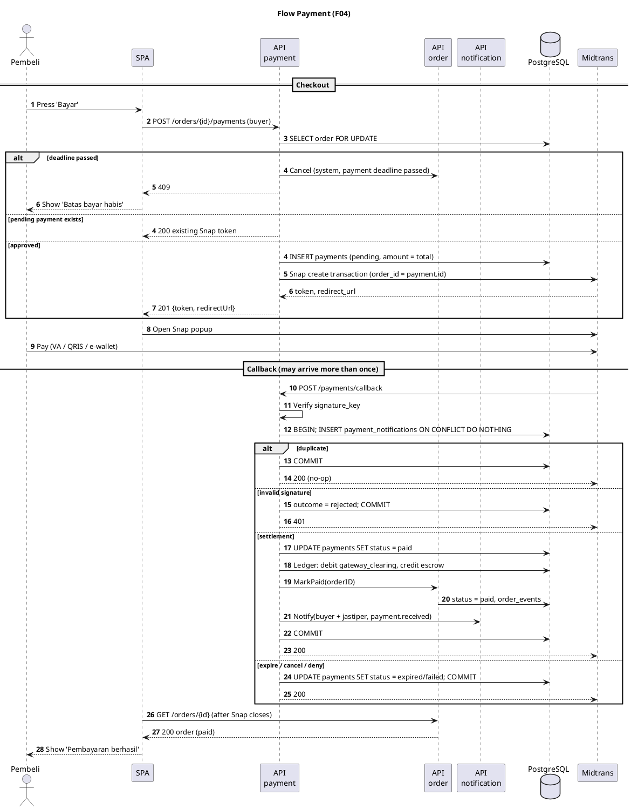
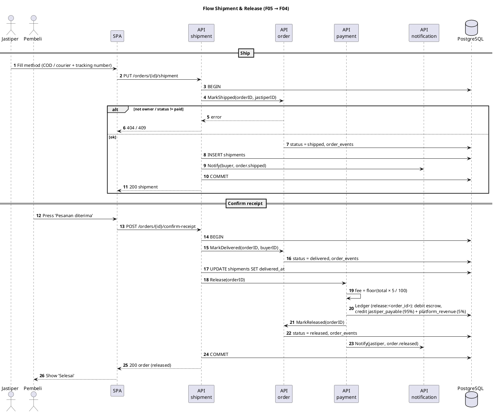
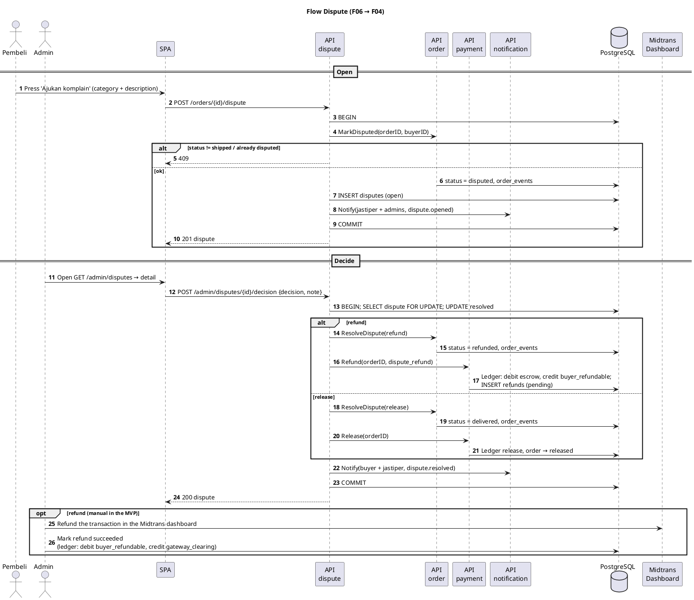
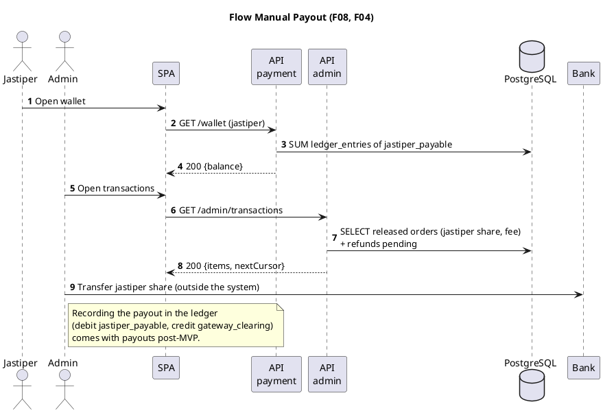
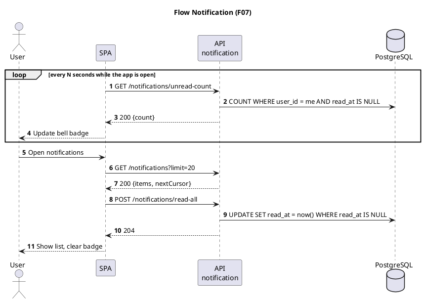

# Feature documentation

One file per backend module: overview, business rules, database tables, endpoints, PlantUML sequence diagrams, and a
to-do list. Endpoint and table designs for modules that are not built yet are plans; once a module ships, its
migration and the generated OpenAPI spec (`/openapi.json`) are the source of truth and the file is updated to match.

| ID  | Module                              | Owner  | Status                                        |
| --- | ----------------------------------- | ------ | --------------------------------------------- |
| F01 | [Auth & User](auth.md)              | Carlo  | Partial: register, login, refresh, logout, `GET /me`, middleware |
| F02 | [Trip & Catalog](trip.md)           | Carlo  | Not started                                   |
| F03 | [Order](order.md)                   | Alfian | Not started                                   |
| F04 | [Payment & Escrow](payment.md)      | Barru  | Not started                                   |
| F05 | [Shipment](shipment.md)             | Alfian | Not started                                   |
| F06 | [Dispute](dispute.md)               | Barru  | Not started                                   |
| F07 | [Notification](notification.md)     | Azfa   | Not started                                   |
| F08 | [Admin](admin.md)                   | Azfa   | Not started                                   |

## MVP scope

The MVP is the smallest set of features that runs the main business flow end to end with real money through
Midtrans: `requested → approved → paid → shipped → delivered → released`, plus the exits when something goes wrong
(reject, cancel before payment, dispute → refund). Each feature file splits its to-do list into **MVP** and
**Post-MVP**.

Cut from the MVP as a whole:

- **Worker and River.** No background jobs: deadlines are checked when data is read or acted on, notifications are
  inserted directly in the caller's transaction, and there is no auto-release (admins release through disputes).
- **Uploads / Blob Storage.** Product links, tracking numbers, and text instead of photos.
- **Trip capacity.** The unit is undecided; jastipers close a trip manually when full.

Not cut: the money rules (double-entry ledger, idempotent payment callbacks, one transaction with an order row lock)
and the full order state machine.

### Platform work for the MVP

| MVP                                                                                     | Post-MVP                                           |
| --------------------------------------------------------------------------------------- | -------------------------------------------------- |
| k8s Secrets for `DATABASE_URL` / `JWT_SECRET` and Azure PostgreSQL (else pods crash-loop) | Worker (`cmd/worker`) and River                    |
| `database.WithTx`                                                                       | Blob storage (`platform/blob`)                     |
| CORS allow-list with credentials (refresh cookie)                                       | Metrics                                            |
| `/health/ready` and graceful shutdown                                                   | `platform/audit` and `audit_logs`                  |
| OpenAPI export command for the FE                                                       | Config via `caarlos0/env`                          |
| PR workflow running `make check`                                                        |                                                    |

### Decisions needed before starting

From [PLAN.md](../PLAN.md) section 7:

1. **Roles** (decision 3): naming shared by BE and FE, and whether one user can be both buyer and jastiper.
2. **Payment deadline** (decision 5), for example 24 hours after approval.
3. **Midtrans** (decision 1): sandbox account for development; before production, confirm that holding funds and
   paying jastipers out manually is allowed.
4. **FE hosting** (decision 6): sets the CORS origins and the refresh cookie domain.

### Order of work

1. Platform, then F01 refresh tokens (Carlo).
2. F02 Trip (Carlo) in parallel with F03 Order (Alfian); Order only needs `trip.Trip()`.
3. F07 in-app notifications (Azfa); small, and used by F03 onwards.
4. F04 Payment (Barru); the longest, so start the Midtrans sandbox integration early and in parallel.
5. F05 Shipment (Alfian), then F06 Dispute (Barru) and F08 transactions list (Azfa).

**Done when:** on AKS with Midtrans sandbox, one order runs from request to `released`, one dispute is decided as a
refund by an admin, and the ledger stays balanced.

## MVP flows

End-to-end sequence diagrams across modules for the MVP scope above (no worker, no uploads, no trip capacity).
Per-module detail is in each feature file.

<details>
<summary><strong style="font-size:1.1em;">1. Session: register, login, refresh, logout</strong></summary>

---



</details>

<details>
<summary><strong style="font-size:1.1em;">2. Trip: jastiper opens a trip, buyer browses</strong></summary>

---



</details>

<details>
<summary><strong style="font-size:1.1em;">3. Order: request, approve / reject, cancel</strong></summary>

---



</details>

<details>
<summary><strong style="font-size:1.1em;">4. Payment: checkout and Midtrans callback</strong></summary>

---



</details>

<details>
<summary><strong style="font-size:1.1em;">5. Shipment and release: ship, confirm receipt, funds released</strong></summary>

---



</details>

<details>
<summary><strong style="font-size:1.1em;">6. Dispute: buyer opens, admin decides refund or release</strong></summary>

---



</details>

<details>
<summary><strong style="font-size:1.1em;">7. Payout: admin pays jastipers manually</strong></summary>

---



</details>

<details>
<summary><strong style="font-size:1.1em;">8. Notifications: polling</strong></summary>

---



</details>

## Related

[PLAN.md](../PLAN.md) (implementation plan and open decisions), [DATABASE.md](../DATABASE.md) (full DDL,
takes precedence for table definitions), `titipdong-docs/PLAN.md` (business flow).

Diagrams are PlantUML (` ```plantuml ` blocks). Render them with the PlantUML IDE plugin, `plantuml` CLI, or
<https://www.plantuml.com/plantuml>.
