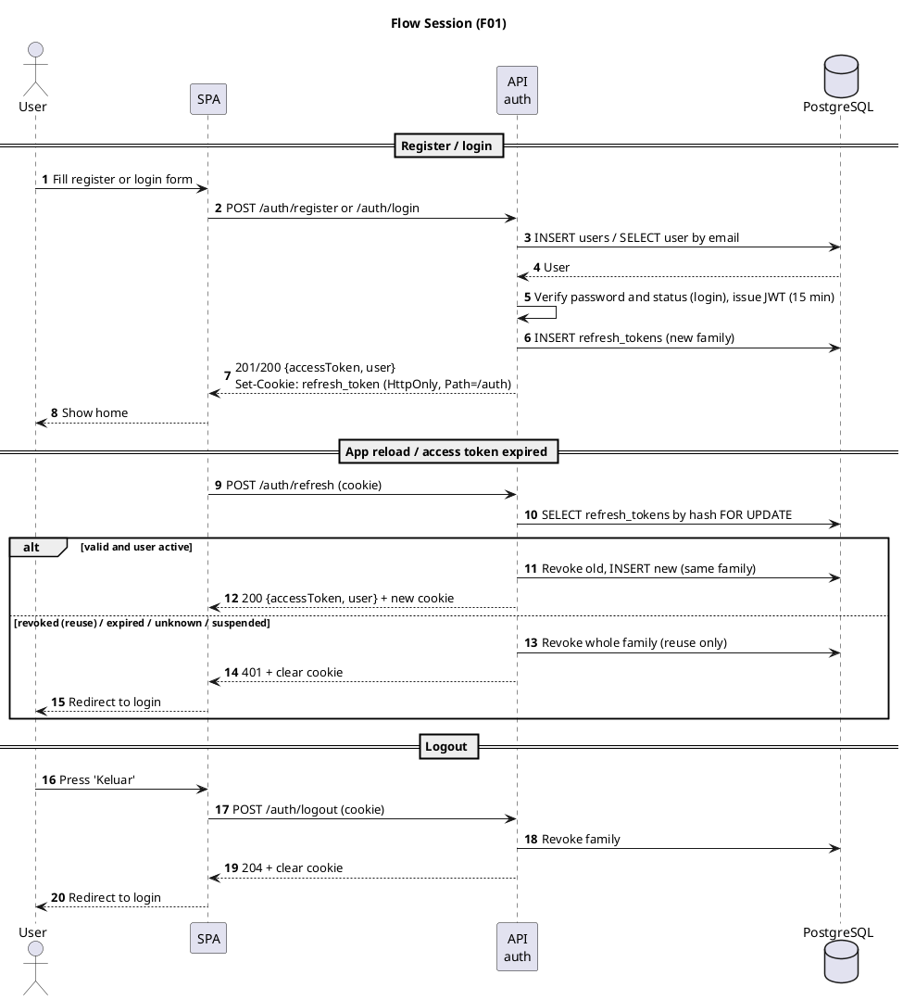
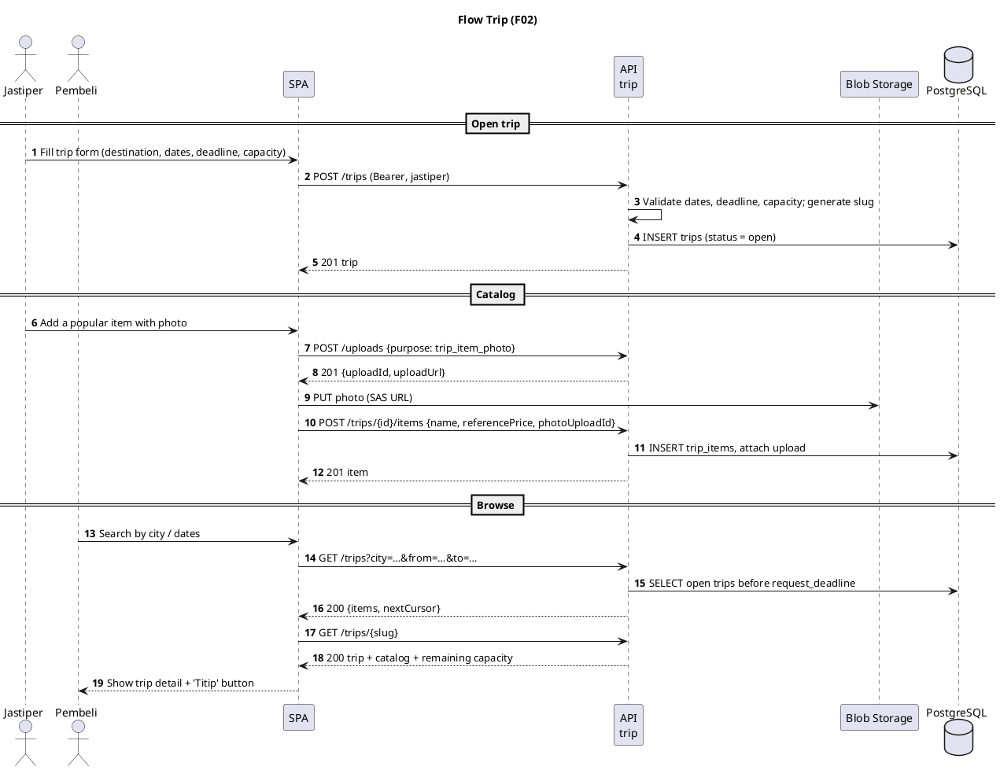
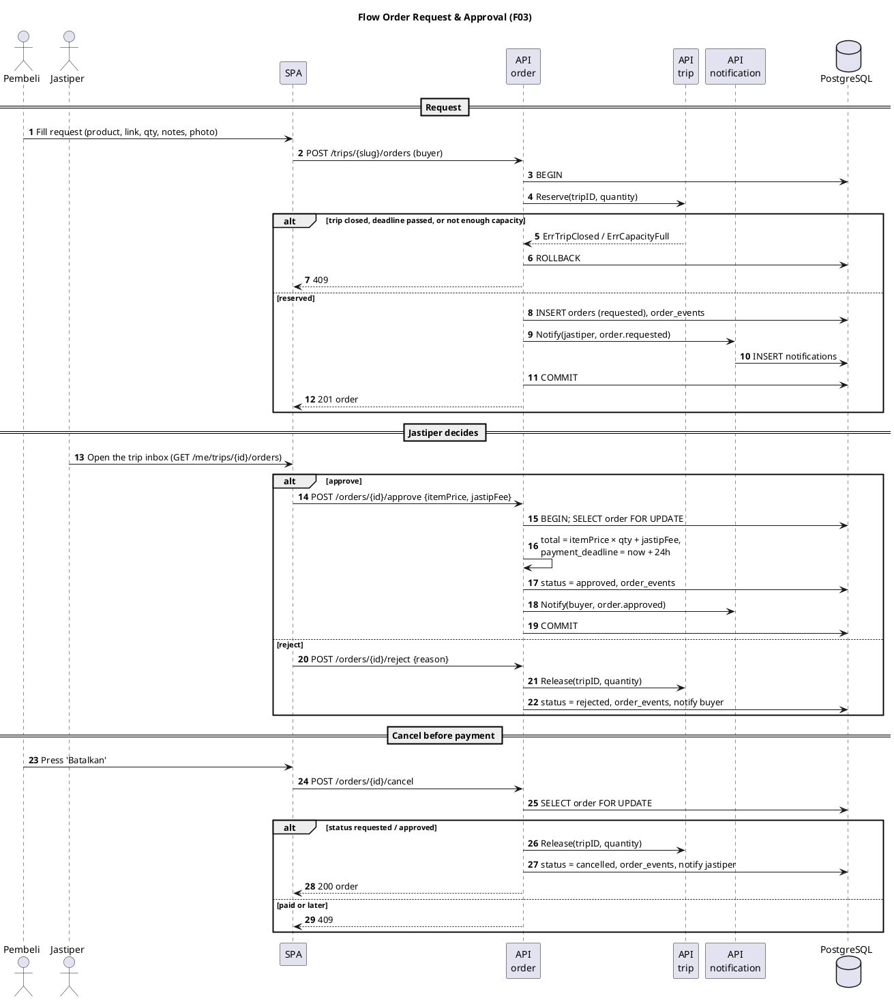
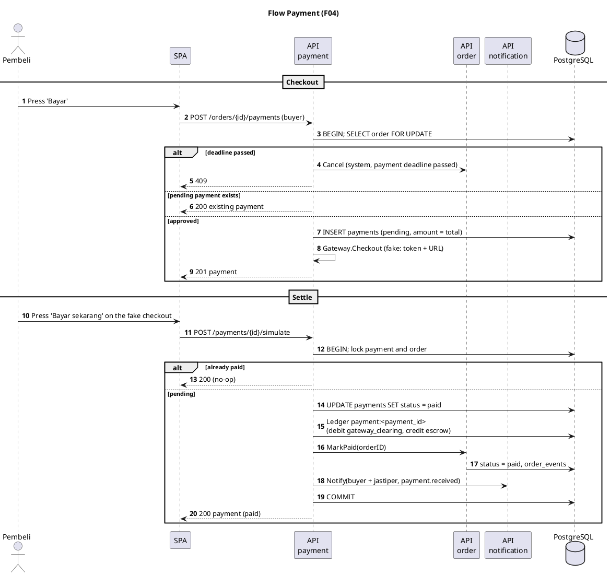
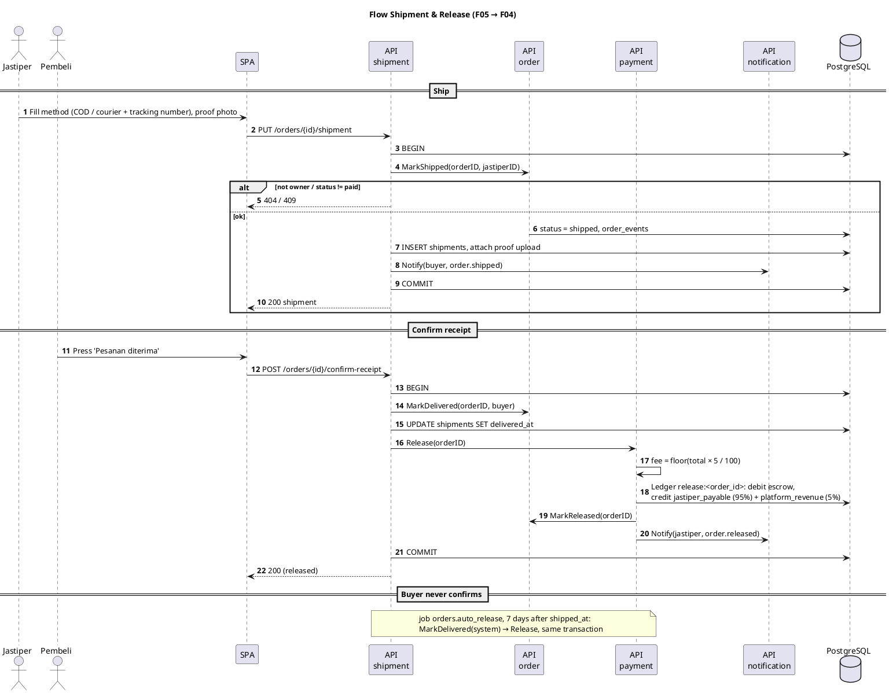
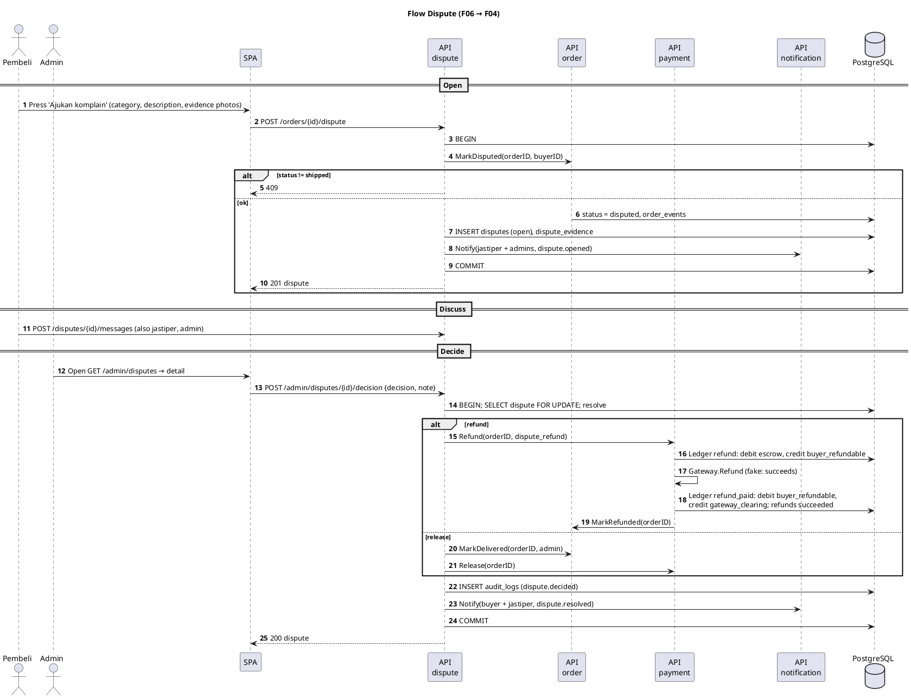
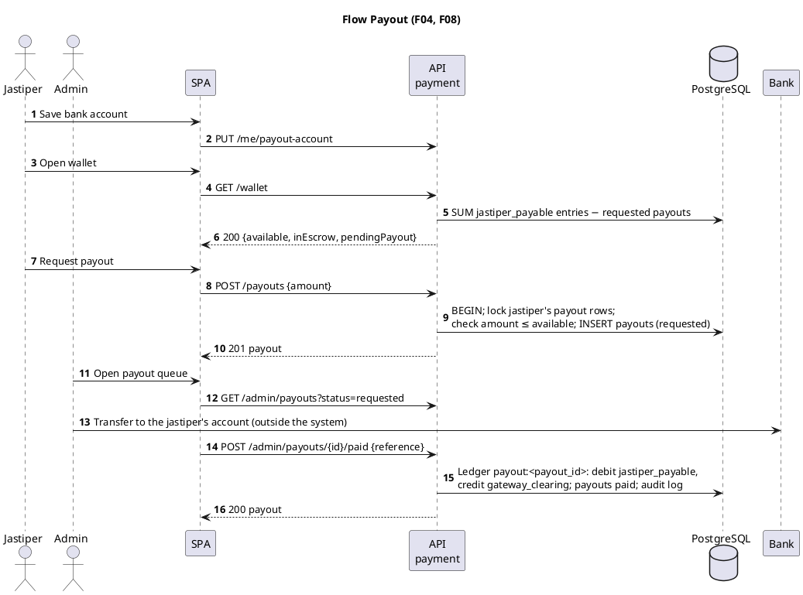
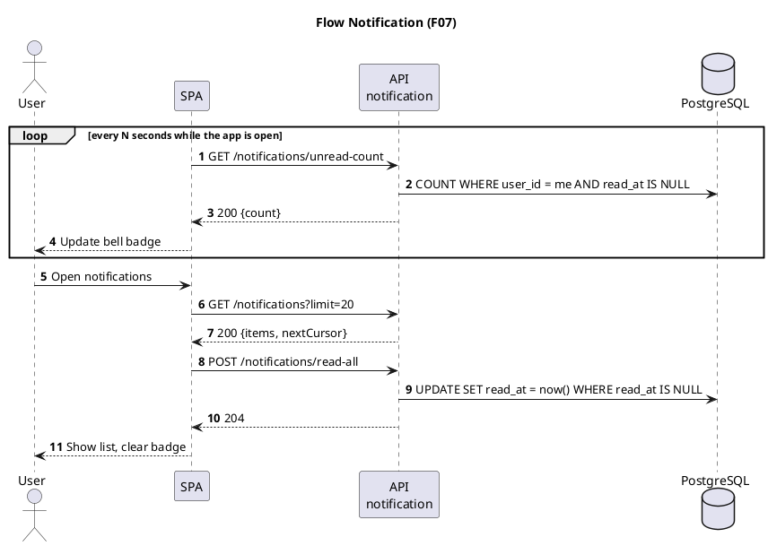

# Feature documentation

One file per backend module: overview, business rules, database tables, endpoints, sequence diagrams, and remaining
work. For a module that is already built, its migration and the generated OpenAPI spec (`/openapi.json`) are the
source of truth, and its file is kept in sync with them.

| ID  | Module                              | Package                 | Status                                                                 |
| --- | ----------------------------------- | ----------------------- | ---------------------------------------------------------------------- |
| F01 | [Auth & User](auth.md)              | `internal/auth`         | Partial: session done; profile, account status, `create-admin` to do   |
| F02 | [Trip & Catalog](trip.md)           | `internal/trip`         | Partial: core and capacity done; edit, cancel, catalog to do          |
| F03 | [Order](order.md)                   | `internal/order`        | Partial: state machine, notifications, capacity done; photo to do     |
| F04 | [Payment & Escrow](payment.md)      | `internal/payment`      | Partial: checkout, ledger, release, refunds, payouts done; wallet history to do |
| F05 | [Shipment](shipment.md)             | `internal/shipment`     | Partial: ship, confirm, auto-release done; proof photo to do           |
| F06 | [Dispute](dispute.md)               | `internal/dispute`      | Done                                                                   |
| F07 | [Notification](notification.md)     | `internal/notification` | Done                                                                   |
| F08 | [Admin](admin.md)                   | `internal/admin`        | To do                                                                  |

Scope decisions (fake payment gateway, in-process jobs, Azure Blob uploads, in-app notifications only) and what is
deliberately left out are in [PLAN.md](../PLAN.md#2-scope-decisions).

## Business flow

The main flow runs `requested → approved → paid → shipped → delivered → released`, with these exits:

- The jastiper rejects a request, or the buyer cancels before paying.
- The payment deadline passes and the order is cancelled.
- The jastiper cancels after payment, and the buyer is refunded.
- The buyer opens a dispute, and an admin decides between refund and release.
- The buyer never confirms receipt, and the funds are released automatically after 7 days.

The diagrams below cross modules. Per-module detail is in each feature file.

<details>
<summary><strong style="font-size:1.1em;">1. Session: register, login, refresh, logout</strong></summary>

---



</details>

<details>
<summary><strong style="font-size:1.1em;">2. Trip: jastiper opens a trip, buyer browses</strong></summary>

---



</details>

<details>
<summary><strong style="font-size:1.1em;">3. Order: request, approve / reject, cancel</strong></summary>

---



</details>

<details>
<summary><strong style="font-size:1.1em;">4. Payment: checkout and settlement (fake gateway)</strong></summary>

---



</details>

<details>
<summary><strong style="font-size:1.1em;">5. Shipment and release: ship, confirm receipt, funds released</strong></summary>

---



</details>

<details>
<summary><strong style="font-size:1.1em;">6. Dispute: buyer opens, admin decides refund or release</strong></summary>

---



</details>

<details>
<summary><strong style="font-size:1.1em;">7. Payout: jastiper requests, admin pays</strong></summary>

---



</details>

<details>
<summary><strong style="font-size:1.1em;">8. Notifications: polling</strong></summary>

---



</details>

## Related

[PLAN.md](../PLAN.md) (architecture, scope, platform), [DATABASE.md](../DATABASE.md) (full DDL, takes precedence for
table definitions), `titipdong-docs/PLAN.md` (business flow).

Diagrams are PlantUML (` ```plantuml ` blocks). Render them with the PlantUML IDE plugin, the `plantuml` CLI, or
<https://www.plantuml.com/plantuml>.
