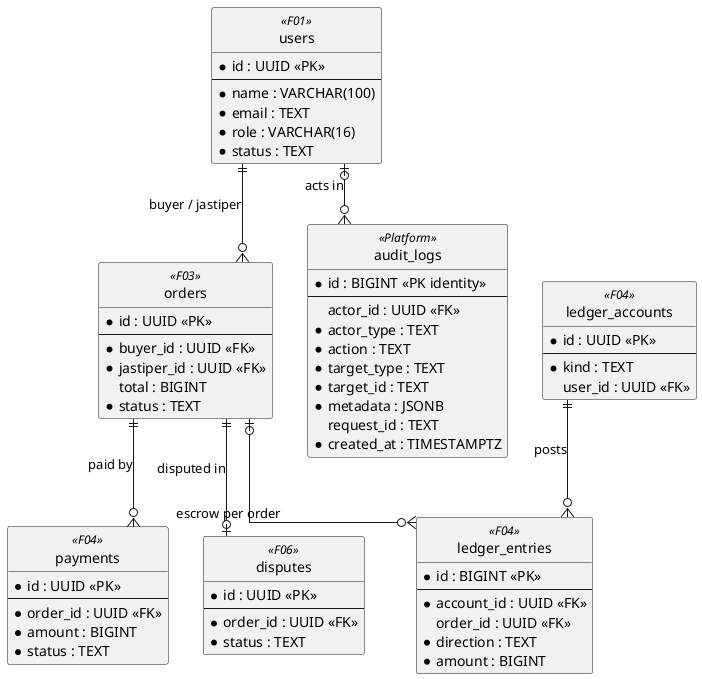
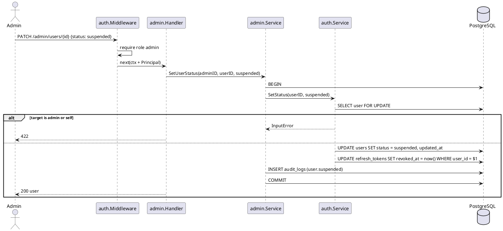
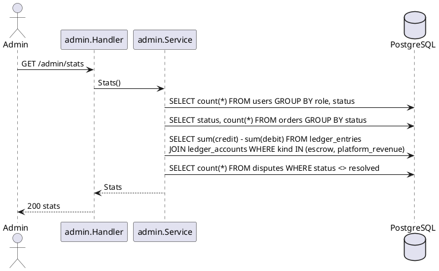

# F08 Admin

| Item    | Value            |
| ------- | ---------------- |
| Owner   | Azfa             |
| Package | `internal/admin` |
| Tag     | `admin`          |
| Status  | Not started      |

## Overview

Back-office for platform admins: platform statistics, transaction monitoring, user management (suspend/activate), and
the audit log. Dispute handling lives in F06 under `/admin/disputes`.

Admin **reads** with its own queries, JOINing any table it needs. It **writes** only through other modules'
services: user status through `auth.Service`, never by updating `users` directly. It only reads `audit_logs`; the
writer is `platform/audit`, used inside money/admin transactions (this avoids an `admin ↔ payment` import cycle).

## Business rules

- Every operation requires `auth.Security(auth.RoleAdmin)`.
- Admins are created only by the `create-admin` CLI (F01), never over HTTP.
- Suspending a user: login and refresh are rejected; an existing access token still works until it expires (≤ 15
  minutes). Suspension is written to `audit_logs`.
- An admin cannot suspend themselves or another admin.
- Money figures come from ledger sums, not stored balances.

## Database tables

Admin owns **no tables**. The diagram shows what it reads (and, through `auth.Service`, the one thing it changes:
`users.status`).

Tables read:

| Table                                   | Used for                                   |
| --------------------------------------- | ------------------------------------------ |
| `users`                                 | User list, status                          |
| `orders`, `order_events`                | Order counts per status, GMV               |
| `payments`, `ledger_entries`, `ledger_accounts` | Transactions, escrow balance, platform revenue |
| `disputes`                              | Open dispute count                         |
| `audit_logs` (platform)                 | Audit log view                             |

### `audit_logs` (platform, read here)

| Column        | Type          | Notes                                           |
| ------------- | ------------- | ----------------------------------------------- |
| `id`          | `BIGINT` identity PK | Append-only                              |
| `actor_id`    | `UUID` FK     | `NULL` for system                               |
| `actor_type`  | `TEXT`        | `buyer`, `jastiper`, `admin`, `system`          |
| `action`      | `TEXT`        | e.g. `order.released`, `user.suspended`         |
| `target_type` | `TEXT`        | e.g. `order`, `dispute`, `user`                 |
| `target_id`   | `TEXT`        |                                                 |
| `metadata`    | `JSONB`       |                                                 |
| `request_id`  | `TEXT`        | From `X-Request-ID`                             |
| `created_at`  | `TIMESTAMPTZ` |                                                 |

Full DDL in [DATABASE.md](../DATABASE.md#10-platform).

## Endpoints

| Method  | Path                    | operationId           | Auth    | Description                                              |
| ------- | ----------------------- | --------------------- | ------- | -------------------------------------------------------- |
| `GET`   | `/admin/stats`          | `getAdminStats`       | `admin` | Users, orders per status, escrow held, revenue           |
| `GET`   | `/admin/transactions`   | `listAdminTransactions` | `admin` | Payments / ledger transactions; filters; cursor        |
| `GET`   | `/admin/users`          | `listAdminUsers`      | `admin` | Search by name/email, filter role/status; cursor         |
| `PATCH` | `/admin/users/{id}`     | `updateAdminUser`     | `admin` | Body `{ status: active\|suspended }`                     |
| `GET`   | `/admin/audit-logs`     | `listAuditLogs`       | `admin` | Filter by target, actor, time; cursor                    |

Dispute endpoints (`/admin/disputes…`) are documented in [dispute.md](dispute.md).

## Sequence diagrams

<strong style="font-size:1.1em;">Suspend a user</strong>

---

<strong style="font-size:1.1em;">Dashboard stats</strong>

---

## To do

MVP scope is defined in [README.md](README.md#mvp-scope). Admin accounts come from the F01 `create-admin` CLI.

### MVP

- [ ] Dispute endpoints (built in F06).
- [ ] `GET /admin/transactions`: released orders with the jastiper's share and the platform fee, so an admin can pay
      jastipers out manually, plus refunds waiting for a manual Midtrans refund. Cursor pagination.

### Post-MVP

- [ ] `GET /admin/stats`.
- [ ] `GET /admin/users` and `PATCH /admin/users/{id}` (suspend/activate); depends on F01 account status
      (`users.status`, `auth.Service.SetStatus`). Revoke the user's refresh tokens on suspension. In the MVP, an
      admin suspends directly in the database.
- [ ] `GET /admin/audit-logs`; depends on `platform/audit`.
- [ ] Decide KYC scope (PLAN section 7, decision 2); the FE has `/admin/kyc`.
