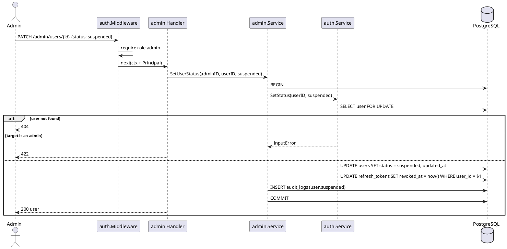
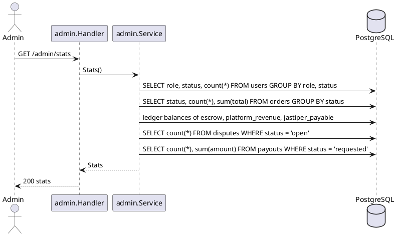

# F08 Admin

| Item    | Value            |
| ------- | ---------------- |
| Package | `internal/admin` |
| Tag     | `admin`          |
| Status  | To do            |

## Overview

Back-office for platform admins: dashboard statistics, every order and ledger transaction, user management
(suspend / reactivate), and the audit log. Dispute handling lives in F06 (`/admin/disputes`) and payout processing
in F04 (`/admin/payouts`); both share the `admin` tag in the API docs.

Admin **reads** with its own queries, JOINing any table it needs. It **writes** only through other modules'
services: user status through `auth.Service.SetStatus`, never by updating `users` directly. It only reads
`audit_logs`; the writer is `platform/audit`, used inside money and admin transactions.

## Business rules

- Every operation requires `auth.Security(auth.RoleAdmin)`.
- Admins are created only with `api create-admin`, never over HTTP.
- Suspending a user: login and refresh are rejected and their refresh tokens are revoked; an access token already
  issued works until it expires (≤ 15 minutes). Suspension and reactivation are written to `audit_logs`.
- An admin cannot suspend an admin (including themselves).
- Money figures come from ledger sums, never stored balances.

## Database tables

Admin owns **no tables**. It reads:

| Table                                            | Used for                                        |
| ------------------------------------------------ | ----------------------------------------------- |
| `users`                                          | User list, counts by role and status            |
| `orders`, `order_events`, `trips`                | Order list and counts per status, GMV           |
| `ledger_transactions`, `ledger_entries`, `ledger_accounts` | Transactions, escrow held, platform revenue, payable outstanding |
| `refunds`, `payouts`                             | Refunds and payouts in the transaction view, pending payout count |
| `disputes`                                       | Open dispute count                              |
| `audit_logs` (platform)                          | Audit log view                                  |

### `audit_logs` (platform, read here)

| Column        | Type                 | Notes                                           |
| ------------- | -------------------- | ----------------------------------------------- |
| `id`          | `BIGINT` identity PK | Append-only                                     |
| `actor_id`    | `UUID` FK            | `NULL` for system                               |
| `actor_type`  | `TEXT`               | `buyer`, `jastiper`, `admin`, `system`          |
| `action`      | `TEXT`               | See below                                       |
| `target_type` | `TEXT`               | `order`, `dispute`, `payout`, `user`            |
| `target_id`   | `TEXT`               |                                                 |
| `metadata`    | `JSONB`              | Amounts, reasons, previous values               |
| `request_id`  | `TEXT`               | From `X-Request-ID`                             |
| `created_at`  | `TIMESTAMPTZ`        |                                                 |

Actions: `order.released`, `order.refunded`, `dispute.decided`, `payout.paid`, `payout.rejected`, `user.suspended`,
`user.activated`.

Full DDL in [DATABASE.md](../DATABASE.md#10-platform).

## Endpoints

| Method  | Path                      | operationId             | Auth    | Description                                              |
| ------- | ------------------------- | ----------------------- | ------- | -------------------------------------------------------- |
| `GET`   | `/admin/stats`            | `getAdminStats`         | `admin` | Users by role/status, orders by status, GMV, escrow held, platform revenue, payable outstanding, open disputes, pending payouts |
| `GET`   | `/admin/orders`           | `listAdminOrders`       | `admin` | Every order; filter `status`, search by code; cursor     |
| `GET`   | `/admin/transactions`     | `listAdminTransactions` | `admin` | Ledger transactions with their entries; filter `kind`; cursor |
| `GET`   | `/admin/users`            | `listAdminUsers`        | `admin` | Search name/email, filter `role`/`status`; cursor        |
| `PATCH` | `/admin/users/{id}`       | `updateAdminUser`       | `admin` | Body `{ status: active\|suspended }`                     |
| `GET`   | `/admin/audit-logs`       | `listAuditLogs`         | `admin` | Filter `targetType`, `targetId`, `actorId`; cursor       |

An admin reads a single order through `GET /orders/{id}` (F03), which already allows admins.

## Sequence diagrams

<strong style="font-size:1.1em;">Suspend a user</strong>

---

<strong style="font-size:1.1em;">Dashboard stats</strong>

---

## Remaining work

- [ ] `GET /admin/stats` (depends on F04 ledger summaries, F06 disputes, payouts).
- [ ] `GET /admin/orders`, `GET /admin/transactions`.
- [ ] `GET /admin/users` and `PATCH /admin/users/{id}` (depends on F01 `users.status` and `SetStatus`).
- [ ] `GET /admin/audit-logs` (depends on `platform/audit`).
