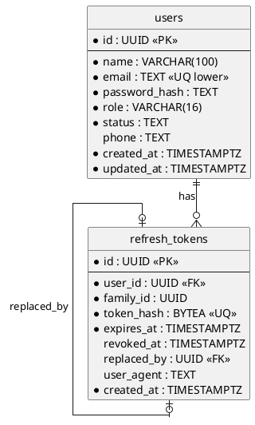
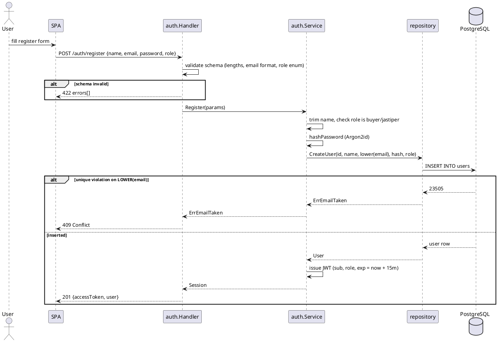
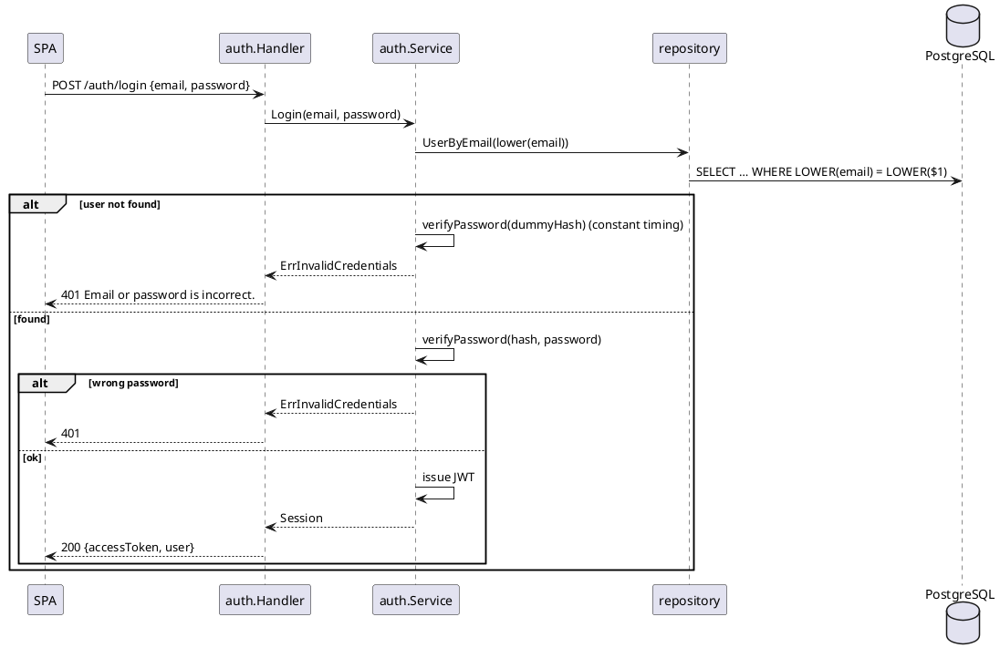
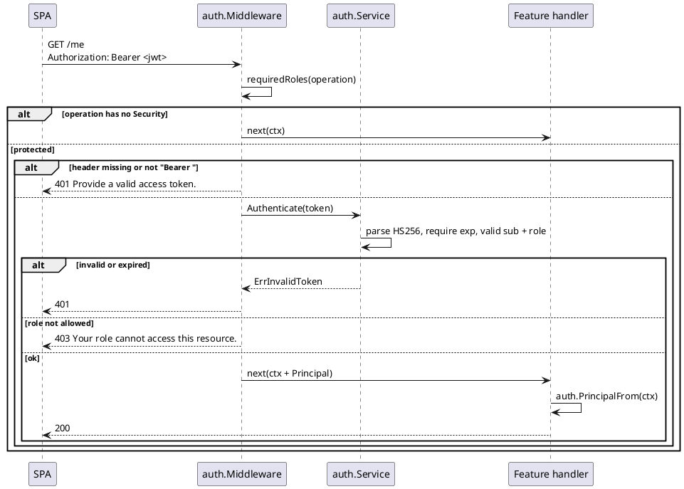
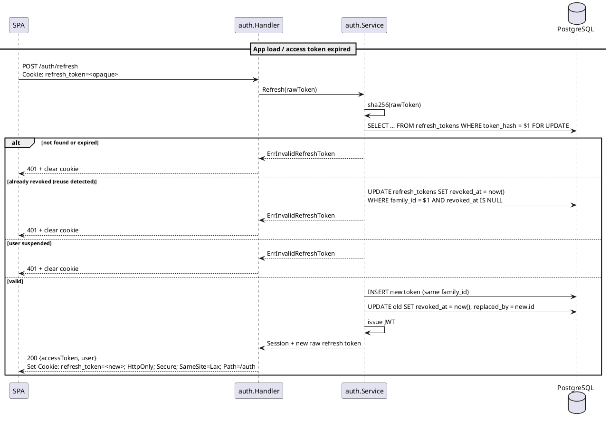

# F01 Auth & User

| Item    | Value                                                                        |
| ------- | ---------------------------------------------------------------------------- |
| Package | `internal/auth`                                                              |
| Tag     | `auth`                                                                       |
| Status  | Partial: session and middleware done; profile, account status, `create-admin` to do |

## Overview

Auth & User manages accounts and access for the three actors (buyer, jastiper, admin). It issues short-lived JWT
access tokens and provides the middleware every other module uses to protect its operations:

- `auth.Middleware(api, svc)` is registered with `api.UseMiddleware` **before** any module's `RegisterRoutes`, because
  Huma binds middleware when an operation is registered.
- `Security: auth.Security(roles...)` on a `huma.Operation` makes it require a bearer token; with roles, other roles
  get 403.
- `auth.PrincipalFrom(ctx)` returns the caller (`UserID`, `Role`) inside a protected handler.

Other modules that need a user's name or email JOIN `users` in their own queries (for example with `GetUserByID`)
instead of calling this module over HTTP.

## Business rules

- Self-registration only allows `buyer` and `jastiper`. Admins are created only with `api create-admin`.
- One role per user: `buyer`, `jastiper`, or `admin`. The role cannot be changed.
- Emails are trimmed and lowercased; uniqueness is enforced on `LOWER(email)`.
- Passwords: 8–128 characters, hashed with Argon2id (PHC string format). Changing it through `PATCH /me` requires the
  current password and revokes all refresh tokens, so every device has to log in again.
- Login with an unknown email still runs a dummy hash check, so response timing does not reveal registered emails.
  Both unknown email and wrong password return the same 401.
- Access token: HS256 JWT, lifetime 15 minutes, claims `sub` (user ID), `role`, `iat`, `exp`. Signed with
  `JWT_SECRET` (≥ 32 chars).
- Refresh token: opaque random value in an `HttpOnly; SameSite=Lax; Path=/auth` cookie (`Secure` unless
  `COOKIE_SECURE=false`), lifetime 30 days, only its SHA-256 hash is stored. Every use rotates it; presenting a token
  that was already rotated revokes the whole family.
- Account status: `active` or `suspended`. Suspended users cannot log in or refresh, and suspension revokes their
  refresh tokens. An access token already issued stays valid until it expires (at most 15 minutes). Login with the
  right password for a suspended account returns 403 `This account is suspended.` (a wrong password stays 401, so
  the status is never shown without the password); refresh returns 401 and revokes the family.
- Missing or invalid token → 401 `Provide a valid access token.` Wrong role → 403
  `Your role cannot access this resource.`

## Database tables

Full DDL is in [DATABASE.md](../DATABASE.md#3-f01-auth--user). Migration: `db/migrations/00001_create_users.sql`.



### `users`

| Column          | Type           | Notes                                                        |
| --------------- | -------------- | ------------------------------------------------------------ |
| `id`            | `UUID` PK      | UUIDv7, generated by the application                         |
| `name`          | `VARCHAR(100)` | Trimmed, not blank                                           |
| `email`         | `TEXT`         | Stored lowercased, unique index on `LOWER(email)`            |
| `password_hash` | `TEXT`         | Argon2id PHC string                                          |
| `role`          | `VARCHAR(16)`  | `buyer`, `jastiper`, `admin`                                 |
| `status`        | `TEXT`         | `active` (default) or `suspended`                            |
| `phone`         | `TEXT`         | ≤ 20 chars, nullable                                         |
| `created_at`    | `TIMESTAMPTZ`  | Default `now()`                                              |
| `updated_at`    | `TIMESTAMPTZ`  | Set by the application                                       |

### `refresh_tokens`

| Column        | Type          | Notes                                                          |
| ------------- | ------------- | -------------------------------------------------------------- |
| `id`          | `UUID` PK     |                                                                |
| `user_id`     | `UUID` FK     | → `users.id`, indexed                                          |
| `family_id`   | `UUID`        | All rotations of one login share a family, indexed             |
| `token_hash`  | `BYTEA`       | SHA-256 of the cookie value, unique; the raw token is never stored |
| `expires_at`  | `TIMESTAMPTZ` |                                                                |
| `revoked_at`  | `TIMESTAMPTZ` | Nullable                                                       |
| `replaced_by` | `UUID` FK     | → `refresh_tokens.id`, set on rotation                         |
| `user_agent`  | `TEXT`        | For a future "active sessions" view                            |
| `created_at`  | `TIMESTAMPTZ` |                                                                |

### Queries (`db/queries/users.sql`)

| Query            | Used by                        |
| ---------------- | ------------------------------ |
| `CreateUser`     | Register                       |
| `GetUserByEmail` | Login (returns `password_hash`) |
| `GetUserByID`    | `GET /me`, any module that needs a user |

## Endpoints

| Method  | Path             | operationId      | Auth            | Status  | Description                                    |
| ------- | ---------------- | ---------------- | --------------- | ------- | ---------------------------------------------- |
| `POST`  | `/auth/register` | `register`       | Public          | Done    | Create a buyer or jastiper account, returns a session |
| `POST`  | `/auth/login`    | `login`          | Public          | Done    | Returns an access token and the user           |
| `GET`   | `/me`            | `getCurrentUser` | Any role        | Done    | Profile of the caller                          |
| `POST`  | `/auth/refresh`  | `refreshSession` | Refresh cookie  | Done    | Rotate the refresh token, return a new access token |
| `POST`  | `/auth/logout`   | `logout`         | Refresh cookie  | Done    | Revoke the refresh token family, clear the cookie |
| `PATCH` | `/me`            | `updateCurrentUser` | Any role     | Done    | Update name, phone, or password                |

### Service methods for other modules

| Method                                    | Caller | Purpose                                              |
| ----------------------------------------- | ------ | ---------------------------------------------------- |
| `Provision(ctx, pool, params)`            | CLI    | Create a user of any role (`seed-demo`, `create-admin`) |
| `SetStatus(ctx, userID, status)`          | Admin  | Suspend or reactivate a non-admin user, revoke sessions on suspend |

### `PATCH /me`

Request (`UpdateUserRequest`), every field optional:

```json
{ "name": "Budi S.", "phone": "08123456789", "currentPassword": "rahasia123", "newPassword": "lebihrahasia456" }
```

`name` 1–100 (trimmed, not blank); `phone` up to 20 characters matching `^\+?[0-9]*$`, an empty string clears it;
`newPassword` 8–128 and requires `currentPassword`. Response `200` (`UserResponse`). Errors: `401` `Current password
is incorrect.`, `422` validation.

### CLI: `create-admin`

```sh
go run ./cmd/api create-admin -name "Admin" -email admin@example.com   # password read from ADMIN_PASSWORD
```

### `POST /auth/register`

Request (`RegisterRequest`):

```json
{ "name": "Budi", "email": "budi@example.com", "password": "rahasia123", "role": "buyer" }
```

Response `201` (`AuthResponse`):

```json
{
  "accessToken": "eyJhbGciOiJIUzI1NiIs...",
  "user": { "id": "0192…", "name": "Budi", "email": "budi@example.com", "role": "buyer", "createdAt": "2026-09-27T10:00:00Z" }
}
```

Errors: `409` email already registered, `422` validation (blank name, role not `buyer`/`jastiper`, length limits).

### `POST /auth/login`

Request (`LoginRequest`): `{ "email": "...", "password": "..." }`. Response `200` is the same `AuthResponse`.
Errors: `401` `Email or password is incorrect.`, `403` `This account is suspended.`, `422` validation.

The user object in every auth response and `GET /me` also carries `status` (`active`/`suspended`) and `phone`
(omitted when not set).

### `GET /me`

Header `Authorization: Bearer <accessToken>`. Response `200` (`UserResponse`). Errors: `401` if the token is invalid,
expired, or its account no longer exists.

## Sequence diagrams

<details>
<summary><strong style="font-size:1.1em;">Register</strong></summary>

---



</details>

<details>
<summary><strong style="font-size:1.1em;">Login</strong></summary>

---



</details>

<details>
<summary><strong style="font-size:1.1em;">Protected request (middleware)</strong></summary>

---



</details>

<details>
<summary><strong style="font-size:1.1em;">Refresh token rotation</strong></summary>

---



</details>

## To do

Done:

- [x] Register, login, `GET /me`, `auth.Middleware`, `auth.Security`, `auth.PrincipalFrom`.
- [x] Refresh tokens with rotation and reuse detection, `POST /auth/refresh`, `POST /auth/logout`; register and login
      set the cookie.
- [x] `cmd/api seed-demo` for demo accounts.
- [x] Migration adding `users.status`, `phone`, `updated_at`; login and refresh reject suspended users.
- [x] `SetStatus(ctx, userID, status)` for F08: refuses admins (`ErrAdminStatus`), revokes refresh tokens on suspend.
- [x] `PATCH /me` (name, phone, password change with the current password; a password change revokes all refresh
      tokens).

Remaining:

- [ ] `api create-admin` CLI command.
- [ ] UUIDv7 for new users and refresh tokens (currently v4).
- [ ] Job `auth.purge_tokens` deleting expired refresh tokens.
