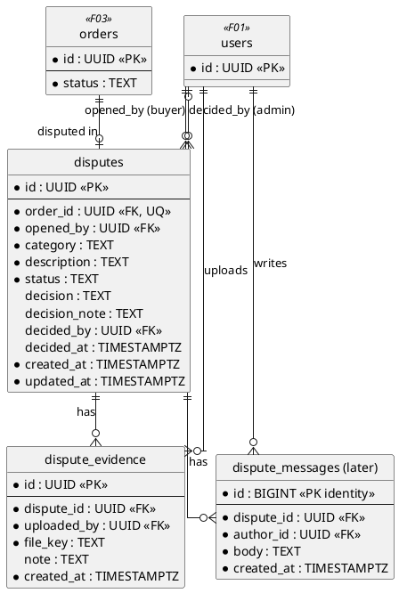
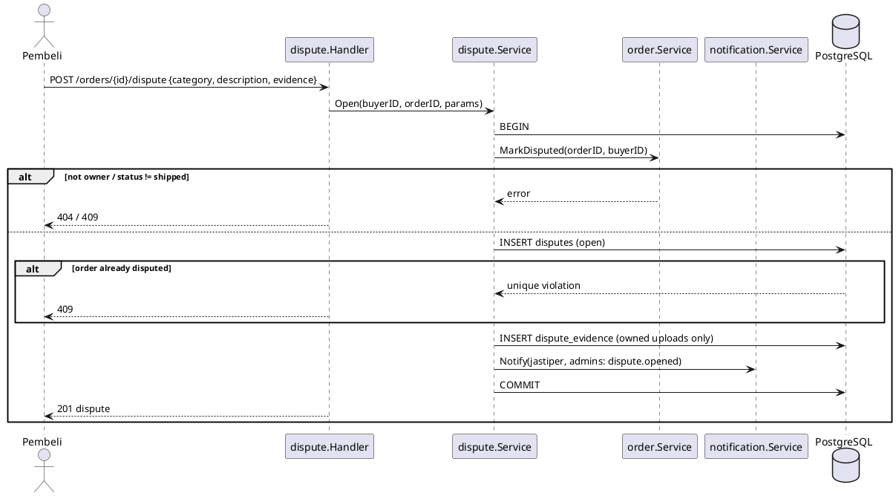
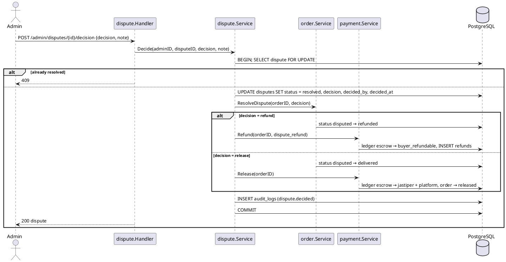

# F06 Dispute

| Item    | Value              |
| ------- | ------------------ |
| Owner   | Barru              |
| Package | `internal/dispute` |
| Tag     | `dispute`          |
| Status  | Not started        |

## Overview

While an order is `shipped`, the buyer can open a dispute (item not received, not as described, damaged, …) with
evidence. The order becomes `disputed`, which stops auto-release. An admin reviews it and decides:

- `refund`: the escrow goes back to the buyer, order `refunded`.
- `release`: the claim is rejected, order `delivered` → funds released to the jastiper.

## Business rules

- Only the order's buyer can open a dispute, only while `shipped`, and an order can be disputed once.
- Evidence files use blob SAS uploads (`uploads.purpose = 'dispute_evidence'`).
- The decision is all-or-nothing (no partial refunds; see DATABASE.md note on `FINANCE.md`).
- The decision runs in **one transaction**: dispute update, `order.ResolveDispute`, `payment.Refund` or
  `payment.Release`, audit log.
- Buyer and jastiper of the order can read the dispute; others get 404.

## Database tables

Full DDL in [DATABASE.md](../DATABASE.md#8-f06-dispute).

### `disputes`

| Column          | Type          | Notes                                                             |
| --------------- | ------------- | ----------------------------------------------------------------- |
| `id`            | `UUID` PK     |                                                                   |
| `order_id`      | `UUID` FK     | Unique (one dispute per order)                                    |
| `opened_by`     | `UUID` FK     | Buyer                                                             |
| `category`      | `TEXT`        | `not_received`, `not_as_described`, `damaged`, `other`            |
| `description`   | `TEXT`        | ≤ 2000                                                            |
| `status`        | `TEXT`        | `open`, `under_review`, `resolved`                                |
| `decision`      | `TEXT`        | `refund` or `release`                                             |
| `decision_note` | `TEXT`        |                                                                   |
| `decided_by`    | `UUID` FK     | Admin                                                             |
| `decided_at`    | `TIMESTAMPTZ` | `resolved` ⇔ decision, decided_by, decided_at all set (CHECK)     |
| `created_at`, `updated_at` | `TIMESTAMPTZ` |                                                        |

### `dispute_evidence`

| Column        | Type        | Notes          |
| ------------- | ----------- | -------------- |
| `id`          | `UUID` PK   |                |
| `dispute_id`  | `UUID` FK   |                |
| `uploaded_by` | `UUID` FK   |                |
| `file_key`    | `TEXT`      | Blob key       |
| `note`        | `TEXT`      | ≤ 500          |
| `created_at`  | `TIMESTAMPTZ` |              |

### `dispute_messages` (after the initial release)

`id` (identity), `dispute_id`, `author_id`, `body` (≤ 2000), `created_at`.

## Endpoints

| Method | Path                              | operationId            | Auth                        | Description                              |
| ------ | --------------------------------- | ---------------------- | --------------------------- | ---------------------------------------- |
| `POST` | `/orders/{id}/dispute`            | `openDispute`          | `buyer` (owner)             | Body `{ category, description, evidence[] }` |
| `GET`  | `/orders/{id}/dispute`            | `getOrderDispute`      | order buyer/jastiper        | Dispute + evidence                       |
| `GET`  | `/admin/disputes`                 | `listDisputes`         | `admin`                     | Queue (open / under review first); cursor |
| `GET`  | `/admin/disputes/{id}`            | `getDispute`           | `admin`                     | Detail with order, evidence, timeline    |
| `POST` | `/admin/disputes/{id}/decision`   | `decideDispute`        | `admin`                     | Body `{ decision: refund\|release, note }` |

## Sequence diagrams

<strong style="font-size:1.1em;">Open dispute</strong>

---

<strong style="font-size:1.1em;">Admin decision</strong>

---

## To do

MVP scope is defined in [README.md](README.md#mvp-scope).

### MVP

- [ ] Migration `create_disputes` (`disputes` only; category + text description) and queries.
- [ ] `openDispute`, `getOrderDispute`, `listDisputes`, `getDispute`, `decideDispute`; depends on F03
      (`MarkDisputed`, `ResolveDispute`) and F04 (`Refund`, `Release`).
- [ ] Without auto-release, disputes are also how an admin releases funds when a buyer never confirms receipt.

### Post-MVP

- [ ] `dispute_evidence` with uploads via `platform/blob` (in the MVP, evidence is exchanged by chat or email).
- [ ] `dispute_messages` conversation.
- [ ] `platform/audit` writer for decisions (in the MVP, the trail is the dispute row, `order_events`, and the
      ledger).
- [ ] Decide whether partial refunds are needed (`FINANCE.md`).
