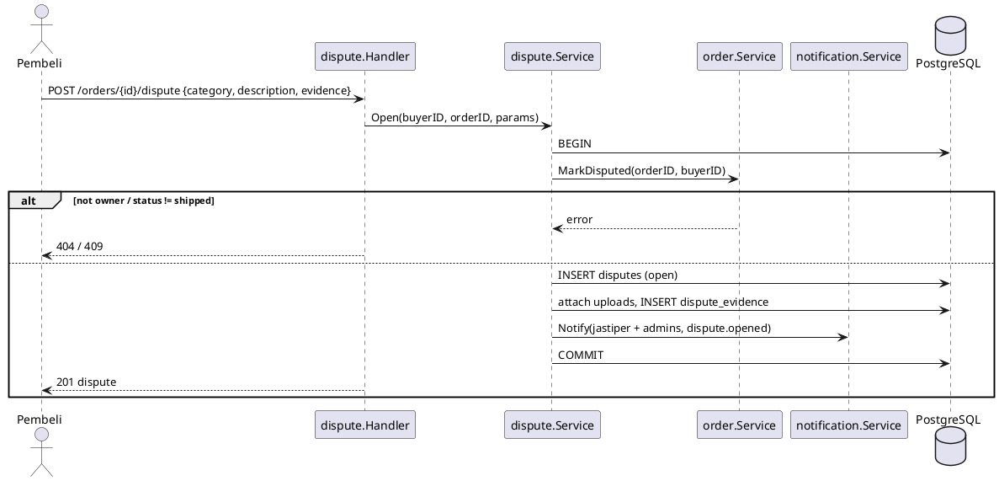
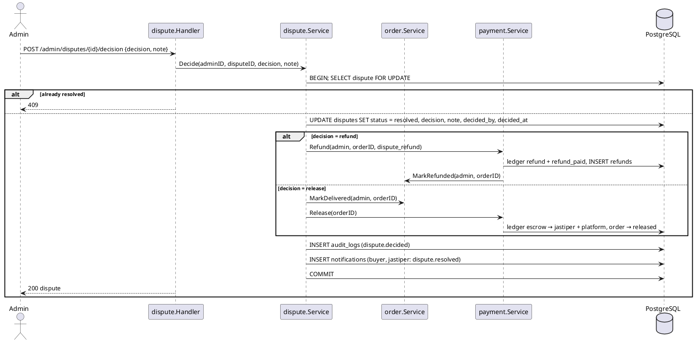

# F06 Dispute

| Item    | Value              |
| ------- | ------------------ |
| Package | `internal/dispute` |
| Tag     | `dispute`          |
| Status  | Done               |

## Overview

While an order is `shipped`, the buyer can open a dispute (item not received, not as described, damaged, other) with
photo evidence. The order becomes `disputed`, which stops auto-release. The buyer, the jastiper, and admins discuss
it in the dispute's message thread and can add more evidence. An admin then decides:

- `refund`: the escrow goes back to the buyer, order `refunded`.
- `release`: the claim is rejected, order `delivered` → funds released to the jastiper.

## Business rules

- Only the order's buyer can open a dispute, only while `shipped`; an order can be disputed once.
- Evidence files are uploads with purpose `dispute_evidence` owned by the person adding them. At most 5 files per
  request (opening may have none); the buyer and the jastiper can both add evidence while the dispute is `open`.
- Messages: the order's buyer and jastiper and any admin can post while the dispute is `open`.
- The decision is all-or-nothing (no partial refunds).
- The decision runs in **one transaction**: dispute update, `payment.Refund` (which moves the order to `refunded`)
  or `order.MarkDelivered` + `payment.Release`, audit log, notifications.
- The buyer and jastiper of the order can read the dispute; others get 404. Admins read every dispute.
- Notifications: `dispute.opened` to the jastiper and every admin, `dispute.message` to the buyer and jastiper except
  the author, `dispute.resolved` to the buyer and jastiper. The decision is audited as `dispute.decided`.
- The decision locks the order before the dispute, the same lock order as every other money path.

## Database tables

Full DDL in [DATABASE.md](../DATABASE.md#8-f06-dispute).


### `disputes`

| Column          | Type          | Notes                                                             |
| --------------- | ------------- | ----------------------------------------------------------------- |
| `id`            | `UUID` PK     | UUIDv7                                                            |
| `order_id`      | `UUID` FK     | Unique (one dispute per order)                                    |
| `opened_by`     | `UUID` FK     | Buyer                                                             |
| `category`      | `TEXT`        | `not_received`, `not_as_described`, `damaged`, `other`            |
| `description`   | `TEXT`        | ≤ 2000                                                            |
| `status`        | `TEXT`        | `open`, `resolved`                                                |
| `decision`      | `TEXT`        | `refund` or `release`                                             |
| `decision_note` | `TEXT`        | ≤ 2000, shown to both parties                                     |
| `decided_by`    | `UUID` FK     | Admin                                                             |
| `decided_at`    | `TIMESTAMPTZ` | `resolved` ⇔ decision, decided_by, decided_at all set (CHECK)     |
| `created_at`, `updated_at` | `TIMESTAMPTZ` |                                                        |

### `dispute_evidence`

| Column        | Type          | Notes          |
| ------------- | ------------- | -------------- |
| `id`          | `UUID` PK     |                |
| `dispute_id`  | `UUID` FK     |                |
| `uploaded_by` | `UUID` FK     |                |
| `file_key`    | `TEXT`        | Blob key       |
| `note`        | `TEXT`        | ≤ 500          |
| `created_at`  | `TIMESTAMPTZ` |                |

### `dispute_messages`

| Column       | Type                 | Notes   |
| ------------ | -------------------- | ------- |
| `id`         | `BIGINT` identity PK |         |
| `dispute_id` | `UUID` FK            |         |
| `author_id`  | `UUID` FK            |         |
| `body`       | `TEXT`               | ≤ 2000  |
| `created_at` | `TIMESTAMPTZ`        |         |

## Endpoints

| Method | Path                              | operationId           | Auth                        | Description                                         |
| ------ | --------------------------------- | --------------------- | --------------------------- | --------------------------------------------------- |
| `POST` | `/orders/{id}/dispute`            | `openDispute`         | `buyer` (owner)             | Body `{ category, description, evidence: [{ uploadId, note }] }` |
| `GET`  | `/orders/{id}/dispute`            | `getOrderDispute`     | order buyer/jastiper, admin | Dispute + evidence (signed URLs) + messages         |
| `POST` | `/disputes/{id}/evidence`         | `addDisputeEvidence`  | order buyer/jastiper        | Body `{ evidence: [{ uploadId, note }] }`; open only |
| `POST` | `/disputes/{id}/messages`         | `postDisputeMessage`  | order buyer/jastiper, admin | Body `{ body }`; open only                          |
| `GET`  | `/admin/disputes`                 | `listDisputes`        | `admin`                     | Filter `status` (default `open`), oldest first; cursor |
| `GET`  | `/admin/disputes/{id}`            | `getDispute`          | `admin`                     | Detail with order, evidence, messages, order timeline |
| `POST` | `/admin/disputes/{id}/decision`   | `decideDispute`       | `admin`                     | Body `{ decision: refund\|release, note }`          |

Invalid states (order not `shipped`, dispute already resolved, already disputed) return 409. Evidence upload errors
use the upload module's mapping (422 for an unknown or unfinished upload, 503 when uploads are not configured).

`openDispute`, `getOrderDispute`, `addDisputeEvidence`, `postDisputeMessage` (201), and `decideDispute` return the
dispute:

```json
{
  "id": "0192…", "orderId": "0192…", "orderCode": "TD-7KQ2MX", "category": "damaged",
  "description": "Kotak penyok", "status": "resolved", "decision": "refund", "decisionNote": "Foto menunjukkan rusak",
  "decidedAt": "2026-10-17T10:00:00Z", "createdAt": "2026-10-17T09:00:00Z",
  "evidence": [{ "id": "0192…", "uploadedBy": { "id": "0192…", "name": "Budi", "role": "buyer" },
                 "url": "https://…", "note": "Kotak", "createdAt": "…" }],
  "messages": [{ "id": 1, "author": { "id": "0192…", "name": "Admin", "role": "admin" }, "body": "…", "createdAt": "…" }]
}
```

`decision`, `decisionNote`, `decidedAt` are omitted while open. `listDisputes` items are summaries (`id`, `orderId`,
`orderCode`, `category`, `status`, `decision`, `createdAt`). `getDispute` returns `{ dispute, order, events }`: the
order with buyer and jastiper, and its status timeline.

## Sequence diagrams

<details>
<summary><strong style="font-size:1.1em;">Open dispute</strong></summary>

---



</details>

<details>
<summary><strong style="font-size:1.1em;">Admin decision</strong></summary>

---



</details>

## Remaining work

Done:

- [x] Migration `create_disputes` (`disputes`, `dispute_evidence`, `dispute_messages`) and queries.

- [x] `openDispute` and `getOrderDispute`.
- [x] Evidence through uploads; `addDisputeEvidence`.
- [x] `postDisputeMessage`.
- [x] Admin `listDisputes`, `getDispute`, `decideDispute`.
- [x] Notifications and audit log.
- [x] Integration test: dispute → refund and dispute → release keep the ledger balanced.
