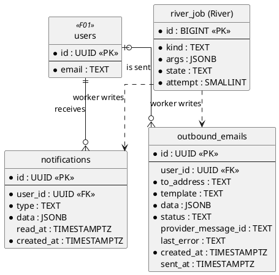
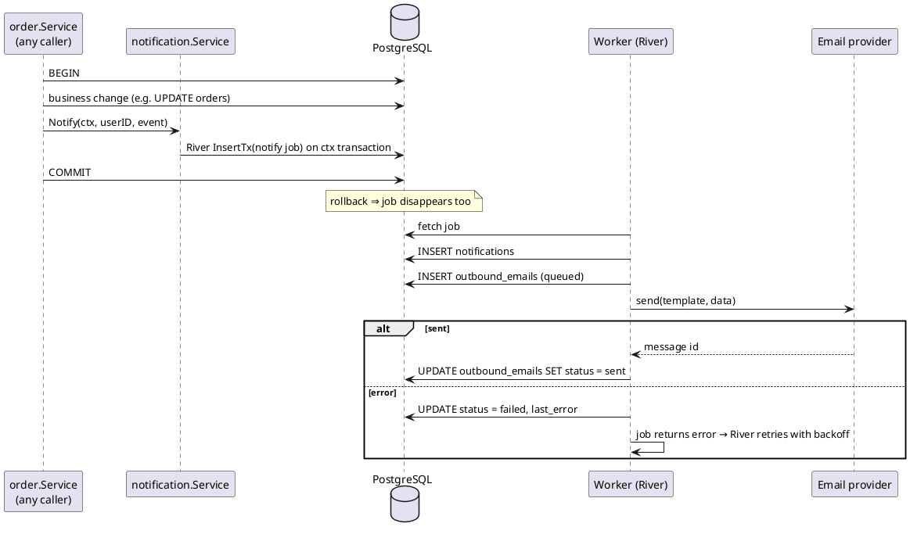
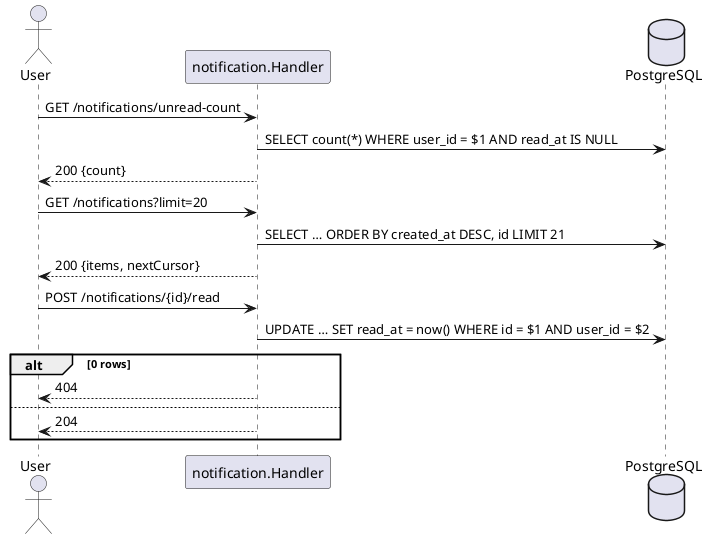

# F07 Notification

| Item    | Value                   |
| ------- | ----------------------- |
| Owner   | Azfa                    |
| Package | `internal/notification` |
| Tag     | `notification`          |
| Status  | Not started             |

## Overview

Tells users about events on their orders (requested, approved, paid, shipped, disputed, released, …) through
**in-app notifications** and **email**. Sending happens in the worker process (`cmd/worker`), never inside an API
request.

`notification.Service.Notify(ctx, userID, event)` inserts a River job on the **caller's transaction** (`InsertTx`).
If the business change rolls back, no notification is sent; if it commits, the job is guaranteed to exist. The worker
then writes the in-app row and sends/records the email.

## Business rules

- Every module that notifies depends on `notification` (one-way); `notification` imports no feature package.
- `data` holds only IDs and display values the FE needs to render; no secrets.
- Email provider is behind an interface; development uses a logging implementation (Mailpit locally).
- Retries and attempt counts live in River's tables; `outbound_emails` records the delivery outcome.
- Users only see and mark their own notifications.

### Event types (initial)

| Type                  | Recipient          | Emitted by |
| --------------------- | ------------------ | ---------- |
| `order.requested`     | jastiper           | Order      |
| `order.approved`      | buyer              | Order      |
| `order.rejected`      | buyer              | Order      |
| `order.cancelled`     | buyer, jastiper    | Order      |
| `payment.received`    | buyer, jastiper    | Payment    |
| `order.shipped`       | buyer              | Shipment   |
| `order.released`      | jastiper           | Payment    |
| `order.refunded`      | buyer              | Payment    |
| `dispute.opened`      | jastiper, admins   | Dispute    |
| `dispute.resolved`    | buyer, jastiper    | Dispute    |

## Database tables

Full DDL in [DATABASE.md](../DATABASE.md#9-f07-notification).

### `notifications`

| Column       | Type          | Notes                                              |
| ------------ | ------------- | -------------------------------------------------- |
| `id`         | `UUID` PK     |                                                    |
| `user_id`    | `UUID` FK     |                                                    |
| `type`       | `TEXT`        | e.g. `order.approved`                              |
| `data`       | `JSONB`       | IDs/values for rendering                           |
| `read_at`    | `TIMESTAMPTZ` | `NULL` = unread                                    |
| `created_at` | `TIMESTAMPTZ` |                                                    |

Indexes: `(user_id, created_at DESC)`, partial `(user_id) WHERE read_at IS NULL` for the unread count.

### `outbound_emails`

| Column                | Type          | Notes                              |
| --------------------- | ------------- | ---------------------------------- |
| `id`                  | `UUID` PK     |                                    |
| `user_id`             | `UUID` FK     | Nullable                           |
| `to_address`          | `TEXT`        |                                    |
| `template`            | `TEXT`        |                                    |
| `data`                | `JSONB`       |                                    |
| `status`              | `TEXT`        | `queued`, `sent`, `failed`         |
| `provider_message_id` | `TEXT`        |                                    |
| `last_error`          | `TEXT`        |                                    |
| `created_at`, `sent_at` | `TIMESTAMPTZ` |                                  |

## Endpoints

| Method | Path                            | operationId              | Auth     | Description                    |
| ------ | ------------------------------- | ------------------------ | -------- | ------------------------------ |
| `GET`  | `/notifications`                | `listNotifications`      | Any role | Newest first; cursor           |
| `GET`  | `/notifications/unread-count`   | `getUnreadCount`         | Any role | `{ count }`                    |
| `POST` | `/notifications/{id}/read`      | `markNotificationRead`   | Any role | Owner only (else 404)          |
| `POST` | `/notifications/read-all`       | `markAllNotificationsRead` | Any role | Marks all unread as read     |

## Sequence diagrams

<strong style="font-size:1.1em;">Notify from a business transaction</strong>

---

<strong style="font-size:1.1em;">Read notifications</strong>

---

## To do

MVP scope is defined in [README.md](README.md#mvp-scope). The MVP has no worker, so `Notify` inserts the in-app row
directly on the caller's transaction instead of enqueueing a River job. The signature stays the same, so callers do
not change when the worker arrives.

### MVP

- [ ] Migration `create_notifications` (`notifications` only) and queries.
- [ ] `Notify(ctx, userID, event)` inserting the row on the transaction in `ctx` (`database.WithTx`).
- [ ] `listNotifications`, `getUnreadCount`, `markAllNotificationsRead`. The FE polls the unread count.
- [ ] Event types for the MVP flow: `order.requested`, `order.approved`, `order.rejected`, `order.cancelled`,
      `payment.received`, `order.shipped`, `order.released`, `order.refunded`, `dispute.opened`, `dispute.resolved`.

### Post-MVP

- [ ] Platform: `cmd/worker` with River client and River migrations (PLAN section 3); move `Notify` to a River job.
- [ ] Email: choose the provider, `mailer` interface with a logging implementation, `outbound_emails`, templates
      (Indonesian copy, casual "kamu"), Mailpit in `compose.yaml`.
- [ ] `markNotificationRead` for a single notification.
