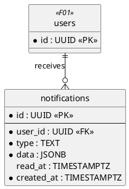
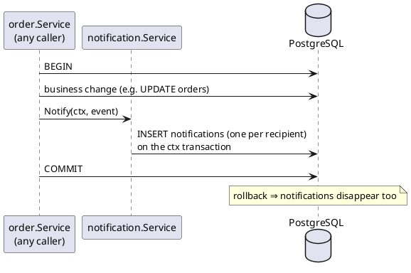
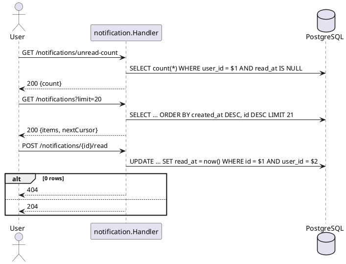

# F07 Notification

| Item    | Value                   |
| ------- | ----------------------- |
| Package | `internal/notification` |
| Tag     | `notification`          |
| Status  | Partial: endpoints and `Notify` done; wiring into modules to do |

## Overview

Tells users about events on their orders, payouts, and disputes through **in-app notifications**. The FE polls the
unread count and shows a list behind the bell icon. There is no email.

`notification.Service.Notify(ctx, event)` inserts the rows on the **caller's transaction** (the one carried in `ctx`
by `database.WithTx`). If the business change rolls back, the notification disappears with it; if it commits, the
notification exists.

## Business rules

- Every module that notifies depends on `notification` (one-way); `notification` imports no feature package.
- One event can go to several users; each gets its own row.
- `data` holds only IDs and display values the FE needs to render and link (order code, product name, amounts); no
  secrets.
- Users only see and mark their own notifications; another user's notification ID returns 404.
- The FE builds the copy from `type` and `data`.

### Event types

| Type                 | Recipient          | Emitted by | `data`                                           |
| -------------------- | ------------------ | ---------- | ------------------------------------------------ |
| `order.requested`    | jastiper           | Order      | `orderId`, `orderCode`, `productName`, `buyerName` |
| `order.approved`     | buyer              | Order      | `orderId`, `orderCode`, `total`, `paymentDeadline` |
| `order.rejected`     | buyer              | Order      | `orderId`, `orderCode`, `reason`                 |
| `order.cancelled`    | buyer, jastiper    | Order      | `orderId`, `orderCode`, `reason`                 |
| `payment.received`   | buyer, jastiper    | Payment    | `orderId`, `orderCode`, `amount`                 |
| `order.shipped`      | buyer              | Shipment   | `orderId`, `orderCode`, `method`, `trackingNumber` |
| `order.released`     | jastiper           | Payment    | `orderId`, `orderCode`, `amount` (jastiper share) |
| `order.refunded`     | buyer, jastiper    | Payment    | `orderId`, `orderCode`, `amount`                 |
| `dispute.opened`     | jastiper, admins   | Dispute    | `disputeId`, `orderId`, `orderCode`, `category`  |
| `dispute.message`    | other participants | Dispute    | `disputeId`, `orderId`, `orderCode`              |
| `dispute.resolved`   | buyer, jastiper    | Dispute    | `disputeId`, `orderId`, `orderCode`, `decision`  |
| `payout.paid`        | jastiper           | Payment    | `payoutId`, `amount`                             |
| `payout.rejected`    | jastiper           | Payment    | `payoutId`, `amount`, `reason`                   |

## Database tables

Full DDL in [DATABASE.md](../DATABASE.md#9-f07-notification).



### `notifications`

| Column       | Type          | Notes                                              |
| ------------ | ------------- | -------------------------------------------------- |
| `id`         | `UUID` PK     | UUIDv7                                             |
| `user_id`    | `UUID` FK     |                                                    |
| `type`       | `TEXT`        | See event types                                    |
| `data`       | `JSONB`       | IDs/values for rendering                           |
| `read_at`    | `TIMESTAMPTZ` | `NULL` = unread                                    |
| `created_at` | `TIMESTAMPTZ` |                                                    |

Indexes: `(user_id, created_at DESC, id DESC)`, partial `(user_id) WHERE read_at IS NULL` for the unread count.

## Endpoints

| Method | Path                            | operationId                | Auth     | Status | Description                    |
| ------ | ------------------------------- | -------------------------- | -------- | ------ | ------------------------------ |
| `GET`  | `/notifications`                | `listNotifications`        | Any role | Done   | Newest first; filter `unread`; cursor |
| `GET`  | `/notifications/unread-count`   | `getUnreadCount`           | Any role | Done   | `{ count }`                    |
| `POST` | `/notifications/{id}/read`      | `markNotificationRead`     | Any role | Done   | Owner only (else 404); idempotent; 204 |
| `POST` | `/notifications/read-all`       | `markAllNotificationsRead` | Any role | Done   | Marks all unread as read; 204  |

### `GET /notifications`

Query: `unread` (bool, default `false`), `limit` (1–100, default 20), `cursor`. Response:

```json
{
  "items": [
    {
      "id": "0192…",
      "type": "order.approved",
      "data": { "orderId": "0192…", "orderCode": "TD-7KQ2MX", "total": 1250000, "paymentDeadline": "2026-10-18T09:00:00Z" },
      "readAt": null,
      "createdAt": "2026-10-17T09:00:00Z"
    }
  ],
  "nextCursor": "…"
}
```

`readAt` is omitted while unread. Errors: 401, 422 (bad cursor or limit). Marking an already-read notification
again keeps the first `readAt` and returns 204.

### Service API

```go
type Event struct {
    Type       string
    Recipients []uuid.UUID
    Data       map[string]any
}

Notify(ctx context.Context, e Event) error   // one row per distinct recipient on ctx's transaction; uuid.Nil is skipped
AdminIDs(ctx context.Context) ([]uuid.UUID, error)
```

## Sequence diagrams

<details>
<summary><strong style="font-size:1.1em;">Notify from a business transaction</strong></summary>

---



</details>

<details>
<summary><strong style="font-size:1.1em;">Read notifications</strong></summary>

---



</details>

## Remaining work

Done:

- [x] Migration `create_notifications` and queries.
- [x] `Notify` and `AdminIDs`.
- [x] `listNotifications`, `getUnreadCount`, `markNotificationRead`, `markAllNotificationsRead`.
- [x] Service and handler tests; integration test that a rolled-back transaction leaves no notification.

Remaining:

- [ ] Wire `Notify` into Order, Payment, Shipment, and Dispute for every event type above.
