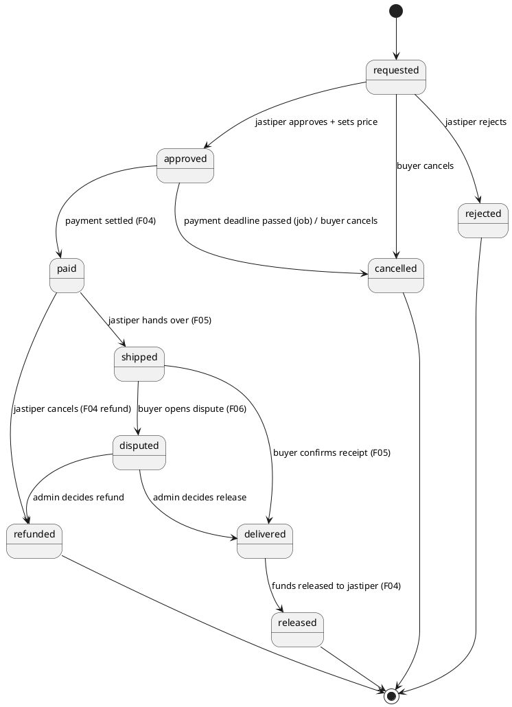
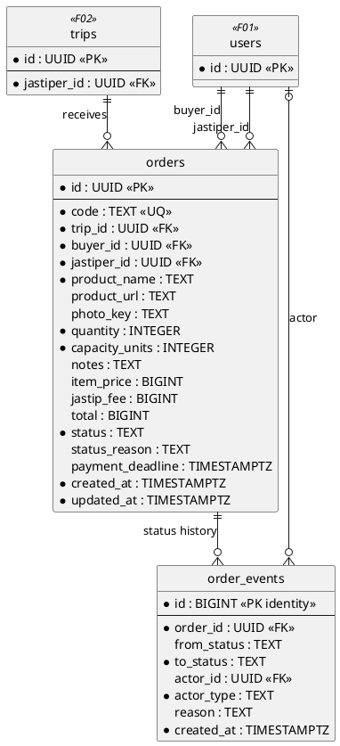
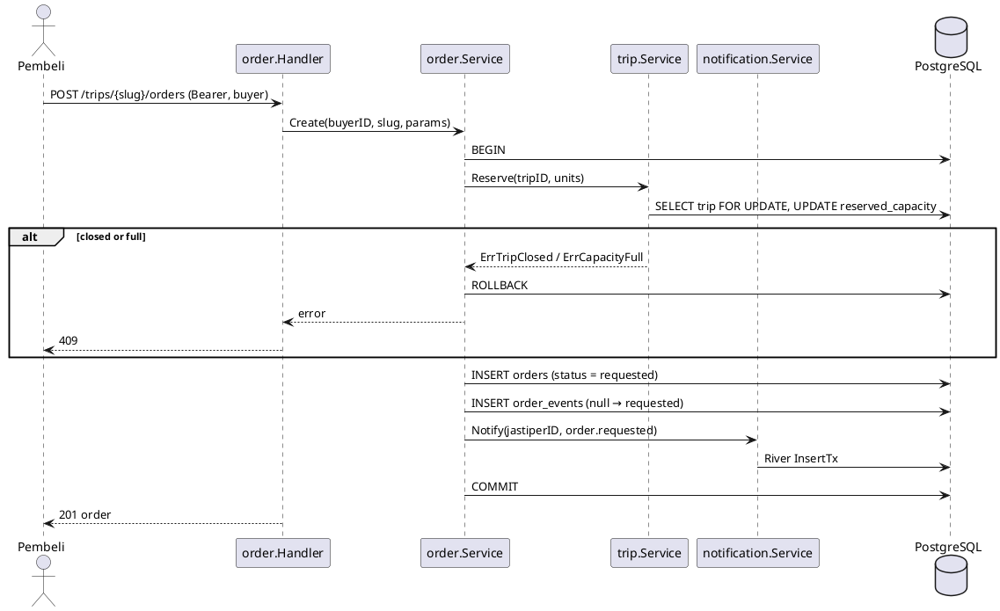
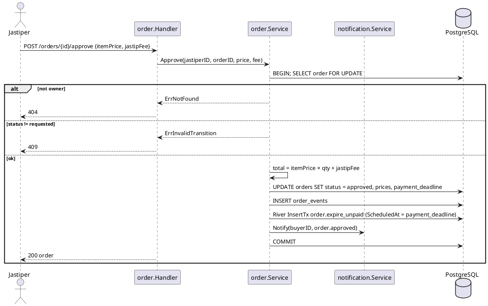
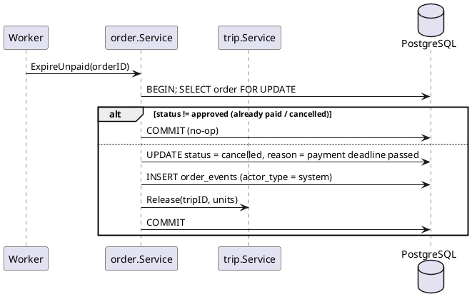

# F03 Order

| Item    | Value            |
| ------- | ---------------- |
| Owner   | Alfian           |
| Package | `internal/order` |
| Tag     | `order`          |
| Status  | Not started      |

## Overview

A buyer requests an item on a jastiper's trip. The jastiper approves it with a price and fee (or rejects it), the
buyer pays (F04), the jastiper ships (F05), and the funds are released when the buyer confirms receipt.

Order owns the **state machine**: `orders.status` is changed only by this service. Other modules call explicit
methods (`MarkPaid`, `MarkShipped`, …), never a generic `SetStatus`.

## State machine

| Method            | From → To                       | Actor             | Called by              |
| ----------------- | ------------------------------- | ----------------- | ---------------------- |
| `Create`          | – → `requested`                 | buyer             | Order handler          |
| `Approve`         | `requested` → `approved`        | jastiper (owner)  | Order handler          |
| `Reject`          | `requested` → `rejected`        | jastiper (owner)  | Order handler          |
| `Cancel`          | `requested`/`approved` → `cancelled` | buyer / system | Order handler, expire job |
| `MarkPaid`        | `approved` → `paid`             | system            | Payment                |
| `MarkShipped`     | `paid` → `shipped`              | jastiper          | Shipment               |
| `MarkDelivered`   | `shipped` → `delivered`         | buyer             | Shipment               |
| `MarkDisputed`    | `shipped` → `disputed`          | buyer             | Dispute                |
| `ResolveDispute`  | `disputed` → `delivered`/`refunded` | admin         | Dispute                |
| `MarkReleased`    | `delivered` → `released`        | system            | Payment                |
| `MarkRefunded`    | `paid`/`disputed` → `refunded`  | jastiper / admin  | Payment                |

## Business rules

- Buyer and jastiper must differ. `jastiper_id` is copied from the trip for access checks.
- Creating an order reserves trip capacity (`trip.Reserve`); reject, cancel, and refund release it.
- On approval: `total = item_price × quantity + jastip_fee`, all integer rupiah, computed only in the backend.
  `payment_deadline` is set (window still open, PLAN section 7 decision 5).
- Every transition, in **one transaction**: lock the order (`SELECT … FOR UPDATE`), check the transition table and the
  actor, update `status`, insert `order_events`, enqueue a notification (River `InsertTx`).
- Ownership: a buyer sees only their orders, a jastiper only orders on their trips. Others get 404.

## Database tables

Full DDL in [DATABASE.md](../DATABASE.md#5-f03-order).

### `orders`

| Column             | Type          | Notes                                                    |
| ------------------ | ------------- | -------------------------------------------------------- |
| `id`               | `UUID` PK     |                                                          |
| `code`             | `TEXT`        | Unique human-friendly reference, e.g. `TD-7K3P9Q`         |
| `trip_id`          | `UUID` FK     | → `trips.id`                                             |
| `buyer_id`         | `UUID` FK     | → `users.id`                                             |
| `jastiper_id`      | `UUID` FK     | → `users.id`, `<> buyer_id`                              |
| `product_name`     | `TEXT`        | ≤ 200                                                    |
| `product_url`      | `TEXT`        | ≤ 2000, nullable                                         |
| `photo_key`        | `TEXT`        | Blob key, nullable                                       |
| `quantity`         | `INTEGER`     | `> 0`                                                    |
| `capacity_units`   | `INTEGER`     | Trip capacity reserved                                   |
| `notes`            | `TEXT`        | ≤ 1000                                                   |
| `item_price`       | `BIGINT`      | Per unit, set on approval                                |
| `jastip_fee`       | `BIGINT`      | Whole order, set on approval                             |
| `total`            | `BIGINT`      | `= item_price × quantity + jastip_fee`                   |
| `status`           | `TEXT`        | See state machine (lowercase)                            |
| `status_reason`    | `TEXT`        | Rejection / cancellation reason                          |
| `payment_deadline` | `TIMESTAMPTZ` | Set on approval                                          |
| `created_at`, `updated_at` | `TIMESTAMPTZ` |                                                  |

### `order_events` (append-only)

| Column        | Type          | Notes                                          |
| ------------- | ------------- | ---------------------------------------------- |
| `id`          | `BIGINT` identity PK |                                         |
| `order_id`    | `UUID` FK     |                                                |
| `from_status` | `TEXT`        | `NULL` for the creating event                  |
| `to_status`   | `TEXT`        |                                                |
| `actor_id`    | `UUID` FK     | `NULL` when the system acted                   |
| `actor_type`  | `TEXT`        | `buyer`, `jastiper`, `admin`, `system`         |
| `reason`      | `TEXT`        |                                                |
| `created_at`  | `TIMESTAMPTZ` | Timeline timestamps (paid at, shipped at, …)   |

## Endpoints

| Method | Path                        | operationId          | Auth                 | Description                                  |
| ------ | --------------------------- | -------------------- | -------------------- | -------------------------------------------- |
| `POST` | `/trips/{slug}/orders`      | `createOrder`        | `buyer`              | Request an item on a trip                    |
| `GET`  | `/orders`                   | `listOrders`         | `buyer`, `jastiper`  | Caller's orders (view depends on role); cursor |
| `GET`  | `/orders/{id}`              | `getOrder`           | owner buyer/jastiper, admin | Detail + event timeline               |
| `GET`  | `/me/trips/{id}/orders`     | `listTripOrders`     | `jastiper` (owner)   | Jastiper inbox per trip                      |
| `POST` | `/orders/{id}/approve`      | `approveOrder`       | `jastiper` (owner)   | Body `{ itemPrice, jastipFee }`              |
| `POST` | `/orders/{id}/reject`       | `rejectOrder`        | `jastiper` (owner)   | Body `{ reason }`                            |
| `POST` | `/orders/{id}/cancel`       | `cancelOrder`        | `buyer` (owner)      | Before payment only                          |

Invalid transitions return `409 Conflict`.

### Jobs

| Job                    | Scheduled                    | Action                                                          |
| ---------------------- | ---------------------------- | --------------------------------------------------------------- |
| `order.expire_unpaid`  | At approval, runs at `payment_deadline` | If still `approved`: `cancelled`, release trip capacity |

## Sequence diagrams

<strong style="font-size:1.1em;">Create order</strong>

---

<strong style="font-size:1.1em;">Approve order</strong>

---

<strong style="font-size:1.1em;">Expire unpaid order (job)</strong>

---

## To do

MVP scope is defined in [README.md](README.md#mvp-scope).

### MVP

- [ ] Decide the payment deadline window, for example 24 hours after approval (PLAN section 7, decision 5).
- [ ] Platform prerequisite: `database.WithTx` (PLAN section 3).
- [ ] Migration `create_orders` (`orders`, `order_events`) and queries. `capacity_units` and `photo_key` are left out
      (no trip capacity, no uploads in the MVP).
- [ ] Full transition table (from, to, allowed actor) and all explicit methods listed above; this is the core of the
      service and is not cut.
- [ ] Order code generator (`TD-XXXXXX`, unique, retry on conflict).
- [ ] Endpoints `createOrder` (rejects `closed` trips and requests after the deadline), `listOrders` (buyer or
      jastiper view by role), `getOrder` (with timeline), `approveOrder`, `rejectOrder`, `cancelOrder` (before
      payment only).
- [ ] Unpaid orders without a job: payment creation is refused after `payment_deadline`, and an `approved` order
      past its deadline is cancelled when it is next read or acted on (`actor_type = system`).
- [ ] Notifications in the same transaction through `notification.Notify` (in-app row, no River).
- [ ] Integration tests (testcontainers) for concurrent transitions.

### Post-MVP

- [ ] Worker + River (PLAN section 3) and the `order.expire_unpaid` job, replacing the on-read cancellation.
- [ ] Trip capacity: `capacity_units`, `trip.Reserve`/`Release` in the order transaction.
- [ ] Product photo through blob SAS uploads.
- [ ] `GET /me/trips/{id}/orders` jastiper inbox per trip (`GET /orders` covers it in the MVP).
