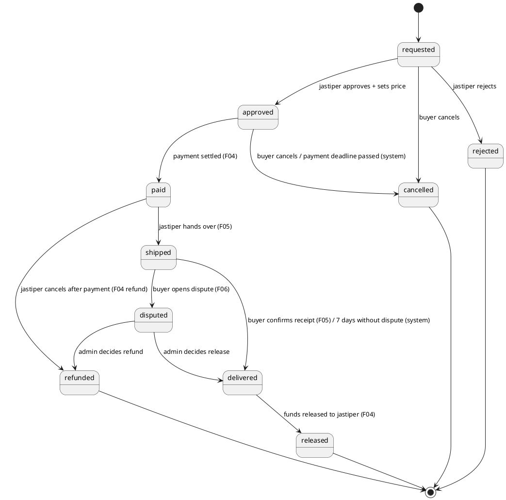
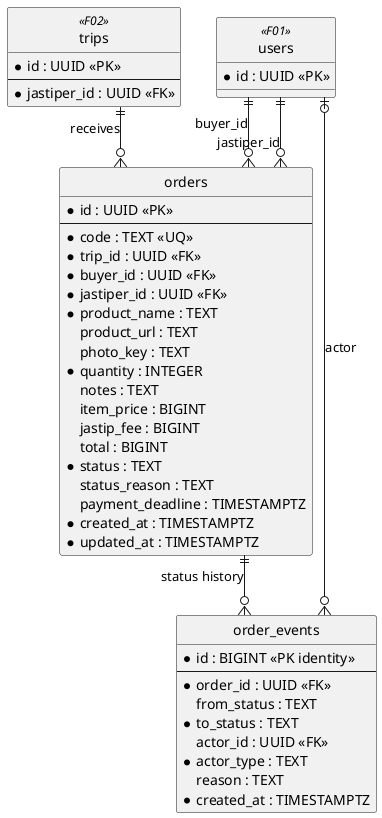
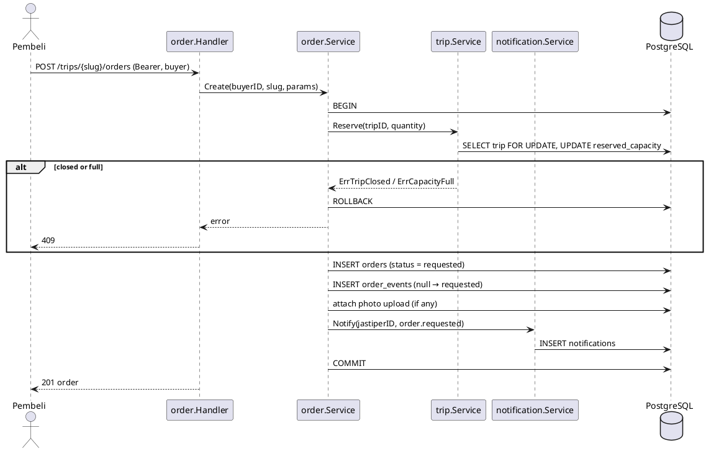
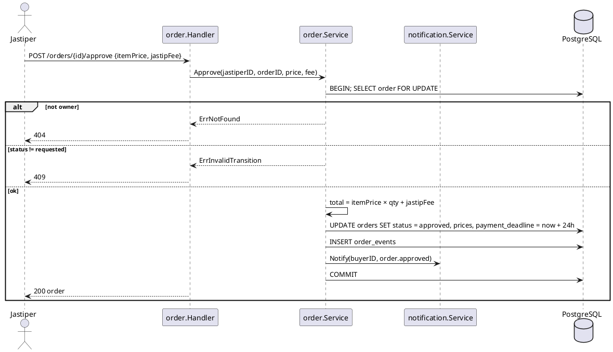
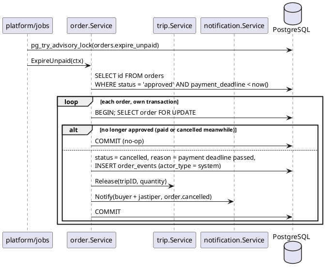

# F03 Order

| Item    | Value                                                                        |
| ------- | ---------------------------------------------------------------------------- |
| Package | `internal/order`                                                             |
| Tag     | `order`                                                                      |
| Status  | Partial: state machine, endpoints, notifications, capacity done; photo, trip inbox to do |

## Overview

A buyer requests an item on a jastiper's trip. The jastiper approves it with a price and fee (or rejects it), the
buyer pays (F04), the jastiper ships (F05), and the funds are released when the buyer confirms receipt.

Order owns the **state machine**: `orders.status` is changed only by this service. Other modules call explicit
methods (`MarkPaid`, `MarkShipped`, …), never a generic `SetStatus`.

## State machine

| Method            | From → To                            | Actor             | Called by                     |
| ----------------- | ------------------------------------ | ----------------- | ----------------------------- |
| `Create`          | – → `requested`                      | buyer             | Order handler                 |
| `Approve`         | `requested` → `approved`             | jastiper (owner)  | Order handler                 |
| `Reject`          | `requested` → `rejected`             | jastiper (owner)  | Order handler                 |
| `Cancel`          | `requested`/`approved` → `cancelled` | buyer (owner)     | Order handler                 |
| `ExpireUnpaid`    | `approved` → `cancelled`             | system            | Payment checkout, read path, job `orders.expire_unpaid` |
| `MarkPaid`        | `approved` → `paid`                  | system            | Payment                       |
| `MarkShipped`     | `paid` → `shipped`                   | jastiper (owner)  | Shipment                      |
| `MarkDelivered`   | `shipped` → `delivered`              | buyer (owner) / system | Shipment, auto-release job |
| `MarkDelivered`   | `disputed` → `delivered`             | admin             | Dispute (release decision)    |
| `MarkDisputed`    | `shipped` → `disputed`               | buyer (owner)     | Dispute                       |
| `MarkReleased`    | `delivered` → `released`             | system            | Payment                       |
| `MarkRefunded`    | `paid` → `refunded`                  | jastiper (owner)  | Payment (jastiper cancel)     |
| `MarkRefunded`    | `disputed` → `refunded`              | admin             | Payment (dispute refund)      |

## Business rules

- Buyer and jastiper must differ. `jastiper_id` is copied from the trip for access checks.
- Creating an order reserves `quantity` items of trip capacity (`trip.Reserve`). Reject, cancel, expiry, and refund
  release it (`trip.Release`). Delivered and released orders keep it: the item was carried.
- On approval: `total = item_price × quantity + jastip_fee`, all integer rupiah, computed only in the backend.
  `payment_deadline = now + 24h`.
- An `approved` order past its `payment_deadline` is cancelled by the system: by the `orders.expire_unpaid` job, when
  the order is read, and when checkout is attempted.
- Every transition, in **one transaction**: lock the order (`SELECT … FOR UPDATE`), check the transition table and
  the actor, update `status`, insert `order_events`, release capacity where needed, and notify (F07).
- Ownership: a buyer sees only their orders, a jastiper only orders on their trips, an admin every order. Others get
  404.
- The product photo is optional, an upload with purpose `order_photo`.

### Notifications sent

| Transition                       | Type              | Recipient        |
| -------------------------------- | ----------------- | ---------------- |
| → `requested`                    | `order.requested` | jastiper         |
| → `approved`                     | `order.approved`  | buyer            |
| → `rejected`                     | `order.rejected`  | buyer            |
| → `cancelled` (buyer)            | `order.cancelled` | jastiper         |
| → `cancelled` (payment deadline) | `order.cancelled` | buyer, jastiper  |

Payment, Shipment, and Dispute send the notifications for the transitions they drive.

## Database tables

Full DDL in [DATABASE.md](../DATABASE.md#5-f03-order).

### `orders`

| Column             | Type          | Notes                                                    |
| ------------------ | ------------- | -------------------------------------------------------- |
| `id`               | `UUID` PK     | UUIDv7                                                   |
| `code`             | `TEXT`        | Unique human-friendly reference, e.g. `TD-7K3P9Q`         |
| `trip_id`          | `UUID` FK     | → `trips.id`                                             |
| `buyer_id`         | `UUID` FK     | → `users.id`                                             |
| `jastiper_id`      | `UUID` FK     | → `users.id`, `<> buyer_id`                              |
| `product_name`     | `TEXT`        | ≤ 200                                                    |
| `product_url`      | `TEXT`        | ≤ 2000, default `''`                                     |
| `photo_key`        | `TEXT`        | Blob key, nullable (to add)                              |
| `quantity`         | `INTEGER`     | `> 0`; also the trip capacity this order reserves        |
| `notes`            | `TEXT`        | ≤ 1000                                                   |
| `item_price`       | `BIGINT`      | Per unit, set on approval                                |
| `jastip_fee`       | `BIGINT`      | Whole order, set on approval                             |
| `total`            | `BIGINT`      | `= item_price × quantity + jastip_fee`                   |
| `status`           | `TEXT`        | See state machine (lowercase)                            |
| `status_reason`    | `TEXT`        | Rejection / cancellation reason                          |
| `payment_deadline` | `TIMESTAMPTZ` | Set on approval                                          |
| `created_at`, `updated_at` | `TIMESTAMPTZ` |                                                  |

### `order_events` (append-only)

| Column        | Type          | Notes                                          |
| ------------- | ------------- | ---------------------------------------------- |
| `id`          | `BIGINT` identity PK |                                         |
| `order_id`    | `UUID` FK     |                                                |
| `from_status` | `TEXT`        | `NULL` for the creating event                  |
| `to_status`   | `TEXT`        |                                                |
| `actor_id`    | `UUID` FK     | `NULL` when the system acted                   |
| `actor_type`  | `TEXT`        | `buyer`, `jastiper`, `admin`, `system`         |
| `reason`      | `TEXT`        |                                                |
| `created_at`  | `TIMESTAMPTZ` | Timeline timestamps (paid at, shipped at, …)   |

## Endpoints

| Method | Path                        | operationId          | Auth                        | Status | Description                                  |
| ------ | --------------------------- | -------------------- | --------------------------- | ------ | -------------------------------------------- |
| `POST` | `/trips/{slug}/orders`      | `createOrder`        | `buyer`                     | Done   | Request an item on a trip                    |
| `GET`  | `/orders`                   | `listOrders`         | `buyer`, `jastiper`         | Done   | Caller's orders (view depends on role); filter `status`; cursor |
| `GET`  | `/orders/{id}`              | `getOrder`           | owner buyer/jastiper, admin | Done   | Detail + event timeline                      |
| `POST` | `/orders/{id}/approve`      | `approveOrder`       | `jastiper` (owner)          | Done   | Body `{ itemPrice, jastipFee }`              |
| `POST` | `/orders/{id}/reject`       | `rejectOrder`        | `jastiper` (owner)          | Done   | Body `{ reason }`                            |
| `POST` | `/orders/{id}/cancel`       | `cancelOrder`        | `buyer` (owner)             | Done   | Before payment only                          |
| `GET`  | `/me/trips/{id}/orders`     | `listTripOrders`     | `jastiper` (owner)          | To do  | Jastiper inbox for one trip; filter `status`; cursor |

`createOrder` gains an optional `photoUploadId`; order responses gain a signed `photoUrl`.

Invalid transitions return `409 Conflict`; a full trip returns `409` with `Trip is full.`

## Sequence diagrams

<strong style="font-size:1.1em;">Create order</strong>

---

<strong style="font-size:1.1em;">Approve order</strong>

---

<strong style="font-size:1.1em;">Expire unpaid orders (job)</strong>

---

## Remaining work

Done:

- [x] `orders` and `order_events`, the full transition table, and the explicit methods.
- [x] Order code generator (`TD-XXXXXX`, unique, retry on conflict).
- [x] `createOrder`, `listOrders`, `getOrder` (with timeline), `approveOrder`, `rejectOrder`, `cancelOrder`.
- [x] Unpaid orders past the deadline are cancelled on read and on checkout.
- [x] Notifications (F07) inside each transition's transaction, including the expiry on read.
- [x] Capacity: `trip.Reserve` on create, `trip.Release` on reject, cancel, expiry, and refund.

Remaining:

- [ ] Transition `shipped → delivered` by the system, for auto-release.
- [ ] `photo_key` column, `photoUploadId` on create, `photoUrl` in responses.
- [ ] `GET /me/trips/{id}/orders`.
- [ ] Job `orders.expire_unpaid`.
- [ ] Integration test for concurrent transitions on the same order.
