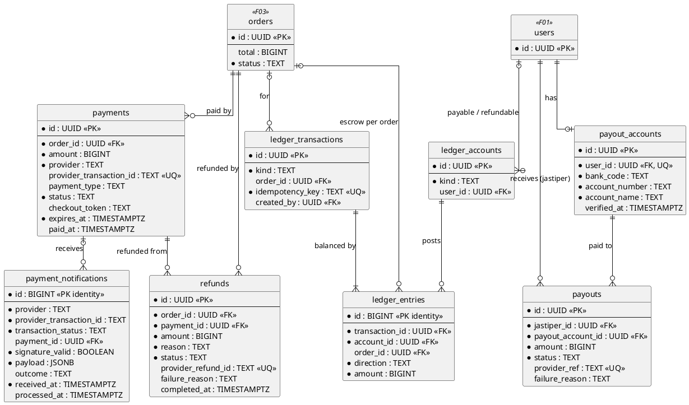
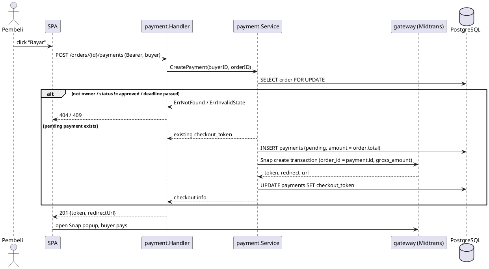
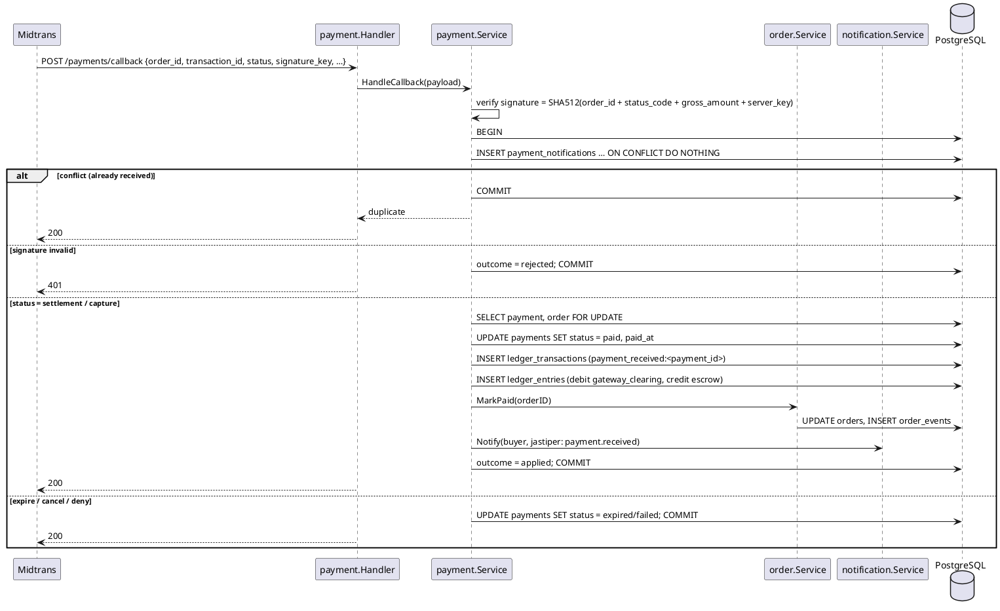
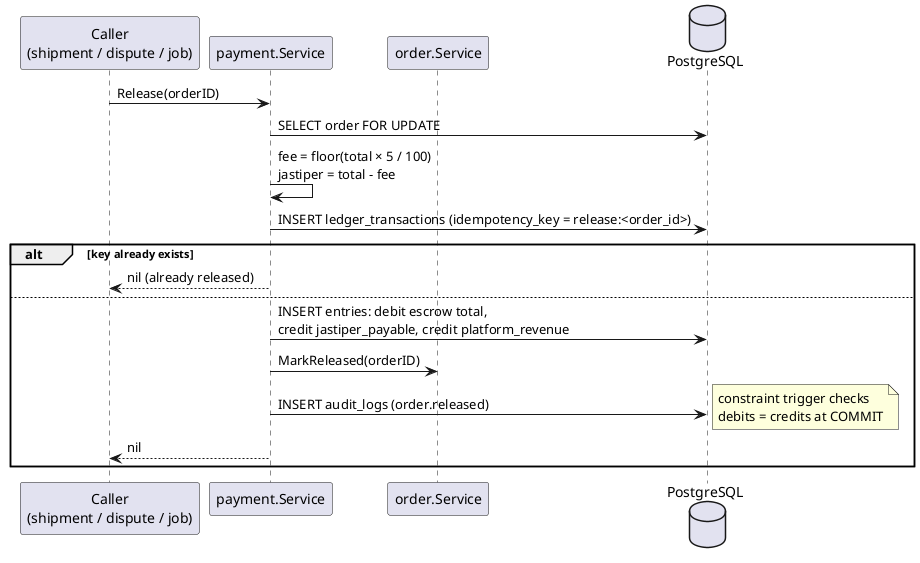

# F04 Payment & Escrow

| Item    | Value              |
| ------- | ------------------ |
| Owner   | Barru              |
| Package | `internal/payment` |
| Tag     | `payment`          |
| Status  | Not started        |

## Overview

The buyer pays the approved order total through **Midtrans Snap**. The money is held in escrow (in the ledger) until
the order is delivered, then released to the jastiper minus a **5% platform fee**, or refunded to the buyer.

Payment is the only module that writes ledger rows. It changes order status only through the order service
(`MarkPaid`, `MarkReleased`, `MarkRefunded`).

The gateway sits behind a `gateway` interface: a Midtrans adapter (sandbox for staging, production) and an in-memory
fake for tests. The Midtrans server key lives only in backend secrets.

## Business rules

- Money is `BIGINT` whole rupiah. No floats.
- One live payment attempt per order (`pending` or `paid`), never two successful payments.
- The payment `id` is sent to Midtrans as `order_id`, so every attempt is unique on the gateway side.
- Callbacks are verified by signature key, stored in `payment_notifications` **before** processing, and deduplicated
  by `UNIQUE (provider, provider_transaction_id, transaction_status)`. A duplicate answers 200 and does nothing.
- Every money movement runs in one transaction with a row lock on the order: ledger transaction + order status +
  notification job + audit log.
- Ledger is append-only (trigger + grants), double-entry enforced by a deferred constraint trigger (debits = credits,
  ≥ 2 entries). Balances are sums of entries, never stored.
- `ledger_transactions.idempotency_key` (e.g. `release:<order_id>`) prevents posting twice on retry.
- Platform fee = `floor(total × 5 / 100)`; the remainder goes to the jastiper, so no rupiah is lost.

### Ledger postings (order total Rp 1.000.000)

| Event                       | Debit                        | Credit                                                  |
| --------------------------- | ---------------------------- | ------------------------------------------------------- |
| Payment settled             | `gateway_clearing` 1.000.000 | `escrow` 1.000.000                                      |
| Release to jastiper         | `escrow` 1.000.000           | `jastiper_payable` 950.000, `platform_revenue` 50.000   |
| Refund decided              | `escrow` 1.000.000           | `buyer_refundable` 1.000.000                            |
| Refund completed at gateway | `buyer_refundable` 1.000.000 | `gateway_clearing` 1.000.000                            |
| Payout to jastiper          | `jastiper_payable` 950.000   | `gateway_clearing` 950.000                              |

## Database tables

Full DDL in [DATABASE.md](../DATABASE.md#6-f04-payment--escrow).

| Table                   | Purpose                                                           | Key columns                                                                     |
| ----------------------- | ----------------------------------------------------------------- | ------------------------------------------------------------------------------- |
| `payments`              | One row per checkout attempt                                      | `order_id`, `amount`, `status` (`pending/paid/failed/expired/cancelled`), `provider_transaction_id` UNIQUE, `checkout_token`, `expires_at`, `paid_at` |
| `payment_notifications` | Every gateway callback, idempotency + reconciliation evidence     | `provider_transaction_id`, `transaction_status`, `signature_valid`, `payload` JSONB, `outcome` (`applied/duplicate/ignored/rejected`) |
| `refunds`               | Refund to buyer                                                   | `order_id`, `payment_id`, `amount`, `reason` (`jastiper_cancelled/dispute_refund`), `status`, `provider_refund_id` |
| `ledger_accounts`       | Accounts                                                          | `kind` (`gateway_clearing/escrow/jastiper_payable/platform_revenue/buyer_refundable`), `user_id` for per-user kinds |
| `ledger_transactions`   | One business event                                                | `kind` (`payment_received/release/refund/refund_paid/payout`), `order_id`, `idempotency_key` UNIQUE |
| `ledger_entries`        | Debit/credit lines                                                | `transaction_id`, `account_id`, `order_id`, `direction`, `amount > 0`           |
| `payout_accounts`       | Jastiper bank account (encrypted number)                          | `user_id` UNIQUE, `bank_code`, `account_number`, `account_name`                 |
| `payouts`               | Disbursement to a jastiper                                        | `jastiper_id`, `amount`, `status` (`requested/processing/paid/failed`)          |

Important indexes: `payments_one_active_per_order` (partial unique on `order_id` where `pending`/`paid`),
`refunds_one_per_order`, `ledger_entries_account_idx`, `ledger_entries_order_idx`.

## Endpoints

| Method | Path                       | operationId              | Auth              | Description                                     |
| ------ | -------------------------- | ------------------------ | ----------------- | ----------------------------------------------- |
| `POST` | `/orders/{id}/payments`    | `createPayment`          | `buyer` (owner)   | Create (or reuse pending) Snap checkout for the order total |
| `POST` | `/payments/callback`       | `handlePaymentCallback`  | Midtrans signature | Midtrans HTTP notification                     |
| `GET`  | `/wallet`                  | `getWallet`              | `jastiper`        | Balance (`jastiper_payable`) and pending escrow |
| `GET`  | `/wallet/transactions`     | `listWalletTransactions` | `jastiper`        | Ledger entries of the caller; cursor            |

### Service methods for other modules

| Method                          | Caller                       | Effect                                                |
| ------------------------------- | ---------------------------- | ----------------------------------------------------- |
| `Release(ctx, orderID)`         | Shipment, Dispute, release job | `escrow → jastiper_payable + platform_revenue`, `order.MarkReleased` |
| `Refund(ctx, orderID, reason)`  | Dispute, jastiper cancel     | `escrow → buyer_refundable`, refund at gateway, `order.MarkRefunded` |

### Jobs

| Job                     | Scheduled                    | Action                                  |
| ----------------------- | ---------------------------- | --------------------------------------- |
| `payment.auto_release`  | N days after `shipped` (window open, decision 5) | If still `shipped`/`delivered`: release |

## Sequence diagrams

<strong style="font-size:1.1em;">Checkout</strong>

---

<strong style="font-size:1.1em;">Payment callback (idempotent)</strong>

---

<strong style="font-size:1.1em;">Release to jastiper</strong>

---

## To do

MVP scope is defined in [README.md](README.md#mvp-scope). The money rules (double-entry ledger, idempotent
callbacks, one transaction with an order row lock) are **not** cut for the MVP.

### MVP

- [ ] Midtrans sandbox account for development; before production, confirm that holding funds and paying jastipers
      out manually is allowed (PLAN section 7, decision 1).
- [ ] Migrations: `payments`, `payment_notifications`, `refunds`, the three ledger tables with append-only and
      balance triggers, grants.
  - [x] `payments` and the three ledger tables with append-only and balance triggers.
  - [ ] `payment_notifications`, `refunds`, grants.
- [ ] `gateway` interface, Midtrans adapter (Snap + notification signature), in-memory fake.
  - [x] `Gateway` interface and fake gateway (`PAYMENT_GATEWAY=fake`).
  - [ ] Midtrans Snap adapter and notification signature check (deferred for the demo).
- [ ] `POST /orders/{id}/payments` (refused after `payment_deadline`) and `POST /payments/callback`.
  - [x] `POST /orders/{id}/payments`, refused after `payment_deadline`.
  - [x] `POST /payments/{id}/simulate` (fake mode only), settling through the same path the callback will use.
  - [ ] `POST /payments/callback`.
- [x] `Release(orderID)` with the 5% fee, called by Shipment on confirm receipt and by Dispute on a `release`
      decision. Shipment calls it; the Dispute call comes with F06.
- [ ] `Refund(orderID, reason)` from a dispute decision: ledger posting and a `refunds` row. The money goes back to
      the buyer **manually through the Midtrans dashboard**; an admin then marks the refund `succeeded`.
- [x] `GET /wallet` for the jastiper's balance.
- [ ] Manual payouts: an admin transfers to the jastiper outside the system, using the F08 transactions list.
- [ ] Integration tests: duplicate callbacks, concurrent release/refund, ledger balance.
  - [x] Ledger balance, checkout after the deadline, and the payment → release flow (`integration_test.go`).
  - [ ] Duplicate callbacks and concurrent release/refund.

### Post-MVP

- [ ] Decide the auto-release window (decision 5) and add the `payment.auto_release` job (needs the worker). In the
      MVP, a buyer who never confirms is handled by an admin through a dispute.
- [ ] Refund through the Midtrans refund API instead of the dashboard.
- [ ] Refund when the jastiper cancels after payment (`paid → refunded`); handled by admin/dispute in the MVP.
- [ ] `payout_accounts`, `payouts`, and the `payout` ledger posting once decision 1 is made.
- [ ] `GET /wallet/transactions`.
- [ ] Reconciliation job for `pending` payments (Midtrans status API).
