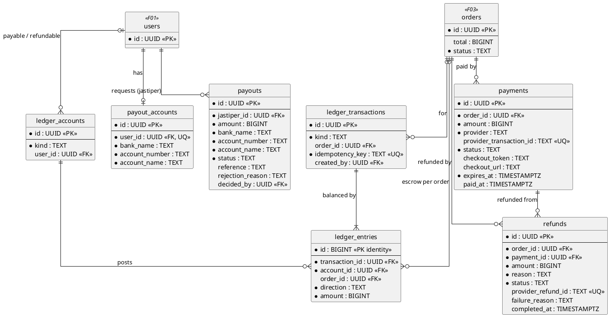
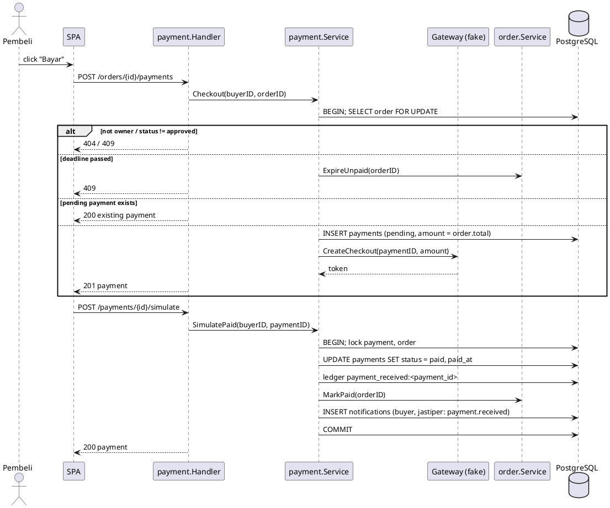
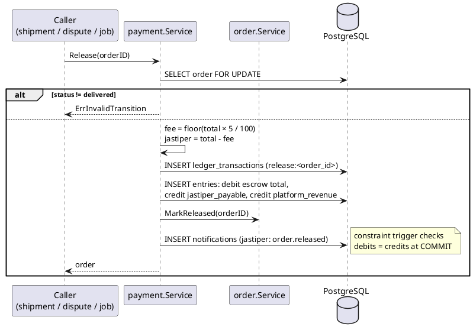
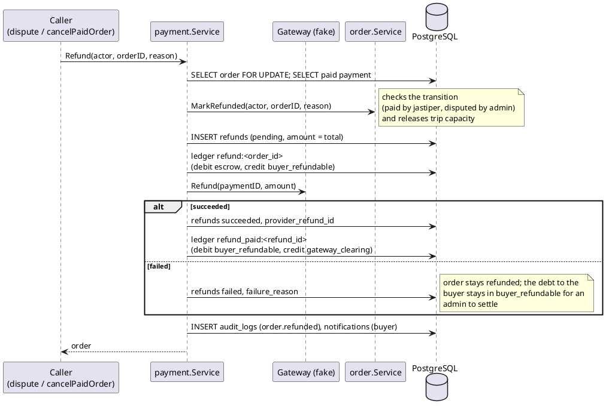
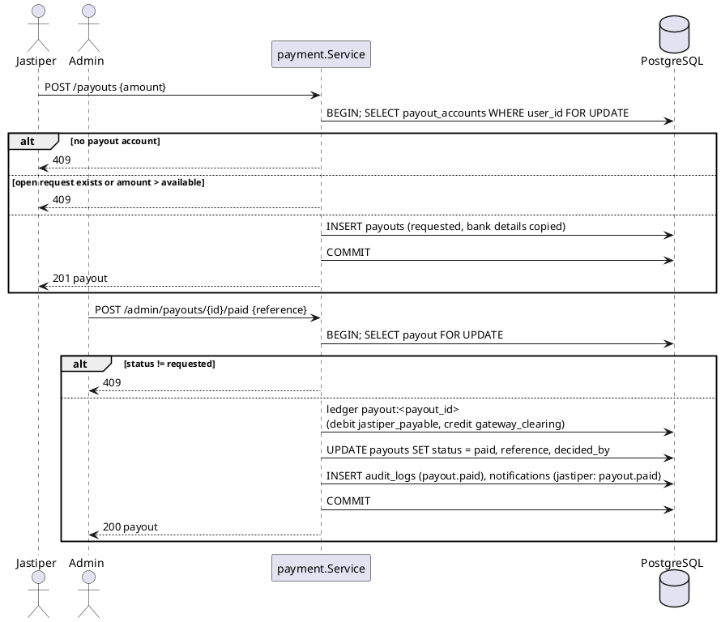

# F04 Payment & Escrow

| Item    | Value                                                                              |
| ------- | ---------------------------------------------------------------------------------- |
| Package | `internal/payment`                                                                 |
| Tag     | `payment`                                                                          |
| Status  | Partial: checkout, settlement, ledger, release, wallet balance done; refunds, payouts, wallet history, auto-release to do |

## Overview

The buyer pays the approved order total. The money is held in **escrow** (in the ledger) until the order is
delivered, then released to the jastiper minus a **5% platform fee**, or refunded to the buyer. Jastipers withdraw
their earnings through payout requests that an admin pays by bank transfer.

Payment is the only module that writes ledger rows. It changes order status only through the order service
(`MarkPaid`, `MarkReleased`, `MarkRefunded`).

The gateway sits behind the `Gateway` interface. The only implementation is the **fake gateway**
(`PAYMENT_GATEWAY=fake`): checkout returns a token, the buyer completes payment with `POST /payments/{id}/simulate`,
and refunds succeed immediately. `simulate` settles through the same `Settle` method a real gateway callback would
call. A Midtrans adapter is out of scope ([PLAN.md](../PLAN.md#7-not-in-scope)).

```go
type Gateway interface {
    Name() string
    CreateCheckout(ctx context.Context, r CheckoutRequest) (Checkout, error)
    Refund(ctx context.Context, r RefundRequest) (RefundResult, error)   // to add
}
```

## Business rules

- Money is `BIGINT` whole rupiah. No floats.
- One live payment attempt per order (`pending` or `paid`), never two successful payments.
- Checkout is refused after the order's `payment_deadline` (the order is cancelled instead).
- Every money movement runs in one transaction with a row lock on the order: ledger transaction + order status +
  notification + audit log.
- Ledger is append-only (trigger), double-entry enforced by a deferred constraint trigger (debits = credits, ≥ 2
  entries). Balances are sums of entries, never stored.
- `ledger_transactions.idempotency_key` (e.g. `release:<order_id>`) prevents posting twice on retry.
- Platform fee = `floor(total × 5 / 100)`; the remainder goes to the jastiper, so no rupiah is lost.
- **Release** happens when the order becomes `delivered`: buyer confirmation, an admin's release decision, or the
  `orders.auto_release` job 7 days after shipping.
- **Refund** (whole order total) happens when the jastiper cancels a `paid` order, or an admin decides a dispute as
  `refund`. Capacity is released on the trip.
- **Payouts**: a jastiper with a saved payout account requests an amount up to their available balance
  (`jastiper_payable` balance minus payouts still `requested`). An admin transfers outside the system, then marks it
  `paid` (ledger posting) or `rejected` with a reason (no posting). One open request per jastiper at a time.

### Ledger postings (order total Rp 1.000.000)

| Event                         | Transaction kind   | Debit                        | Credit                                                  |
| ----------------------------- | ------------------ | ---------------------------- | ------------------------------------------------------- |
| Payment settled               | `payment_received` | `gateway_clearing` 1.000.000 | `escrow` 1.000.000                                      |
| Release to jastiper           | `release`          | `escrow` 1.000.000           | `jastiper_payable` 950.000, `platform_revenue` 50.000   |
| Refund decided                | `refund`           | `escrow` 1.000.000           | `buyer_refundable` 1.000.000                            |
| Refund completed at gateway   | `refund_paid`      | `buyer_refundable` 1.000.000 | `gateway_clearing` 1.000.000                            |
| Payout paid to jastiper       | `payout`           | `jastiper_payable` 950.000   | `gateway_clearing` 950.000                              |

Idempotency keys: `payment_received:<payment_id>`, `release:<order_id>`, `refund:<order_id>`,
`refund_paid:<refund_id>`, `payout:<payout_id>`.

## Database tables

Full DDL in [DATABASE.md](../DATABASE.md#6-f04-payment--escrow).



| Table                 | State | Purpose                                                       | Key columns                                                                     |
| --------------------- | ----- | ------------------------------------------------------------- | ------------------------------------------------------------------------------- |
| `payments`            | Done  | One row per checkout attempt                                  | `order_id`, `amount`, `status` (`pending/paid/failed/expired/cancelled`), `checkout_token`, `expires_at`, `paid_at` |
| `ledger_accounts`     | Done  | Accounts                                                      | `kind` (`gateway_clearing/escrow/jastiper_payable/platform_revenue/buyer_refundable`), `user_id` for per-user kinds |
| `ledger_transactions` | Done  | One business event                                            | `kind`, `order_id`, `idempotency_key` UNIQUE, `created_by`                      |
| `ledger_entries`      | Done  | Debit/credit lines                                            | `transaction_id`, `account_id`, `order_id`, `direction`, `amount > 0`           |
| `refunds`             | To do | Refund of an order to its buyer                               | `order_id`, `payment_id`, `amount`, `reason` (`jastiper_cancelled/dispute_refund`), `status` (`pending/succeeded/failed`) |
| `payout_accounts`     | To do | The jastiper's bank account                                   | `user_id` UNIQUE, `bank_name`, `account_number`, `account_name`                 |
| `payouts`             | To do | Withdrawal request; bank details copied at request time        | `jastiper_id`, `amount`, `status` (`requested/paid/rejected`), `reference`      |

## Endpoints

| Method | Path                            | operationId              | Auth               | Status | Description                                     |
| ------ | ------------------------------- | ------------------------ | ------------------ | ------ | ----------------------------------------------- |
| `POST` | `/orders/{id}/payments`         | `checkoutOrder`          | `buyer` (owner)    | Done   | Create (or reuse the pending) checkout for the order total |
| `POST` | `/payments/{id}/simulate`       | `simulatePayment`        | `buyer` (owner)    | Done   | Fake gateway only: settle the payment           |
| `GET`  | `/wallet`                       | `getWallet`              | `jastiper`         | Done   | Balance; gains `inEscrow` and `pendingPayout`    |
| `GET`  | `/wallet/transactions`          | `listWalletTransactions` | `jastiper`         | To do  | Ledger entries of the caller's payable account; cursor |
| `POST` | `/orders/{id}/cancel-paid`      | `cancelPaidOrder`        | `jastiper` (owner) | To do  | Body `{ reason }`: cancel a `paid` order and refund the buyer |
| `GET`  | `/me/payout-account`            | `getPayoutAccount`       | `jastiper`         | To do  | Saved bank account (404 if none)                |
| `PUT`  | `/me/payout-account`            | `savePayoutAccount`      | `jastiper`         | To do  | Body `{ bankName, accountNumber, accountName }` |
| `POST` | `/payouts`                      | `requestPayout`          | `jastiper`         | To do  | Body `{ amount }`                               |
| `GET`  | `/payouts`                      | `listMyPayouts`          | `jastiper`         | To do  | Caller's payout requests; cursor                |
| `GET`  | `/admin/payouts`                | `listPayouts`            | `admin`            | To do  | Filter `status`; cursor                         |
| `POST` | `/admin/payouts/{id}/paid`      | `markPayoutPaid`         | `admin`            | To do  | Body `{ reference }`: bank transfer reference   |
| `POST` | `/admin/payouts/{id}/reject`    | `rejectPayout`           | `admin`            | To do  | Body `{ reason }`                               |

Admin payout endpoints live in this package (tag `admin`) because they post to the ledger.

### Service methods for other modules

| Method                                        | Caller                                   | Effect                                                |
| --------------------------------------------- | ---------------------------------------- | ----------------------------------------------------- |
| `Release(ctx, orderID)`                       | Shipment, Dispute, auto-release job      | `escrow → jastiper_payable + platform_revenue`, `order.MarkReleased`, notify jastiper |
| `Refund(ctx, actor, orderID, reason)`         | Dispute, `cancelPaidOrder`               | `refund` posting, `Gateway.Refund`, `refund_paid` posting, `order.MarkRefunded`, `trip.Release` (through order), notify buyer |
| `Ledger summaries` (`PlatformTotals`, …)      | Admin                                    | Escrow held, platform revenue, payable outstanding     |

## Sequence diagrams

<details>
<summary><strong style="font-size:1.1em;">Checkout and settle</strong></summary>

---



</details>

<details>
<summary><strong style="font-size:1.1em;">Release to jastiper</strong></summary>

---



</details>

<details>
<summary><strong style="font-size:1.1em;">Refund to buyer</strong></summary>

---



</details>

<details>
<summary><strong style="font-size:1.1em;">Payout</strong></summary>

---



</details>

## Remaining work

Done:

- [x] `payments` and the three ledger tables with append-only and balance triggers.
- [x] `Gateway` interface and fake gateway.
- [x] `POST /orders/{id}/payments` (refused after the deadline), `POST /payments/{id}/simulate`.
- [x] `Release(orderID)` with the 5% fee, called by Shipment.
- [x] `GET /wallet` balance.
- [x] Notifications `payment.received` (buyer, jastiper) and `order.released` (jastiper share) in the same
      transaction.
- [x] Integration tests: ledger balance, checkout after the deadline, payment → release.

Remaining:

- [ ] `Gateway.Refund` (fake succeeds), `refunds` table, `Refund(...)`, `POST /orders/{id}/cancel-paid`.
- [ ] `payout_accounts` and `payouts` tables, payout account and payout endpoints, admin payout endpoints.
- [ ] `GET /wallet` gains `inEscrow` and `pendingPayout`; `GET /wallet/transactions`.
- [ ] Notifications `order.refunded`, `payout.paid`, `payout.rejected` (with refunds and payouts) and audit log rows
      for releases, refunds, and payouts.
- [ ] Job `orders.auto_release`: for `shipped` orders shipped more than 7 days ago, `order.MarkDelivered(system)`
      then `Release`, one transaction per order.
- [ ] Ledger summaries for F08 stats.
- [ ] Integration tests: refund postings, payout postings, concurrent release and refund on one order.
