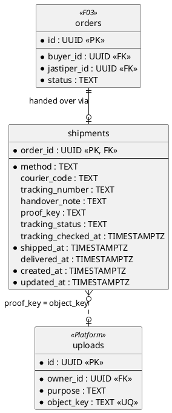
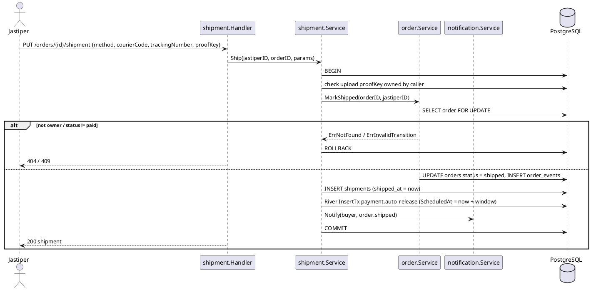
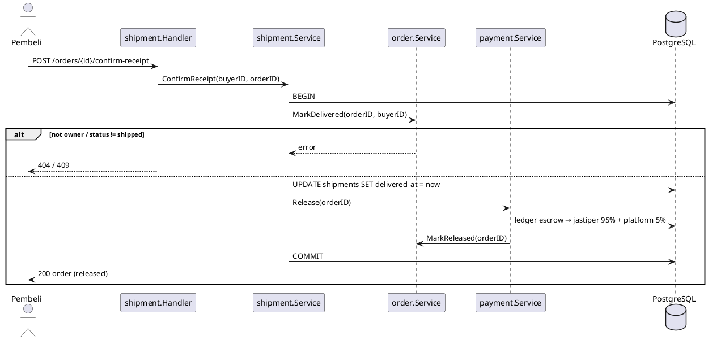

# F05 Shipment

| Item    | Value               |
| ------- | ------------------- |
| Owner   | Alfian              |
| Package | `internal/shipment` |
| Tag     | `shipment`          |
| Status  | Not started         |

## Overview

After an order is `paid`, the jastiper hands the item over, either in person (**COD**, meet-up) or by **courier**
with a tracking number, and uploads a proof photo. The order becomes `shipped`. The buyer confirms receipt, which
moves the order to `delivered` and triggers the release of funds (F04).

Courier tracking comes from an external tracking provider behind an interface (fake in development and tests).

## Business rules

- Only the order's jastiper can create or update the shipment, and only while the order is `paid`.
- `courier` requires `courier_code` and `tracking_number`; `cod` does not.
- Proof photos use blob SAS uploads (`uploads.purpose = 'shipment_proof'`); the key must belong to the caller.
- Only the order's buyer can confirm receipt, and only while `shipped`.
- If the buyer never confirms, `payment.auto_release` releases after the window (PLAN section 7, decision 5), unless
  a dispute is opened first.

## Database tables

Full DDL in [DATABASE.md](../DATABASE.md#7-f05-shipment).

### `shipments` (one row per order)

| Column                | Type          | Notes                                           |
| --------------------- | ------------- | ----------------------------------------------- |
| `order_id`            | `UUID` PK FK  | → `orders.id`                                   |
| `method`              | `TEXT`        | `cod` or `courier`                              |
| `courier_code`        | `TEXT`        | e.g. `jne`, `jnt`, `sicepat`                    |
| `tracking_number`     | `TEXT`        | Required for `courier`                          |
| `handover_note`       | `TEXT`        | ≤ 1000                                          |
| `proof_key`           | `TEXT`        | Blob key                                        |
| `tracking_status`     | `TEXT`        | Last status from the tracking provider          |
| `tracking_checked_at` | `TIMESTAMPTZ` |                                                 |
| `shipped_at`          | `TIMESTAMPTZ` |                                                 |
| `delivered_at`        | `TIMESTAMPTZ` |                                                 |
| `created_at`, `updated_at` | `TIMESTAMPTZ` |                                        |

Index `shipments_tracking_poll_idx (tracking_checked_at) WHERE method = 'courier' AND delivered_at IS NULL` for the
tracking poll job.

## Endpoints

| Method | Path                           | operationId        | Auth                   | Description                                         |
| ------ | ------------------------------ | ------------------ | ---------------------- | --------------------------------------------------- |
| `PUT`  | `/orders/{id}/shipment`        | `upsertShipment`   | `jastiper` (owner)     | Set method, courier, tracking, proof → `MarkShipped` |
| `GET`  | `/orders/{id}/shipment`        | `getShipment`      | order buyer/jastiper, admin | Shipment + latest tracking status             |
| `POST` | `/orders/{id}/confirm-receipt` | `confirmReceipt`   | `buyer` (owner)        | `MarkDelivered` → `payment.Release`                 |

## Sequence diagrams

### Ship order

### Confirm receipt

## To do

- [ ] Choose the tracking provider; define the `tracker` interface and a fake.
- [ ] Migration `create_shipments` and queries.
- [ ] Endpoints above; depends on F03 `MarkShipped`/`MarkDelivered` and F04 `Release`.
- [ ] Tracking poll job (courier shipments not yet delivered).
- [ ] Blob SAS uploads for proof photos (`platform/blob`).
