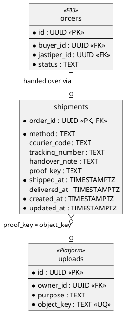
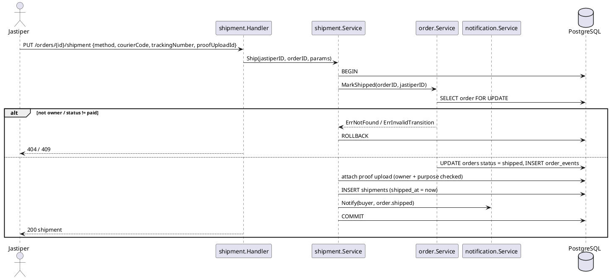
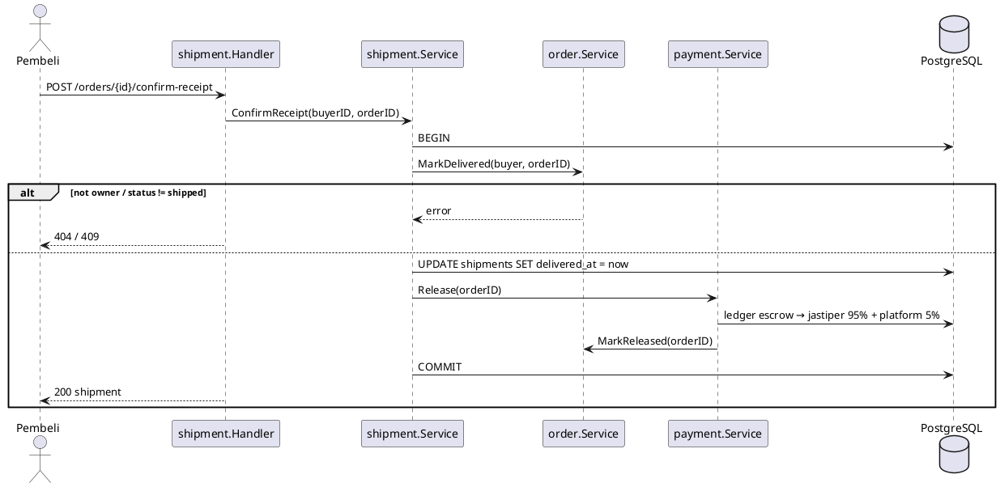

# F05 Shipment

| Item    | Value                                                         |
| ------- | ------------------------------------------------------------- |
| Package | `internal/shipment`                                           |
| Tag     | `shipment`                                                    |
| Status  | Partial: ship, get, confirm receipt, notifications done; proof photo to do |

## Overview

After an order is `paid`, the jastiper hands the item over, either in person (**COD**, meet-up) or by **courier**
with a tracking number, optionally with a proof photo. The order becomes `shipped`. The buyer confirms receipt, which
moves the order to `delivered` and releases the funds (F04) in the same transaction.

If the buyer neither confirms nor opens a dispute within 7 days of shipping, the `orders.auto_release` job releases
the funds (see [payment.md](payment.md)).

Courier status is not fetched from a tracking provider; the buyer checks the tracking number on the courier's site.

## Business rules

- Only the order's jastiper can ship, and only while the order is `paid`. An order is shipped once.
- `courier` requires `courier_code` and `tracking_number`; `cod` does not.
- The proof photo is optional, an upload with purpose `shipment_proof` owned by the caller.
- Only the order's buyer can confirm receipt, and only while `shipped`.
- The buyer, the jastiper, and admins can read the shipment; others get 404.
- Shipping notifies the buyer (`order.shipped`); the release notifies the jastiper (`order.released`, from F04).

## Database tables

Full DDL in [DATABASE.md](../DATABASE.md#7-f05-shipment).

### `shipments` (one row per order)

| Column            | Type          | Notes                                  |
| ----------------- | ------------- | -------------------------------------- |
| `order_id`        | `UUID` PK FK  | → `orders.id`                          |
| `method`          | `TEXT`        | `cod` or `courier`                     |
| `courier_code`    | `TEXT`        | e.g. `jne`, `jnt`, `sicepat`           |
| `tracking_number` | `TEXT`        | Required for `courier`                 |
| `handover_note`   | `TEXT`        | ≤ 1000                                 |
| `proof_key`       | `TEXT`        | Blob key, nullable (to add)            |
| `shipped_at`      | `TIMESTAMPTZ` | Starts the 7-day auto-release window   |
| `delivered_at`    | `TIMESTAMPTZ` |                                        |
| `created_at`, `updated_at` | `TIMESTAMPTZ` |                               |

Index `shipments_auto_release_idx (shipped_at) WHERE delivered_at IS NULL` (to add) for the auto-release job.

## Endpoints

| Method | Path                           | operationId        | Auth                        | Status | Description                                         |
| ------ | ------------------------------ | ------------------ | --------------------------- | ------ | --------------------------------------------------- |
| `PUT`  | `/orders/{id}/shipment`        | `shipOrder`        | `jastiper` (owner)          | Done   | Set method, courier, tracking → `MarkShipped`       |
| `GET`  | `/orders/{id}/shipment`        | `getShipment`      | order buyer/jastiper, admin | Done   | Shipment details                                    |
| `POST` | `/orders/{id}/confirm-receipt` | `confirmReceipt`   | `buyer` (owner)             | Done   | `MarkDelivered` → `payment.Release`                 |

`shipOrder` gains an optional `proofUploadId`; the shipment response gains a signed `proofUrl` and
`autoReleaseAt` (`shipped_at + 7 days`).

## Sequence diagrams

<strong style="font-size:1.1em;">Ship order</strong>

---

<strong style="font-size:1.1em;">Confirm receipt</strong>

---

## Remaining work

Done:

- [x] `shipments` table and queries.
- [x] `PUT /orders/{id}/shipment`, `GET /orders/{id}/shipment`, `POST /orders/{id}/confirm-receipt` (one
      transaction with the release).
- [x] `order.shipped` notification in the ship transaction.

Remaining:

- [ ] `proof_key` column, `proofUploadId` on ship, `proofUrl` in the response.
- [ ] `autoReleaseAt` in the response and the `shipped_at` index for the auto-release job.
