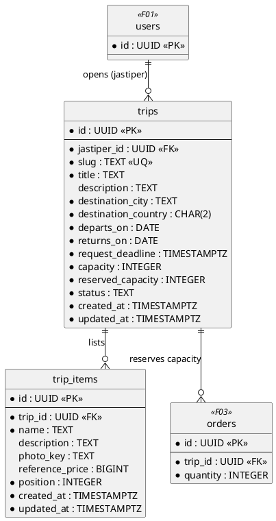
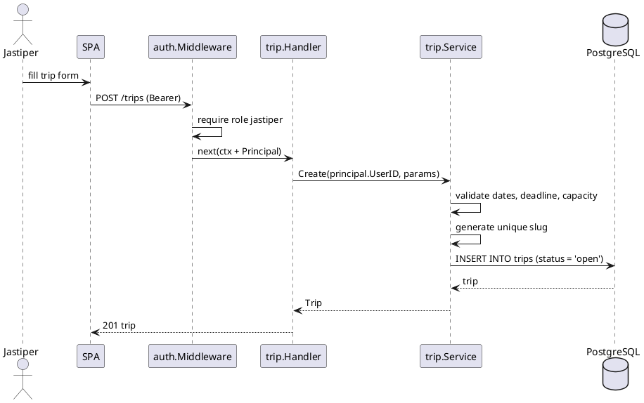
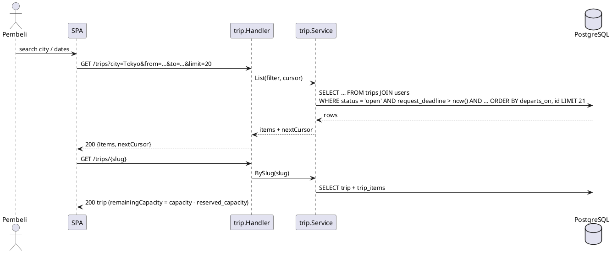
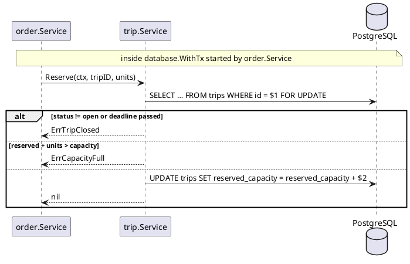

# F02 Trip & Catalog

| Item    | Value                                                                  |
| ------- | ---------------------------------------------------------------------- |
| Package | `internal/trip`                                                        |
| Tag     | `trip`                                                                 |
| Status  | Partial: create, list, get, close, my trips, capacity done; edit, cancel, catalog to do |

## Overview

A jastiper opens a **trip** (destination, travel dates, request deadline, capacity) and lists popular items for it
(the **catalog**). Buyers browse and filter open trips and request items through F03 Order.

The trip owns its capacity. Order reserves and releases capacity through `trip.Service.Reserve` / `Release` inside
the order's transaction, so the dependency stays one-way (`order → trip`).

## Business rules

- Only jastipers create trips; a jastiper can only change their own trips (others get 404, not 403).
- `returns_on >= departs_on`; `request_deadline` is the last moment buyers can request and must be in the future and
  no later than the end of `returns_on`.
- `slug` is unique and used in the public URL (`/trip/:slug`): the title plus a short random suffix.
- **Capacity is counted in items.** An order reserves its `quantity`. `reserved_capacity` is changed only by
  `Reserve` / `Release`, which lock the trip row (`SELECT … FOR UPDATE`). `CHECK (reserved_capacity BETWEEN 0 AND
  capacity)` makes overbooking impossible even if code is wrong.
- A trip accepts requests when it is `open`, before `request_deadline`, and has remaining capacity.
- Status:
  - `open` → `closed`: closed by the jastiper, or by the `trips.close_expired` job once `request_deadline` passes.
  - `closed` → `completed`: set by the same job once `returns_on` has passed and no order is still active.
  - `open`/`closed` → `cancelled`: by the jastiper, only when the trip has no active order (`requested`, `approved`,
    `paid`, `shipped`, `delivered`, `disputed`).
- Editing (`PATCH`) is allowed while `open`. `capacity` cannot drop below `reserved_capacity`.
- Catalog items (`trip_items`) are edited while the trip is `open` or `closed`. `reference_price` is indicative; the
  final price is set per order at approval. Photos are uploads with purpose `trip_item_photo`.

## Database tables

Full DDL in [DATABASE.md](../DATABASE.md#4-f02-trip--catalog).

### `trips`

| Column                | Type          | Notes                                                |
| --------------------- | ------------- | ---------------------------------------------------- |
| `id`                  | `UUID` PK     | UUIDv7                                               |
| `jastiper_id`         | `UUID` FK     | → `users.id`                                         |
| `slug`                | `TEXT`        | Unique, public URL                                   |
| `title`               | `TEXT`        | ≤ 120 chars                                          |
| `description`         | `TEXT`        | ≤ 2000 chars, `NOT NULL DEFAULT ''`                  |
| `destination_city`    | `TEXT`        |                                                      |
| `destination_country` | `CHAR(2)`     | ISO 3166-1 alpha-2                                   |
| `departs_on`          | `DATE`        |                                                      |
| `returns_on`          | `DATE`        | `>= departs_on`                                      |
| `request_deadline`    | `TIMESTAMPTZ` |                                                      |
| `capacity`            | `INTEGER`     | Items, `> 0`, default 20 for pre-capacity rows       |
| `reserved_capacity`   | `INTEGER`     | Default 0, `BETWEEN 0 AND capacity`                  |
| `status`              | `TEXT`        | `open`, `closed`, `completed`, `cancelled`           |
| `created_at`, `updated_at` | `TIMESTAMPTZ` |                                                 |

Indexes: `trips_browse_idx (departs_on, id) WHERE status = 'open'`, `trips_jastiper_idx (jastiper_id, created_at
DESC, id DESC)`.

### `trip_items` (to add)

| Column            | Type          | Notes                            |
| ----------------- | ------------- | -------------------------------- |
| `id`              | `UUID` PK     |                                  |
| `trip_id`         | `UUID` FK     | → `trips.id`                     |
| `name`            | `TEXT`        | ≤ 120 chars                      |
| `description`     | `TEXT`        | ≤ 1000 chars                     |
| `photo_key`       | `TEXT`        | Blob object key (from `uploads`) |
| `reference_price` | `BIGINT`      | Rupiah, `>= 0`, indicative       |
| `position`        | `INTEGER`     | Display order                    |
| `created_at`, `updated_at` | `TIMESTAMPTZ` |                         |

## Endpoints

| Method   | Path                            | operationId       | Auth               | Status | Description                                    |
| -------- | ------------------------------- | ----------------- | ------------------ | ------ | ---------------------------------------------- |
| `GET`    | `/trips`                        | `listTrips`       | Public             | Done   | Open trips accepting requests; filter `city`; cursor |
| `GET`    | `/trips/{slug}`                 | `getTrip`         | Public             | Done   | Trip detail                                    |
| `POST`   | `/trips`                        | `createTrip`      | `jastiper`         | Done   | Create a trip                                  |
| `POST`   | `/trips/{id}/close`             | `closeTrip`       | `jastiper` (owner) | Done   | Stop accepting requests                        |
| `GET`    | `/me/trips`                     | `listMyTrips`     | `jastiper`         | Done   | The caller's trips                             |
| `PATCH`  | `/trips/{id}`                   | `updateTrip`      | `jastiper` (owner) | To do  | Edit an open trip                              |
| `POST`   | `/trips/{id}/cancel`            | `cancelTrip`      | `jastiper` (owner) | To do  | Cancel a trip without active orders            |
| `GET`    | `/trips/{id}/items`             | `listTripItems`   | Public             | To do  | Catalog items in display order                 |
| `POST`   | `/trips/{id}/items`             | `createTripItem`  | `jastiper` (owner) | To do  | Add a catalog item                             |
| `PATCH`  | `/trips/{id}/items/{itemId}`    | `updateTripItem`  | `jastiper` (owner) | To do  | Edit a catalog item                            |
| `DELETE` | `/trips/{id}/items/{itemId}`    | `deleteTripItem`  | `jastiper` (owner) | To do  | Remove a catalog item                          |

`createTrip` takes `capacity` (required, 1–1000 items). Trip responses carry `capacity` and `remainingCapacity`
(`capacity - reserved_capacity`); `acceptsRequests` is false when no capacity remains, and `listTrips` leaves full
trips out. To do: `getTrip` embeds the catalog (`items`, each with a signed `photoUrl`); `listTrips` gains `from` /
`to` filters on `departsOn`.

Lists use cursor pagination (`?limit=` default 20, max 100; `?cursor=`), responses `{ items, nextCursor }`.

### Service methods for other modules

| Method                                         | Caller | Purpose                                                  |
| ---------------------------------------------- | ------ | -------------------------------------------------------- |
| `BySlug(ctx, slug)`, `ByID(ctx, id)`           | Order  | Read jastiper ID, status, deadline                       |
| `Reserve(ctx, tripID, units) error`            | Order  | Lock trip; `ErrTripClosed` unless accepting; `ErrCapacityFull` if not enough room; add units |
| `Release(ctx, tripID, units) error`            | Order  | Lock trip, subtract units (reject, cancel, expiry, refund); error if more than reserved |

## Sequence diagrams

<strong style="font-size:1.1em;">Create trip</strong>

---

<strong style="font-size:1.1em;">Browse trips (buyer)</strong>

---

<strong style="font-size:1.1em;">Reserve capacity (called by Order)</strong>

---

## Remaining work

Done:

- [x] `trips` table, create, list (city filter + cursor), get, close, my trips.
- [x] Slug generation, `ByID` / `BySlug`, `Trip.AcceptsRequests(now)`.
- [x] Service and handler tests.
- [x] Migration adding `capacity` / `reserved_capacity`, backfilling `reserved_capacity` from existing active orders.
- [x] `capacity` in create and responses, `remainingCapacity`; `Reserve` / `Release` under a row lock; integration
      test for concurrent `Reserve`.

Remaining:

- [ ] `from` / `to` filters on `listTrips`.
- [ ] `PATCH /trips/{id}` and `POST /trips/{id}/cancel`.
- [ ] `trip_items` table and catalog CRUD with photos (`platform/blob`).
- [ ] Job `trips.close_expired` (`open` → `closed` after the deadline, `closed` → `completed` after the return date).
