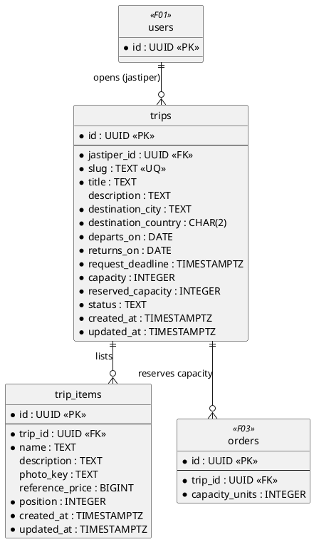
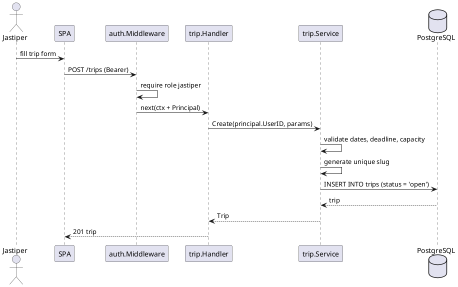
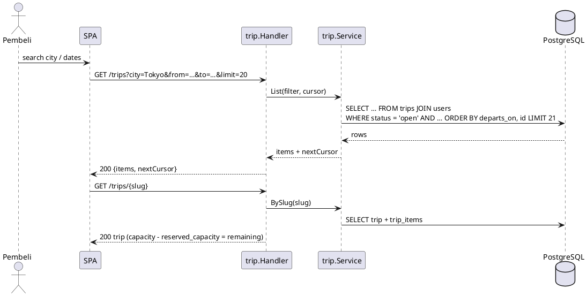
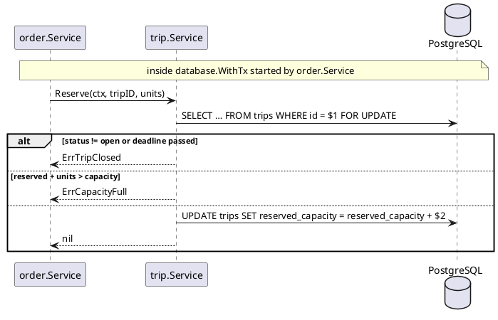

# F02 Trip & Catalog

| Item    | Value           |
| ------- | --------------- |
| Owner   | Carlo           |
| Package | `internal/trip` |
| Tag     | `trip`          |
| Status  | Not started     |

## Overview

A jastiper opens a **trip** (destination, travel dates, request deadline, capacity) and can list popular items for it
(the **catalog**). Buyers browse and filter open trips and request items through F03 Order.

The trip owns its capacity. Order reserves and releases capacity through `trip.Service.Reserve` / `Release` inside
the order's transaction, so the dependency stays one-way (`order → trip`).

## Business rules

- Only jastipers create and edit trips; a jastiper can only edit their own trips (others get 404, not 403).
- `returns_on >= departs_on`; `request_deadline` is the last moment buyers can request.
- `slug` is unique and used in the public URL (`/trip/:slug`).
- `reserved_capacity` is changed only by `Reserve`/`Release`, which lock the trip row (`SELECT … FOR UPDATE`). A
  `CHECK (reserved_capacity BETWEEN 0 AND capacity)` makes overbooking impossible even if code is wrong.
- Status: `open` (accepting requests) → `closed` (deadline passed or closed by the jastiper) → `completed`; or
  `cancelled` (trip will not happen; open orders must be rejected or refunded first).
- `trip_items.reference_price` is indicative only; the final price is set per order at approval.
- Capacity unit (kg, items, …) is still open (PLAN section 7, decision 4).

## Database tables

Full DDL in [DATABASE.md](../DATABASE.md#4-f02-trip--catalog).

### `trips`

| Column                | Type          | Notes                                                |
| --------------------- | ------------- | ---------------------------------------------------- |
| `id`                  | `UUID` PK     | UUIDv7                                               |
| `jastiper_id`         | `UUID` FK     | → `users.id`                                         |
| `slug`                | `TEXT`        | Unique, public URL                                   |
| `title`               | `TEXT`        | ≤ 120 chars                                          |
| `description`         | `TEXT`        | ≤ 2000 chars, nullable                               |
| `destination_city`    | `TEXT`        |                                                      |
| `destination_country` | `CHAR(2)`     | ISO 3166-1 alpha-2                                   |
| `departs_on`          | `DATE`        |                                                      |
| `returns_on`          | `DATE`        | `>= departs_on`                                      |
| `request_deadline`    | `TIMESTAMPTZ` |                                                      |
| `capacity`            | `INTEGER`     | `> 0`                                                |
| `reserved_capacity`   | `INTEGER`     | Default 0, `BETWEEN 0 AND capacity`                  |
| `status`              | `TEXT`        | `open`, `closed`, `completed`, `cancelled`           |
| `created_at`, `updated_at` | `TIMESTAMPTZ` |                                              |

Indexes: `trips_browse_idx (destination_city, departs_on) WHERE status = 'open'`,
`trips_jastiper_idx (jastiper_id, created_at DESC)`.

### `trip_items`

| Column            | Type          | Notes                          |
| ----------------- | ------------- | ------------------------------ |
| `id`              | `UUID` PK     |                                |
| `trip_id`         | `UUID` FK     | → `trips.id`                   |
| `name`            | `TEXT`        | ≤ 120 chars                    |
| `description`     | `TEXT`        | ≤ 1000 chars                   |
| `photo_key`       | `TEXT`        | Blob object key (from `uploads`) |
| `reference_price` | `BIGINT`      | Rupiah, `>= 0`, indicative     |
| `position`        | `INTEGER`     | Display order                  |
| `created_at`, `updated_at` | `TIMESTAMPTZ` |                       |

## Endpoints

| Method   | Path                            | operationId       | Auth            | Description                                   |
| -------- | ------------------------------- | ----------------- | --------------- | --------------------------------------------- |
| `GET`    | `/trips`                        | `listTrips`       | Public          | Open trips; filter by city, date range; cursor |
| `GET`    | `/trips/{slug}`                 | `getTrip`         | Public          | Trip detail with catalog and remaining capacity |
| `POST`   | `/trips`                        | `createTrip`      | `jastiper`      | Create a trip                                 |
| `PATCH`  | `/trips/{id}`                   | `updateTrip`      | `jastiper` (owner) | Edit a trip                                |
| `POST`   | `/trips/{id}/close`             | `closeTrip`       | `jastiper` (owner) | Stop accepting requests                    |
| `GET`    | `/me/trips`                     | `listMyTrips`     | `jastiper`      | The caller's trips                            |
| `GET`    | `/trips/{id}/items`             | `listTripItems`   | Public          | Catalog items                                 |
| `POST`   | `/trips/{id}/items`             | `createTripItem`  | `jastiper` (owner) | Add a catalog item                         |
| `PATCH`  | `/trips/{id}/items/{itemId}`    | `updateTripItem`  | `jastiper` (owner) | Edit a catalog item                        |
| `DELETE` | `/trips/{id}/items/{itemId}`    | `deleteTripItem`  | `jastiper` (owner) | Remove a catalog item                      |

Lists use cursor pagination (`?limit=` default 20, max 100; `?cursor=`), responses `{ items, nextCursor }`.

### Service methods for other modules

| Method                                  | Caller | Purpose                                         |
| --------------------------------------- | ------ | ----------------------------------------------- |
| `Reserve(ctx, tripID, units) error`     | Order  | Lock trip, check `open` + deadline, add units   |
| `Release(ctx, tripID, units) error`     | Order  | Lock trip, subtract units (reject/cancel/refund) |
| `Trip(ctx, id) (Trip, error)`           | Order  | Read jastiper ID, status, deadline              |

## Sequence diagrams

### Create trip

### Browse trips (buyer)

### Reserve capacity (called by Order)

## To do

- [ ] Decide the capacity unit (PLAN section 7, decision 4).
- [ ] Migration `create_trips` (`trips`, `trip_items`) and queries in `db/queries/trips.sql`, `trip_items.sql`.
- [ ] Repository, service (`Reserve`/`Release` under row lock), handler with the endpoints above.
- [ ] Slug generation (from title + short random suffix), unique.
- [ ] Auto-close when `request_deadline` passes (worker job or filter on read).
- [ ] Catalog photos through blob SAS uploads (`uploads.purpose = 'trip_item_photo'`), depends on `platform/blob`.
- [ ] Service tests (capacity edge cases), handler tests, integration test for concurrent `Reserve`.
